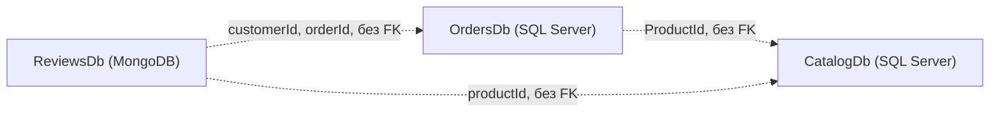
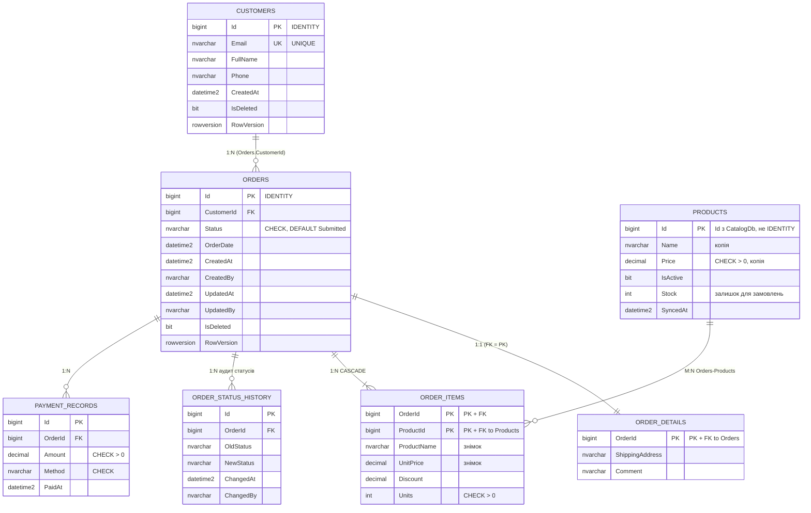
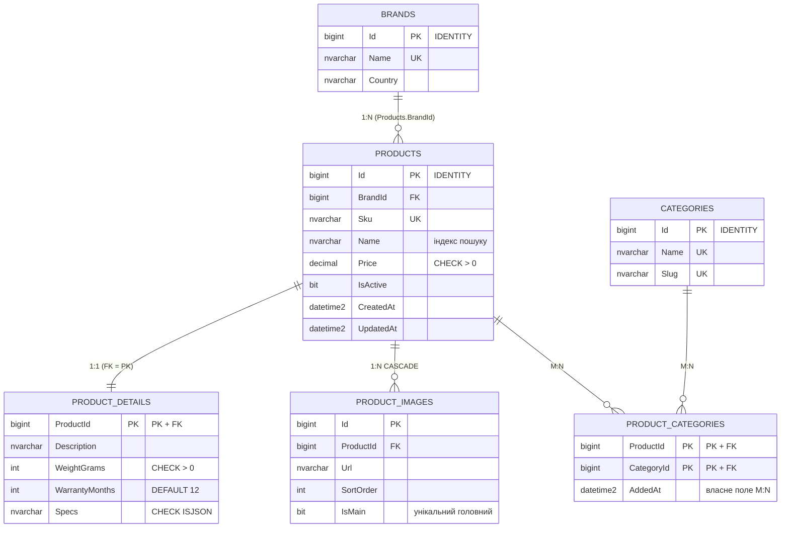
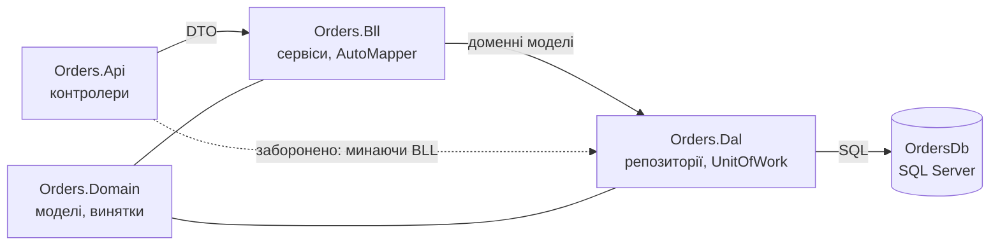
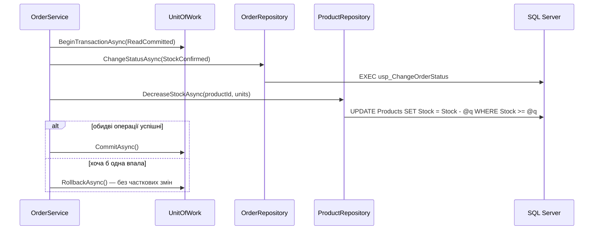
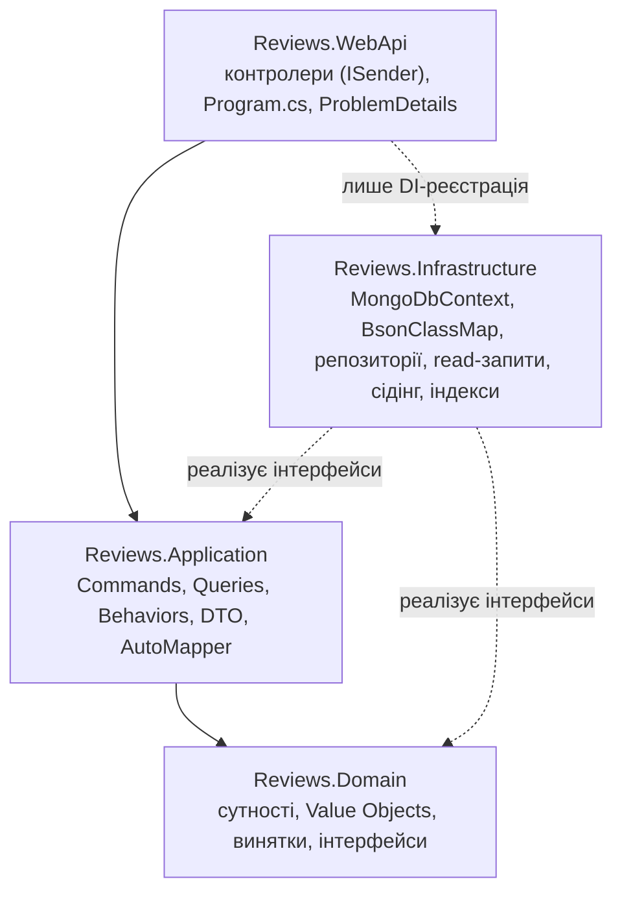
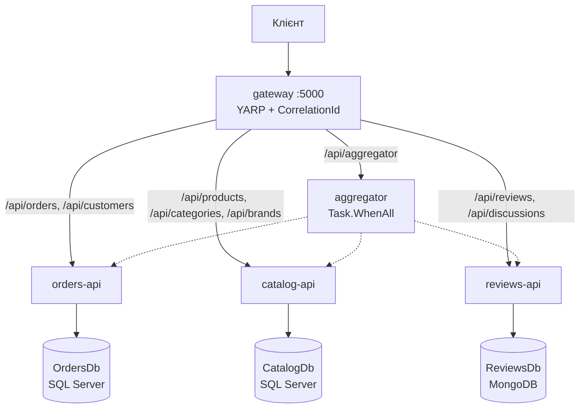
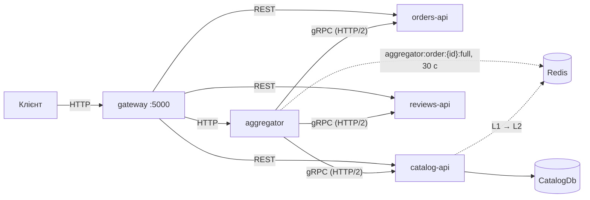

# TechNest — платформа інтернет-магазину електроніки (.NET)

| Практичне заняття | Що зроблено | Розділ |
|-------------------|-------------|--------|
| № 01 | Три бази даних для мікросервісів (SQL Server ×2 + MongoDB), політика дублювання | [Частина 1](#частина-1--три-бази-даних-лаб-01) |
| № 02 | Мікросервіс «Замовлення»: DAL → BLL → Web/API (ADO.NET + Dapper), Unit of Work, Aspire | [Частина 2](#частина-2--мікросервіс-замовлення-лаб-02) |
| № 03 | Мікросервіс «Каталог» на EF Core: Code First, Fluent API, міграції, специфікації, пагінація | [Частина 3](#частина-3--мікросервіс-каталог-на-ef-core-лаб-03) |
| № 04 | Мікросервіс «Відгуки»: Clean Architecture, CQRS/MediatR, Value Objects, MongoDB | [Частина 4](#частина-4--мікросервіс-відгуки-clean-architecture--mongodb-лаб-04) |
| № 05 | Платформа на .NET Aspire: AppHost, ServiceDefaults (Serilog + OpenTelemetry), YARP Gateway, Aggregator | [Частина 5](#частина-5--мікросервісна-платформа-net-aspire-лаб-05) |
| № 06 | gRPC-контракти (Protocol Buffers), кеш L1 (пам'ять) + L2 (Redis), Aggregator на gRPC | [Частина 6](#частина-6--grpc-та-кешування-лаб-06) |
| № 07 | Resilience (retry, circuit breaker, таймаути), бізнес-метрики, health checks | [Частина 7](#частина-7--resilience-метрики-та-health-checks-лаб-07) |
| № 08 | Асинхронна взаємодія: RabbitMQ, інтеграційні події, ідемпотентні споживачі, retry/DLQ, трасування через брокер | [Частина 8](#частина-8--асинхронна-взаємодія-rabbitmq-лаб-08) |
| № 09 | Безпека: ASP.NET Identity + JWT, Duende IdentityServer (OAuth 2.0), Keycloak + Pulumi, permission-based авторизація | [Частина 9](#частина-9--автентифікація-й-авторизація-лаб-09) |
| № 10 | Контейнеризація й Kubernetes: Dockerfile, Deployment/Service/ConfigMap/Secret, probes, Aspirate | [Частина 10](#частина-10--docker-і-kubernetes-лаб-10) |

# Частина 1 — три бази даних (Лаб. 01)


Практичне заняття № 01 «ASP.NET. Проєктування та розробка баз даних для мікросервісної архітектури».
Три самостійні БД одного інтернет-магазину електроніки: дві реляційні (SQL Server) і одна документна (MongoDB).

## 1. Предметна область і контексти

**TechNest** — інтернет-магазин електроніки. Покупці переглядають каталог, оформлюють і оплачують замовлення та залишають відгуки й обговорення під товарами. Систему розділено на три незалежні мікросервіси, кожен із власною БД і логікою.

| # | Контекст | БД | Сутності (кожна належить рівно одному контексту) |
|---|----------|----|--------------------------------------------------|
| 1 | **Замовлення** | `OrdersDb` — SQL Server (ADO.NET + Dapper, Лаб. 02) | Customers, Orders, OrderDetails, OrderItems, OrderStatusHistory, PaymentRecords, Products (лише локальна копія довідника) |
| 2 | **Каталог** | `CatalogDb` — SQL Server (EF Core, Лаб. 03) | Brands, Categories, Products, ProductDetails, ProductCategories, ProductImages |
| 3 | **Відгуки та обговорення** | `ReviewsDb` — MongoDB (Лаб. 04) | reviews, discussions, messages, productRatings |

Деталі (агрегати, життєвий цикл, карта контекстів) — у [`docs/contexts.md`](docs/contexts.md).
**Між базами немає жодного FOREIGN KEY і жодних міжбазових JOIN-ів**: `ProductId`, `customerId`, `orderId` — звичайні значення (логічні посилання).



## 2. Структура репозиторію

```
README.md                  опис домену, запуск (Aspire), розгортання БД, таблиця дублювання, приклади curl
docs/                      contexts.md · erd-p1.md · erd-p2.md · duplication-policy.md · mongo-documents.md · lab02-requests.http
db/p1/                     schema.sql · procedures.sql · seed.sql · checks.sql     (OrdersDb)
db/p2/                     schema.sql · seed.sql                                   (CatalogDb)
db/p3/                     collections.js · seed.js · queries.js                   (ReviewsDb, MongoDB)
Platform.slnx              одне рішення на всю платформу
Platform.AppHost/          оркестрація .NET Aspire (AppHost.cs)
Platform.Messaging/        (Лаб. 08) події, publisher, топологія RabbitMQ, consumer (BackgroundService), трасування
Platform.Messaging.Tests/  (Лаб. 08) unit-тести подій і топології
Dockerfile (Лаб. 10)       багатоетапні образи кожного сервісу поруч із csproj; .dockerignore у корені
deploy/k8s/                 (Лаб. 10) ручні маніфести Kubernetes і скрипти (образи, Secret-и, розгортання)
Platform.AppHost/aspirate-output/  (Лаб. 10) маніфести платформи у форматі Aspirate (формат `aspirate generate`)
Platform.Security/         (Лаб. 09) JWT-автентифікація трьох емітентів, [RequirePermission], scope-політики, Client Credentials
Platform.Security.Tests/   (Лаб. 09) unit-тести PermissionEvaluator
Services/Auth/             (Лаб. 09, ч. 1) Auth Service: ASP.NET Identity + JWT + refresh-токени
Services/IdentityServer/   (Лаб. 09, ч. 2) Duende IdentityServer + ASP.NET Identity + EF-сховища
Services/Payments/         (Лаб. 09) заглушка платіжного сервісу (payments-api)
Pulumi/                    (Лаб. 09, ч. 3) Keycloak як код: realm, resource servers, ролі, клієнти, користувачі
postman/, scripts/         (Лаб. 09) колекція Postman, check-matrix.ps1, add-migrations.ps1
Services/Orders/           мікросервіс «Замовлення» (Проєкт №1)
    Orders.Api/            контролери, Program.cs, appsettings.json, обробка помилок
    Orders.Bll/            сервіси, DTO, профілі AutoMapper
    Orders.Dal/            репозиторії (ADO.NET, Dapper), Unit of Work
    Orders.Domain/         моделі, доменні винятки
    Orders.Tests/          unit-тести BLL
Services/Catalog/          мікросервіс «Каталог» (Проєкт №2, EF Core)
    Catalog.Api/           контролери, Program.cs, appsettings*.json, Dockerfile
    Catalog.Bll/           сервіси, DTO, профілі AutoMapper, валідатори FluentValidation
    Catalog.Dal/           DbContext, Configurations/, Migrations/, репозиторії, специфікації, UoW, сідінг
    Catalog.Domain/        сутності з бізнес-правилами, доменні винятки
    Catalog.Tests/         unit-тести (домен, сервіси, специфікації на InMemory)
Services/Reviews/          мікросервіс «Відгуки» (Проєкт №3, Clean Architecture + CQRS + MongoDB)
    Reviews.Domain/        сутності, value objects, винятки, інтерфейси репозиторіїв (без залежностей)
    Reviews.Application/   Commands/, Queries/, Behaviors/, DTO, профілі AutoMapper, валідатори
    Reviews.Infrastructure/ MongoDbContext, BSON-мапінг, репозиторії, read-запити, сідінг, індекси
    Reviews.WebApi/        контролери (лише ISender), Program.cs, обробка помилок
    Reviews.Tests/         unit-тести (домен, BSON-мапінг, MediatR pipeline, архітектура)
```

## 3. Розгортання з нуля

### 3.1. Вимоги
* SQL Server 2019+ (або Docker), утиліта `sqlcmd`; MongoDB 6+ (або Docker), `mongosh`.
* Усі скрипти **ідемпотентні** — їх можна запускати повторно без помилок і дублікатів.

### 3.2. Сервери в Docker (за потреби)
```bash
docker run -d --name sql -e ACCEPT_EULA=Y -e MSSQL_SA_PASSWORD='Your_strong_Passw0rd' -p 1433:1433 mcr.microsoft.com/mssql/server:2022-latest
docker run -d --name mongo -p 27017:27017 mongo:7
```

### 3.3. Проєкт №1 — OrdersDb (порядок важливий)
```bash
sqlcmd -S localhost -U sa -P 'Your_strong_Passw0rd' -C -I -i db/p1/schema.sql      # 1) БД, таблиці, індекси, view
sqlcmd -S localhost -U sa -P 'Your_strong_Passw0rd' -C -I -i db/p1/procedures.sql  # 2) 6 збережуваних процедур
sqlcmd -S localhost -U sa -P 'Your_strong_Passw0rd' -C -I -i db/p1/seed.sql        # 3) тестові дані (ідемпотентно)
sqlcmd -S localhost -U sa -P 'Your_strong_Passw0rd' -C -I -i db/p1/checks.sql      # 4) перевірки (CRUD, помилки, конкурентність)
```
`-I` обов'язковий (QUOTED_IDENTIFIER для фільтрованих індексів). У SSMS достатньо відкрити файли й виконати по черзі.

### 3.4. Проєкт №2 — CatalogDb
```bash
sqlcmd -S localhost -U sa -P 'Your_strong_Passw0rd' -C -I -i db/p2/schema.sql
sqlcmd -S localhost -U sa -P 'Your_strong_Passw0rd' -C -I -i db/p2/seed.sql
```

### 3.5. Проєкт №3 — ReviewsDb (MongoDB)
```bash
mongosh "mongodb://localhost:27017" --file db/p3/collections.js   # колекції, JSON Schema, індекси
mongosh "mongodb://localhost:27017" --file db/p3/seed.js          # дані (upsert, ідемпотентно)
mongosh "mongodb://localhost:27017" --file db/p3/queries.js       # find / aggregation / $lookup / $text
```

### 3.6. Самоперевірка
| Що перевірити | Як |
|---------------|----|
| Немає FK за межі бази | `SELECT * FROM sys.foreign_keys` у `OrdersDb` і `CatalogDb` — усі таблиці лише своєї БД (також `checks.sql`, п. 1) |
| Недопустимий перехід статусу | `checks.sql`, п. 5–6: «відвантажити» неоплачене → помилка **50002**, статус не змінився |
| Конкурентність | `checks.sql`, п. 7: застарілий `RowVersion` → помилка **50008** |
| Різні набори полів у MongoDB | `db.reviews.find()` у `ReviewsDb` — документи мають різні поля (photos / pros+cons / videoUrl / лише rating) |
| Ідемпотентність seed | Запустити `seed.sql` / `seed.js` вдруге — кількість рядків/документів не змінюється |

### 3.7. (Рекомендовано) Принцип найменших привілеїв
```sql
-- виконати в master:  CREATE LOGIN orders_app WITH PASSWORD = '<пароль>';
USE OrdersDb;  CREATE USER orders_app FOR LOGIN orders_app;
GRANT SELECT, INSERT, UPDATE, EXECUTE ON SCHEMA::dbo TO orders_app;   -- доступ лише до власної БД, без DELETE/DDL
```

## 4. ERD

### 4.1. Проєкт №1 — OrdersDb


### 4.2. Проєкт №2 — CatalogDb


### 4.3. Проєкт №3 — ReviewsDb (MongoDB)
```
reviews ──(embedded)── author{}, comments[], verifiedPurchase{}, photos[]      ← EMBEDDING
reviews ──(reference)── discussionId ─► discussions                            ← REFERENCING (гібрид)
messages ──(reference)── discussionId ─► discussions, parentMessageId ─► messages
productRatings (_id = productId)                                                ← проєкція для читання
```
Приклади документів — [`docs/mongo-documents.md`](docs/mongo-documents.md).

## 5. Типи зв'язків

| БД | 1:1 | 1:N | M:N |
|----|-----|-----|-----|
| OrdersDb | Orders ↔ OrderDetails (FK = PK) | Customers → Orders; Orders → OrderStatusHistory / PaymentRecords | Orders ↔ Products через OrderItems |
| CatalogDb | Products ↔ ProductDetails (FK = PK) | Brands → Products; Products → ProductImages | Products ↔ Categories через ProductCategories (власне поле `AddedAt`) |

## 6. Ключі, обмеження, індекси

* **PK:** `BIGINT IDENTITY` — вставки йдуть з одного джерела (одна БД на сервіс), ключ компактний і послідовний. GUID був би виправданий, якби Id генерувались у кількох місцях. `OrdersDb.Products.Id` — не IDENTITY, а Id із Каталогу. У MongoDB — `ObjectId`.
* **Обмеження:** PK, FK, UNIQUE (`Customers.Email`, `Products.Sku`, …), CHECK (статуси, `Price > 0`, `Units > 0`, `Discount <= UnitPrice*Units`, `ISJSON`), DEFAULT.
* **Каскади:** `ON DELETE CASCADE` лише для залежних частин агрегата (OrderDetails, OrderItems, OrderStatusHistory, ProductDetails, ProductImages, ProductCategories). Для клієнта з історією замовлень і платежів каскаду **немає**.
* **Індекси** — кожен має коментар у `schema.sql` з описом запиту: `IX_Orders_CustomerId_Status`, `IX_Orders_Active` (filtered), `IX_Orders_Status_OrderDate` (filtered), `IX_OrderItems_ProductId`, `IX_OrderStatusHistory_OrderId_ChangedAt`, `IX_PaymentRecords_OrderId`, `IX_Products_BrandId`, `IX_Products_Name_Active` (filtered), `IX_ProductCategories_CategoryId`, `IX_ProductImages_ProductId_SortOrder`, `UX_ProductImages_Main` (unique filtered); у MongoDB — див. `collections.js`.
* **Аудит і soft delete:** `CreatedAt/CreatedBy/UpdatedAt/UpdatedBy/IsDeleted` у `Customers` та `Orders`.
* **Конкурентність:** `ROWVERSION` у `Orders` і `Customers` — оптимістичне блокування: два користувачі, що редагують одне замовлення, не затруть зміни «тихо» (`usp_UpdateOrderDetails` повертає помилку 50008 при застарілому RowVersion). Під час зміни статусу додатково використовується `UPDLOCK` у транзакції.

## 7. Збережувані процедури Проєкту №1

| Процедура | Призначення |
|-----------|-------------|
| `usp_CreateOrder` | Create: замовлення + деталі + позиції (знімок назви/ціни) + запис в історії, у транзакції |
| `usp_GetOrderById` | Read: 3 набори (шапка + RowVersion, позиції, історія статусів) |
| `usp_GetCustomerOrders` | Read: фільтр за статусом і пагінація (OFFSET/FETCH) |
| `usp_UpdateOrderDetails` | Update: адреса/коментар з перевіркою RowVersion |
| `usp_SoftDeleteOrder` | Delete: м'яке видалення (лише Submitted/Cancelled) |
| `usp_ChangeOrderStatus` | **Транзакційна** зміна статусу: `UPDLOCK`, перевірка переходу, `THROW 50002` на недопустимому, запис у PaymentRecords при `Paid` та в історію |

Допустимі переходи: `Submitted → AwaitingValidation → StockConfirmed → Paid → Shipped`; `Cancelled` — лише до оплати.
Коди керованих помилок наведено на початку `procedures.sql`.

## 8. Політика дублювання даних і узгодженості

| Поле | Де зберігається | Джерело (власник даних) | Політика узгодженості |
|------|-----------------|-------------------------|-----------------------|
| `OrderItems.ProductName`, `OrderItems.UnitPrice` | OrdersDb | Product (CatalogDb) | **Знімок** на момент оформлення — не оновлюється |
| `Products.Name`, `Products.Price`, `Products.IsActive` (локальна копія довідника) | OrdersDb | Product (CatalogDb) | Копія для читання, **оновлюється подіями** з Каталогу (eventual consistency, Лаб. 08) |
| `reviews.productName` | ReviewsDb (MongoDB) | Product (CatalogDb) | Копія для читання, **оновлюється подіями** з Каталогу |
| `discussions.productName` | ReviewsDb (MongoDB) | Product (CatalogDb) | Копія для читання, **оновлюється подіями** з Каталогу |
| `productRatings.productName` | ReviewsDb (MongoDB) | Product (CatalogDb) | Копія для читання, **оновлюється подіями** з Каталогу |
| `reviews.author.displayName`, `messages.author.displayName` | ReviewsDb (MongoDB) | Customer (OrdersDb, `Customers.FullName`) | **Знімок** на момент написання — не оновлюється |
| `reviews.verifiedPurchase.orderId` | ReviewsDb (MongoDB) | Order (OrdersDb) | Лише посилання за Id (без FK); факт покупки фіксується на момент написання відгуку |
| `Products.Stock` (OrdersDb) | OrdersDb | Сервіс Замовлень (резервування залишку при підтвердженні) | Власник — Замовлення: зменшується при `confirm`, повертається при `cancel`; поповнення приходить подіями (Лаб. 08). Каталог цього поля не редагує |
| `Products.AvailableStock` (CatalogDb) | CatalogDb | Каталог (фізичний залишок на складі) | Не дублюється в інших базах; не плутати з `OrdersDb.Products.Stock` (резерв для замовлень, власник — Замовлення) |

* **Знімок** — свідомо не оновлюється (ціна й назва в позиції замовлення фіксуються на момент покупки, як `OrderItem` в Microsoft eShop).
* **Копія для читання** — оновлюється подіями від власника даних (механізм подій — Лаб. 08; до того копії змінюються лише скриптами від імені власника).
* Незалежне редагування двох копій без власника (**dual write**) заборонене.
* Жодне з цих полів не має FOREIGN KEY на іншу базу.

## 9. Відповідність вимогам

| Вимога | Де |
|--------|----|
| Опис домену та 3 контексти | цей README, `docs/contexts.md` |
| Таблиця політики дублювання | розділ 8, `docs/duplication-policy.md` |
| Три бази без FK між ними | розділ 3.6, `db/` |
| P1: ≥4 таблиці, 1:1 / 1:N / M:N | `db/p1/schema.sql` (7 таблиць) |
| Ключі, обмеження, індекси під запити | `db/p1/schema.sql`, `db/p2/schema.sql` |
| Аудит, soft delete, rowversion | `db/p1/schema.sql` |
| 4–6 процедур, транзакційна зміна статусу | `db/p1/procedures.sql` (6 процедур) |
| P2: 6 сутностей, M:N з власним полем | `db/p2/schema.sql`, `db/p2/seed.sql` |
| P3: 4 колекції, embed / reference / гібрид, гнучка схема | `db/p3/collections.js`, `db/p3/seed.js`, `docs/mongo-documents.md` |
| Ідемпотентні seed-скрипти | `db/p1/seed.sql`, `db/p2/seed.sql`, `db/p3/seed.js` |
| Скрипти розгортання, README, ERD | розділи 3–4 |

---

# Частина 2 — мікросервіс «Замовлення» (Лаб. 02)

Тришарова архітектура **Web/API → BLL → DAL** поверх бази `OrdersDb` (Проєкт №1 з Лаб. 01): репозиторії на **ADO.NET** та **Dapper**, **Unit of Work** з транзакціями, **DTO + AutoMapper**, асинхронні контролери, помилки у форматі **ProblemDetails**, запуск через **.NET Aspire**.

## 11. Структура рішення та залежності

| Проєкт | Призначення |
|--------|-------------|
| `Orders.Api` | Web/API: контролери, Program.cs (DI, Serilog, Swagger), глобальний обробник помилок |
| `Orders.Bll` | сервіси й інтерфейси, DTO, профілі AutoMapper, бізнес-валідація |
| `Orders.Dal` | інтерфейси репозиторіїв (у т.ч. `IGenericRepository<T>`), реалізації ADO.NET / Dapper, Unit of Work |
| `Orders.Domain` | моделі, константи статусів, доменні винятки (`NotFound`, `BusinessConflict`, `Validation`) |
| `Orders.Tests` | unit-тести BLL (NSubstitute) і перевірка конфігурації AutoMapper |
| `Platform.AppHost` | .NET Aspire: запуск API разом із базою даних |

Залежності спрямовані в один бік: `Api → Bll → Dal`; `Domain` підключають і `Dal`, і `Bll`. Контролер не звертається до репозиторію — лише до сервісу; SQL є **лише** в `Orders.Dal`.



### Репозиторії (DAL)

| Репозиторій | Технологія | Особливості |
|-------------|-----------|-------------|
| `CustomerRepository` | **чистий ADO.NET** (`SqlCommand`, `SqlParameter`, `SqlDataReader`) | свідомо **не** успадковує `IGenericRepository<T>`; власні `Update`/`SoftDelete`; ручне читання через reader |
| `BaseDapperRepository<T>` | Dapper | спільний CRUD **написано один раз** (`GetById`, `GetAll`, `Add`, `Delete`); `SELECT`/`INSERT` будуються з властивостей моделі |
| `OrderRepository : BaseDapperRepository<Order>` | Dapper | **multi-mapping** (`Order` + `OrderItem` одним JOIN), виклик збережених процедур Лаб. 01 (`usp_ChangeOrderStatus`, `usp_GetCustomerOrders`, `usp_UpdateOrderDetails`, `usp_SoftDeleteOrder`), асинхронні `QueryAsync`/`ExecuteAsync` |
| `ProductRepository : BaseDapperRepository<Product>` | Dapper | `IN @Ids`, атомарне `DecreaseStock` (`WHERE Stock >= @Quantity`), `Upsert` локальної копії |

* **Параметризація:** значення передаються **лише** як параметри (`SqlParameter` / об'єкт-параметри Dapper). Ім'я таблиці в `BaseDapperRepository` — константа з коду і додатково перевіряється регулярним виразом.
* **З'єднання:** `await using` / `DisposeAsync`; пул підключень SqlClient увімкнено за замовчуванням. Dapper не керує з'єднанням — лише розширює `SqlConnection`.
* **Перетворення помилок БД** (`SqlErrorTranslator`): `THROW 50001` → `NotFoundException`; `50002` (недопустимий перехід) → `BusinessConflictException`; `2601/2627` (UNIQUE) → `BusinessConflictException`. Raw SQL-повідомлення в API не потрапляють.

### Unit of Work

`UnitOfWork` відкриває **одне** `SqlConnection`, створює всі репозиторії з цим з'єднанням і функцією `() => _transaction`, тому всі вони автоматично працюють у **поточній** транзакції (`BeginTransactionAsync(IsolationLevel)` → `CommitAsync` / `RollbackAsync` → `DisposeAsync`). Реєструється як **Scoped**: один екземпляр і одне з'єднання на HTTP-запит.



**Рівень ізоляції та таймаути.** За замовчуванням `ReadCommitted`: немає «брудних» читань і мінімум блокувань. Вищі рівні (`RepeatableRead`, `Serializable`) прибирають більше аномалій читання, але тримають більше блокувань і підвищують ризик взаємних блокувань (deadlock); нижчі — швидші, але допускають аномалії. Критичну консистентність забезпечено точково: `UPDLOCK` у процедурі зміни статусу та умова `Stock >= @Quantity` в одному `UPDATE`. Для зменшення ризику deadlock залишки змінюються у **фіксованому порядку** (за `ProductId`). Таймаути: підключення — `Connect Timeout=15` у рядку підключення; команди — 30 с (`RepositoryBase.CommandTimeoutSeconds`).

**Відкат, ініційований сервером.** Процедура з Лаб. 01 працює з `XACT_ABORT ON`: після `THROW` SQL Server сам відкочує *всю* транзакцію. Тому `UnitOfWork.RollbackAsync` толерантний до вже завершеної транзакції (ловить `InvalidOperationException`/`SqlException`).

### Бізнес-операції (BLL) і валідація

| Метод сервісу | Транзакція | Що змінює |
|---------------|-----------|-----------|
| `CreateAsync` | так | `Orders` + `OrderDetails` + `OrderItems` + `OrderStatusHistory` (назва й ціна позиції беруться з `Products` як **знімок**) |
| `ConfirmOrderAsync` | так | статус замовлення → `StockConfirmed` та зменшення `Products.Stock` — або обидва, або жодне |
| `CancelOrderAsync` | так | статус → `Cancelled` + повернення залишку, якщо замовлення було підтверджене |
| `PayOrderAsync`, `ShipOrderAsync` | процедура | `usp_ChangeOrderStatus` (власна транзакція); `Shipped` для неоплаченого → 409 |

Валідація на двох рівнях: **DataAnnotations** на DTO (відхиляє некоректний запит ще до сервісу → 400) і **бізнес-правила в BLL** (клієнт/товар існує, дублікати позицій, допустимі статуси, page/pageSize, унікальність email).

### Відповідність помилок і HTTP-статусів

| Де виникає | Виняток (Domain) | HTTP |
|------------|------------------|------|
| `THROW 50001/50006/50010`, сервіс не знайшов ресурс | `NotFoundException` | **404** |
| `THROW 50002/50004/50008/50009`, UNIQUE (2601/2627), нестача товару | `BusinessConflictException` | **409** |
| `THROW 50003/50005/50007`, бізнес-валідація BLL | `ValidationException` | **400** |
| DataAnnotations на DTO (до сервісу) | автоматично `[ApiController]` | **400** (ValidationProblemDetails) |
| інше | — | **500** (без технічних деталей) |

Усе перетворюється **одним** глобальним обробником `DomainExceptionHandler` (`IExceptionHandler` + `AddProblemDetails`); у кожну відповідь додається `traceId`. Операції логуються Serilog з кореляційним ідентифікатором (`X-Correlation-ID`), без персональних і секретних даних.

## 12. Запуск через .NET Aspire

> **Лаб. 05:** AppHost перероблено — бази тепер піднімаються в контейнерах, а запуск описано в [розділі 32](#32-запуск). Нижче — запуск Лаб. 02 як був.

**Потрібно:** .NET SDK 9.0.200+ (формат `.slnx`), SQL Server з базою з Лаб. 01. Docker потрібен лише для SQL Server у контейнері (або для варіанта 2 нижче).

1. **Розгорніть БД** (розділ 3.3 цього README; після зміни схеми в Лаб. 02 **перезапустіть** `schema.sql` → `procedures.sql` → `seed.sql` — у `Products` додано колонку `Stock`, скрипти ідемпотентні й самі мігрують стару схему).
2. **Вкажіть рядок підключення** у `Platform.AppHost/appsettings.json` (секція `ConnectionStrings:OrdersDb`; за замовчуванням — `sa` з Docker-команди розділу 3.2). Для запуску API без Aspire — той самий ключ у `Services/Orders/Orders.Api/appsettings.json` або змінна оточення `ConnectionStrings__OrdersDb=Server=...;Database=OrdersDb;...`.
3. **Запустіть однією командою:**
   ```bash
   dotnet run --project Platform.AppHost
   ```
4. Відкрийте **Aspire Dashboard** за посиланням з консолі: ресурс `orders-api` має статус **Running**. Натисніть на його endpoint — відкриється **Swagger** (`/` перенаправляє на `/swagger`).
5. Візьміть URL API з Dashboard і виконайте запити зі Swagger або `curl` (розділ 13).

**Варіант 2 — SQL Server у контейнері:** у `Platform.AppHost/AppHost.cs` закоментуйте `AddConnectionString`, розкоментуйте `AddSqlServer("sql").WithDataVolume().AddDatabase("OrdersDb")`. База створюється **порожньою** — застосуйте до неї `db/p1/schema.sql`, `procedures.sql`, `seed.sql` (рядок підключення видно в Dashboard).

Ім'я ресурсу `OrdersDb` збігається з іменем рядка підключення в API, тому Aspire передає його через `WithReference(ordersDb)` автоматично (`ConnectionStrings__OrdersDb`), і код `Orders.Api` не змінюється.

Без Aspire: `dotnet run --project Services/Orders/Orders.Api` → <http://localhost:5080/swagger>. Тести: `dotnet test Services/Orders/Orders.Tests`.

## 13. Приклади запитів (curl)

Підставте адресу з Aspire Dashboard (або `http://localhost:5080`). Ті самі запити — у [`docs/lab02-requests.http`](docs/lab02-requests.http). Для `https` з dev-сертифікатом додайте `-k`. Дані — з `seed.sql` (замовлення 1 — Paid, 2 — Submitted, 3 — Cancelled).

```bash
API=http://localhost:5080

# --- READ -----------------------------------------------------------------
curl -i $API/api/products
curl -i $API/api/customers/1
curl -i "$API/api/orders?customerId=1&status=Paid&page=1&pageSize=5"   # фільтр + пагінація
curl -i $API/api/orders/2                                               # замовлення з позиціями та rowVersion
curl -i $API/api/orders/2/history

# --- CREATE (201 Created + Location) ---------------------------------------
curl -i -X POST $API/api/orders -H "Content-Type: application/json" \
  -d '{"customerId":1,"shippingAddress":"Чернівці, вул. Руська, 10","items":[{"productId":3,"units":2},{"productId":4,"units":1}]}'

# спецсимвол у даних (SQL-ін'єкція неможлива: усе — параметри)
curl -i -X POST $API/api/customers -H "Content-Type: application/json" \
  -d "{\"email\":\"patrick.obrien@example.com\",\"fullName\":\"Patrick O'Brien\"}"

# --- ПОМИЛКИ (ProblemDetails) ----------------------------------------------
curl -i -X POST $API/api/orders/2/ship          # 409: Invalid status transition: Submitted -> Shipped
curl -i -X POST $API/api/orders/999999/confirm  # 404: Order 999999 not found
curl -i -X POST $API/api/orders -H "Content-Type: application/json" -d '{"customerId":0,"shippingAddress":"","items":[]}'   # 400

# --- ТРАНЗАКЦІЙНА БІЗНЕС-ОПЕРАЦІЯ ------------------------------------------
curl -i -X POST $API/api/orders/2/confirm       # 204: статус -> StockConfirmed, залишки товарів 2 і 3 зменшено
curl -i -X POST $API/api/orders/2/confirm       # 409: повторне підтвердження
curl -i -X POST $API/api/orders/2/pay -H "Content-Type: application/json" -d '{"paymentMethod":"Card"}'   # 204
curl -i -X POST $API/api/orders/2/ship          # 204: тепер дозволено

# --- ВІДКАТ ТРАНЗАКЦІЇ ------------------------------------------------------
# товар 5 має залишок 5; замовляємо 1 шт. товару 4 і 6 шт. товару 5
curl -i -X POST $API/api/orders -H "Content-Type: application/json" \
  -d '{"customerId":2,"shippingAddress":"Київ, просп. Науки, 1","items":[{"productId":4,"units":1},{"productId":5,"units":6}]}'
curl -i -X POST $API/api/orders/5/confirm       # 409 Insufficient stock for product 5
curl -s $API/api/orders/5                       # статус усе ще Submitted -> зміну статусу відкочено
curl -s $API/api/products/4                     # залишок товару 4 не змінився -> відкотилось і перше списання

# --- ОПТИМІСТИЧНА КОНКУРЕНТНІСТЬ -------------------------------------------
curl -s $API/api/orders/4                       # скопіюйте поле rowVersion
curl -i -X PUT $API/api/orders/4/details -H "Content-Type: application/json" \
  -d '{"shippingAddress":"Нова адреса, 5","comment":"змінено","rowVersion":"<rowVersion>"}'   # 200
# повторіть той самий запит зі СТАРИМ rowVersion -> 409 Concurrency conflict
```

Приклад відповіді 409 (`application/problem+json`):
```json
{ "title": "Business rule conflict", "status": 409,
  "detail": "Invalid status transition: Submitted -> Shipped", "traceId": "0HN..." }
```

| Метод і шлях | Успіх | Помилки |
|--------------|-------|---------|
| `GET /api/orders/{id}` | 200 | 404 |
| `GET /api/orders?customerId=&status=&page=&pageSize=` | 200 | 400, 404 |
| `GET /api/orders/{id}/history` | 200 | 404 |
| `POST /api/orders` | **201** + `Location` | 400 |
| `PUT /api/orders/{id}/details` | 200 | 400, 404, 409 |
| `DELETE /api/orders/{id}` (soft) | 204 | 404, 409 |
| `POST /api/orders/{id}/confirm` · `/pay` · `/ship` · `/cancel` | 204 | 400, 404, 409 |
| `GET/POST/PUT/DELETE /api/customers` | 200 / 201 / 200 / 204 | 400, 404, 409 |
| `GET /api/products`, `GET /api/products/{id}`, `PUT /api/products/{id}` (sync з Каталогу) | 200 | 400, 404 |

## 14. Git

Гілки: `main` — стабільна, `develop` — інтеграційна, `feature/*` — завдання (наприклад `feature/dal`, `feature/bll`, `feature/api`, `feature/aspire`). Зміни зливаються в `develop` через Pull Request з описом, `develop` → `main` — після перевірки.

```bash
git init -b main && git add . && git commit -m "chore: Lab 01 databases"
git switch -c develop
git switch -c feature/dal    # ... комітимо: feat(dal): ADO.NET CustomerRepository, Dapper repositories, UnitOfWork
```

## 15. Самоперевірка перед здачею

| Перевірка | Очікуваний результат |
|-----------|----------------------|
| Створити клієнта з ім'ям `O'Brien` | 201, без синтаксичної помилки SQL |
| Підтвердити замовлення, де товару не вистачає (розділ 13, «Відкат») | 409, статус і залишок першого товару не змінилися |
| Підтвердити вже підтверджене замовлення | 409 у форматі ProblemDetails |
| `GET /api/orders/999999` | 404, не 500 |
| `dotnet run --project Platform.AppHost` | у Dashboard `orders-api` — Running; Swagger відкривається |
| `dotnet test Services/Orders/Orders.Tests` | усі тести зелені |

**Знімки екрана для здачі:** Swagger з переліком ендпоінтів і Aspire Dashboard зі статусом Running (покласти в `docs/screenshots/`).

## 16. Відповідність критеріям Лаб. 02

| Критерій | Де |
|----------|----|
| Рішення з шарів Api → Bll → Dal (+ Domain), DI, рядок підключення в appsettings, Scoped UoW, логування | `Platform.slnx`, `Orders.Api/Program.cs`, `appsettings.json` |
| `IGenericRepository<T>` + конкретні інтерфейси | `Orders.Dal/Interfaces/` |
| Репозиторій на чистому ADO.NET (без Generic Repository) | `CustomerRepository` |
| ≥ 2 репозиторії на Dapper зі спільною `BaseDapperRepository<T>` | `OrderRepository`, `ProductRepository` |
| Усі запити параметризовані, з'єднання звільняються | `Orders.Dal/Repositories/` |
| Unit of Work: одне з'єднання, транзакція з рівнем ізоляції, Commit/Rollback/DisposeAsync | `Orders.Dal/UnitOfWork.cs` |
| DTO + профілі AutoMapper в BLL, зареєстровані в DI | `Orders.Bll/Dtos`, `Mapping`, `Program.cs` |
| Транзакційна операція через кілька репозиторіїв, знімок назви й ціни | `OrderService.CreateAsync` / `ConfirmOrderAsync` / `CancelOrderAsync` |
| Доменні винятки NotFound / BusinessConflict / Validation | `Orders.Domain/Exceptions` |
| Валідація: DataAnnotations (DTO) + бізнес-правила (BLL) | `Dtos/*.cs`, `Services/*.cs` |
| Тонкі асинхронні контролери, атрибутна маршрутизація, Swagger, `CreatedAtAction`, 204, `CancellationToken` | `Orders.Api/Controllers` |
| Централізована обробка помилок у ProblemDetails | `ErrorHandling/DomainExceptionHandler.cs` |
| AppHost запускає API разом із базою даних | `Platform.AppHost/AppHost.cs` |
| README із запуском через Aspire та прикладами curl | розділи 12–13 |

---

# Частина 3 — мікросервіс «Каталог» на EF Core (Лаб. 03)

Мікросервіс `Services/Catalog` будується за тією самою схемою, що й «Замовлення» (**Api → Bll → Dal**, спільні моделі в **Domain**), але доступ до даних — **Entity Framework Core (Code First)**: сутності з бізнес-правилами, Fluent API, міграції, LINQ to Entities, репозиторії з Eager / Explicit / LINQ-завантаженням, Unit of Work з єдиним `SaveChangesAsync()`, пагінація/фільтрація/сортування в SQL, специфікації (Ardalis.Specification), валідація (DataAnnotations + FluentValidation), ProblemDetails, Serilog.

Модель відповідає Проєкту №2 з Лаб. 01 (`db/p2`): `Brand`, `Category`, `Product`, `ProductDetail` (1:1), `ProductImage` (1:N), `ProductCategory` (M:N з полем `AddedAt`). Ідентифікатори — `long` (`bigint`), як у Лаб. 01, бо інші сервіси посилаються на `ProductId` без FK.

## 17. Запуск і міграції

> **Важливо:** схему `CatalogDb` тепер створюють **міграції EF Core**. Якщо ви раніше виконували `db/p2/schema.sql` (Лаб. 01), видаліть ту базу (`DROP DATABASE CatalogDb;`) — файли `db/p2/*.sql` залишаються як проєктний документ Лаб. 01. Рядок підключення: `Services/Catalog/Catalog.Api/appsettings.json` (ключ `ConnectionStrings:CatalogDb`) або змінна `ConnectionStrings__CatalogDb`.

```bash
# 1) інструмент dotnet-ef (один раз)
dotnet tool install --global dotnet-ef

# 2) застосувати міграцію до бази (DbContext у Catalog.Dal, рядок підключення — в Catalog.Api)
dotnet ef database update --project Services/Catalog/Catalog.Dal --startup-project Services/Catalog/Catalog.Api --environment Development

# 3) SQL-скрипт міграції (для перегляду або ручного застосування)
dotnet ef migrations script --project Services/Catalog/Catalog.Dal --startup-project Services/Catalog/Catalog.Api -o db/p2/ef-InitialCreate.sql

# 4) запуск сервісу (міграції та сідінг застосовуються автоматично при старті в Development)
dotnet run --project Services/Catalog/Catalog.Api          # http://localhost:5090/swagger
```

Або через Aspire — `dotnet run --project Platform.AppHost` запускає `orders-api` і `catalog-api`; у `Platform.AppHost/appsettings.json` задано рядки `OrdersDb` і `CatalogDb`. Docker-образ: `docker build -f Services/Catalog/Catalog.Api/Dockerfile -t technest-catalog-api .` (контекст — корінь репозиторію).

**Початкова міграція.** Папка `Services/Catalog/Catalog.Dal/Migrations/` містить `InitialCreate` і знімок моделі, а `db/p2/ef-InitialCreate.sql` — її SQL-скрипт. Створена міграція містить усі таблиці, складений ключ `ProductCategories`, `CHECK`-обмеження (ціна, залишок, вага, гарантія, `ISJSON`), унікальний індекс `Sku`, відфільтрований унікальний індекс головного зображення та довідникові дані (`HasData`).

> **Чесна примітка про міграцію.** Файли міграції та знімка написано **вручну** за форматом EF Core 9 (в середовищі підготовки не було .NET SDK). Щоб отримати «еталонні» файли, один раз перегенеруйте їх:
> ```bash
> rm -r Services/Catalog/Catalog.Dal/Migrations
> dotnet ef migrations add InitialCreate --project Services/Catalog/Catalog.Dal --startup-project Services/Catalog/Catalog.Api
> dotnet ef migrations script --project Services/Catalog/Catalog.Dal --startup-project Services/Catalog/Catalog.Api -o db/p2/ef-InitialCreate.sql
> ```
> Доки цього не зроблено, у `appsettings.json` увімкнено `Database:IgnorePendingModelChangesWarning` (EF Core 9 інакше зупинить `MigrateAsync` при розбіжності знімка з моделлю). Після перегенерації встановіть його в `false`.

Режими сідінгу: `Database:MigrateOnStartup` і `Database:Seed` (у `appsettings.Production.json` обидва `false`).

## 18. Модель, Fluent API, зв'язки

| Сутність | Бізнес-правила в самій сутності (приватні setter-и, валідація в конструкторі) |
|----------|-------------------------------------------------------------------------------|
| `Product` | ціна > 0 (≤ 2 знаки), SKU `^[A-Z0-9-]+$`, `RemoveStock`/`AddStock`/`ChangePrice`/`Rename`/`SetActive`/`SetDetail`/`AddImage`/`AssignToCategory`; `RowVersion` для оптимістичної конкурентності |
| `ProductDetail` | вага > 0, гарантія ≥ 0, `Specs` — валідний JSON |
| `ProductImage` | непорожній URL, не більше одного головного зображення |
| `Brand`, `Category` | обов'язкові назви, slug у форматі `a-b-c` |
| `ProductCategory` | проміжна сутність M:N, складений ключ `(ProductId, CategoryId)`, поле `AddedAt` |

Конфігурації — окремі `IEntityTypeConfiguration<T>` у `Catalog.Dal/Configurations/` (таблиці, ключі, довжини, `decimal(18,2)`, унікальні індекси, `CHECK`), підключені одним рядком `ApplyConfigurationsFromAssembly` в `OnModelCreating`.

| Зв'язок | Реалізація |
|---------|------------|
| 1:1 | `Product` ↔ `ProductDetail` (PK = FK `ProductId`) |
| 1:N | `Product` → `ProductImage` (cascade); `Brand` → `Product` (restrict) |
| M:N | `Product` ↔ `Category` через явну `ProductCategory` з `AddedAt` |

## 19. Репозиторії та Unit of Work

| Репозиторій | Спосіб завантаження | Метод |
|-------------|---------------------|-------|
| `GenericRepository<T>` | базові `GetByIdAsync`, `GetAllAsync`, `AddAsync`; `Update`/`Delete` лише змінюють стан | — |
| `ProductRepository` | **Eager Loading** — один запит із JOIN | `GetWithDetailsAsync` (`Include`/`ThenInclude`) |
| `CategoryRepository` | **Explicit Loading** — категорія окремо, товари окремим запитом | `GetWithProductsAsync` (`Entry(...).Collection(...).Query().Include(...).LoadAsync()`) |
| `ProductCategoryRepository` | **LINQ to Entities** через проміжну сутність за її полем | `GetRecentlyAddedAsync(categoryName, since)` |

`UnitOfWork` об'єднує репозиторії навколо одного `DbContext` (Scoped); `SaveChangesAsync()` викликається **один раз** наприкінці бізнес-операції. Помилки збереження перетворюються на `ConflictException` (дублікат унікального ключа 2601/2627, `DbUpdateConcurrencyException`).

**Перевірка за логом SQL.** Serilog логує SQL-команди EF Core (`Microsoft.EntityFrameworkCore.Database.Command`). Виконайте `GET /api/products/1` — у лозі **один** `SELECT ... LEFT JOIN ...` (eager). Виконайте `GET /api/categories/1/products` — **два** окремі `SELECT` (explicit): спочатку `Categories`, потім `ProductCategories JOIN Products`. Фрагмент логу додайте до звіту.

## 20. API: пагінація, фільтрація, сортування, валідація, помилки

`GET /api/products?page=1&pageSize=20&search=&minPrice=&maxPrice=&categoryId=&brandId=&inStock=&sortBy=name&sortDir=asc`

* `pageSize` — 1…100 (за замовчуванням 20), `sortBy` — лише `name | price | sku | created | stock`, `sortDir` — `asc | desc`.
* Відповідь (тіло): `items`, `totalCount`, `page`, `pageSize`, `totalPages`, `hasNext`, `hasPrevious`; заголовки: `X-Total-Count`, `X-Total-Pages`, `X-Page`, `X-Page-Size`.
* Фільтрація, сортування, `Skip/Take` і підрахунок `totalCount` виконуються **в SQL** (`ProductsPageSpec` → `OFFSET … FETCH`, `ProductsFilterSpec` → `COUNT(*)`).
* **Specification pattern:** критерії, `Include`, `OrderBy`, `Skip/Take` описані в класах специфікацій (`Catalog.Dal/Specifications`), а репозиторій лише застосовує їх (`WithSpecification`). Друга специфікація — `LowStockProductsSpec` (`GET /api/products/low-stock?threshold=5`) — працює через той самий `ListAsync` без змін у репозиторії.

**Валідація у два шари.** DataAnnotations на DTO (`Required`, `StringLength`, `Range`) відхиляє структурно некоректний запит автоматично (`[ApiController]` → 400 `ValidationProblemDetails`). Правила формату — FluentValidation у окремих класах (`Catalog.Bll/Validators`), зареєстровані через `AddValidatorsFromAssemblyContaining` і викликані **явно** в контролерах (без застарілого `AddFluentValidation`): SKU-формат, ціна (> 0, 2 знаки), дозволені `sortBy`/`sortDir`, `minPrice ≤ maxPrice`, валідний JSON, формат slug/URL. Помилки повертаються в `ValidationProblemDetails` з переліком по полях.

**Глобальна обробка помилок** (`ApiExceptionHandler`, `IExceptionHandler` + `AddProblemDetails`):

| Виняток | HTTP |
|---------|------|
| `EntityNotFoundException` | **404** |
| `ValidationException` (BLL), DataAnnotations/FluentValidation | **400** |
| `ConflictException` (дублікат SKU, конкурентна зміна), `DomainException` (ціна ≤ 0, недостатній залишок) | **409** |
| інше | **500** (деталі — лише в Development) |

Виняток логується **один раз** — в обробнику. **Serilog:** структуровані властивості, sink-и console + file (`logs/catalog-.log`), enrich `CorrelationId`, `RequestPath`, `UserId` (якщо користувач автентифікований), `UseSerilogRequestLogging`, SQL-команди EF Core на рівні `Information` (вимикаються ключем `Diagnostics:LogSqlCommands`).

| Метод і шлях | Успіх | Помилки |
|--------------|-------|---------|
| `GET /api/products` (пагінація/фільтри/сортування) | 200 | 400 |
| `GET /api/products/{id}` (eager) | 200 | 404 |
| `POST /api/products` | **201** + `Location` | 400, 409 (SKU) |
| `PUT /api/products/{id}` · `/price` · `/detail` | 200 | 400, 404 |
| `POST /api/products/{id}/stock/add` · `/stock/remove` | 200 | 400, 404, 409 |
| `POST /api/products/{id}/images` | 200 | 400, 404, 409 |
| `POST` / `DELETE /api/products/{id}/categories/{categoryId}` | 204 | 404, 409 |
| `DELETE /api/products/{id}` | 204 | 404 |
| `GET /api/products/low-stock` | 200 | 400 |
| `GET /api/categories` · `/{id}` · `/{id}/products` (explicit) · `/recent-products?categoryName=&since=` (M:N) | 200 | 404 |
| `POST /api/categories`, `POST /api/brands` | 201 | 400, 409 |

## 21. Приклади запитів (curl)

```bash
API=http://localhost:5090

# список: сторінка 2 по 5, сортування за ціною (totalCount — по всій вибірці)
curl -i "$API/api/products?page=2&pageSize=5&sortBy=price&sortDir=desc"
curl -i "$API/api/products?search=ноут&minPrice=1000&maxPrice=40000&inStock=true"

# картка (eager) і категорія з товарами (explicit) — порівняйте SQL у лозі
curl -s $API/api/products/1
curl -s $API/api/categories/1/products
curl -s "$API/api/categories/recent-products?categoryName=Ноутбуки"       # M:N за AddedAt

# створення: 201 + Location; повтор з тим самим SKU -> 409; порожній Name -> 400 з помилками по полях
curl -i -X POST $API/api/products -H "Content-Type: application/json" \
  -d '{"brandId":1,"name":"Ноутбук Z9","sku":"NB-Z9","price":45999.00,"initialStock":3}'
curl -i -X POST $API/api/products -H "Content-Type: application/json" \
  -d '{"brandId":1,"name":"Ноутбук Z9","sku":"NB-Z9","price":45999.00}'            # 409
curl -i -X POST $API/api/products -H "Content-Type: application/json" \
  -d '{"brandId":1,"name":"","sku":"bad sku","price":-1}'                           # 400

# бізнес-правила сутності
curl -i -X PUT  $API/api/products/1/price -H "Content-Type: application/json" -d '{"price":-5}'          # 400
curl -i -X POST $API/api/products/5/stock/remove -H "Content-Type: application/json" -d '{"quantity":99}' # 409 Only 5 units available
curl -i $API/api/products/999999                                                                          # 404 ProblemDetails
curl -i "$API/api/products?sortBy=password"                                                               # 400

# друга специфікація
curl -s "$API/api/products/low-stock?threshold=10"
```

## 22. Самоперевірка перед здачею

| Перевірка | Очікуваний результат |
|-----------|----------------------|
| Лог SQL для `GET /api/products/1` і `GET /api/categories/1/products` | eager — 1 запит, explicit — 2 запити |
| `POST /api/products` з порожнім `name` | 400 `ValidationProblemDetails` з помилками по полях, не 500 |
| Повторне створення з тим самим SKU | 409; неіснуючий Id — 404 (ProblemDetails) |
| `page=2&pageSize=5` | `totalCount` = кількість усіх товарів у БД, а не на сторінці |
| Двічі запустити застосунок | seed не дублюється (`SELECT COUNT(*) FROM Products` не змінюється) |
| Додати іншу специфікацію (`/low-stock`) | працює через `ListAsync` без змін у репозиторії |
| `dotnet test Services/Catalog/Catalog.Tests` | усі тести зелені |

**Знімки екрана для здачі:** Swagger з ендпоінтами; відповідь з пагінацією; відповідь 400 з помилками валідації; фрагмент логу з SQL для eager і explicit loading.

## 23. Відповідність критеріям Лаб. 03

| Критерій | Де |
|----------|----|
| Сутності з інкапсульованими бізнес-правилами | `Catalog.Domain/Entities` |
| Окремі `IEntityTypeConfiguration<T>`, підключені централізовано | `Catalog.Dal/Configurations`, `CatalogDbContext.OnModelCreating` |
| Зв'язки 1:1, 1:N, M:N через явну проміжну сутність | `ProductConfiguration`, `ProductCategoryConfiguration` |
| Початкова міграція в репозиторії | `Catalog.Dal/Migrations`, `db/p2/ef-InitialCreate.sql` |
| Async Generic Repository + Unit of Work з єдиним `SaveChangesAsync` | `GenericRepository<T>`, `UnitOfWork` |
| Три специфічні репозиторії: Eager, Explicit, LINQ M:N | `ProductRepository`, `CategoryRepository`, `ProductCategoryRepository` |
| Сервіси BLL через UoW, DTO, AutoMapper | `Catalog.Bll/Services`, `Dtos`, `Mapping` |
| Асинхронні контролери зі статусами та Swagger | `Catalog.Api/Controllers`, `Program.cs` |
| Ідемпотентний сідінг: `HasData` + програмний після `MigrateAsync` | `BrandConfiguration`, `CategoryConfiguration`, `DbInitializer`, `Program.cs` |
| Пагінація, фільтрація, сортування в SQL | `ProductsPageSpec`, `ProductsFilterSpec`, `ProductService.GetListAsync` |
| DataAnnotations + FluentValidation з ValidationProblemDetails | `Dtos/InputDtos.cs`, `Validators/Validators.cs`, контролери |
| Глобальна обробка помилок ProblemDetails | `ErrorHandling/ApiExceptionHandler.cs` |
| Serilog зі структурованими властивостями | `Program.cs`, `appsettings*.json`, `RequestLogContextMiddleware` |
| Specification pattern | `Catalog.Dal/Specifications` |

---

# Частина 4 — мікросервіс «Відгуки»: Clean Architecture + MongoDB (Лаб. 04)

Мікросервіс `Services/Reviews` працює з MongoDB-базою `ReviewsDb` Проєкту №3 (Лаб. 01) і побудований за **Clean Architecture**: чотири шари, домен без зовнішніх залежностей, **CQRS** через **MediatR**, **Value Objects**, наскрізна валідація в **Pipeline Behaviors**, BSON-мапінг через `BsonClassMap` (без атрибутів у домені), оптимістична конкурентність за версією документа, ідемпотентний сідінг і автоматичні індекси.

## 24. Шари та правило залежностей



| Проєкт | Посилається на | NuGet |
|--------|----------------|-------|
| `Reviews.Domain` | **нічого** | `MongoDB.Bson` (лише `ObjectId`, без драйвера) |
| `Reviews.Application` | Domain | `MediatR`, `FluentValidation`, `FluentValidation.DependencyInjectionExtensions`, `AutoMapper` |
| `Reviews.Infrastructure` | Application, Domain | `MongoDB.Driver`, `MongoDB.Bson`, `Microsoft.Extensions.Options.ConfigurationExtensions` |
| `Reviews.WebApi` | Application, Infrastructure | `Swashbuckle.AspNetCore`, `Serilog.AspNetCore` |

Жоден контролер і жоден обробник з Application не звертається до `IMongoCollection` напряму: запис іде через `IReviewRepository` (Domain), читання — через `IReviewQueries` (Application); обидва реалізує Infrastructure. Це перевіряє `ArchitectureTests`.

## 25. Domain

* `BaseEntity` — `Id` (`ObjectId`), `CreatedAt`, `UpdatedAt`, `Version` (оптимістична конкурентність).
* Сутності: **`Review`** (агрегат документа `reviews`), **`Discussion`** (колекція `discussions`), **`Comment`** (незмінний вкладений документ у масиві `comments`). Приватні setter-и, валідація в конструкторах і методах (`Edit`, `AddComment`, `AddPhotos`, `AttachVideo`, …), порушення правил — `DomainException`. Необов'язкові поля (`photos`, `pros`, `cons`, `videoUrl`, `verifiedPurchase`) відсутні в документі, якщо не задані, — гнучка схема з Лаб. 01.
* Базовий `ValueObject` (рівність за значеннями, `GetEqualityComponents`) та незмінні VO: **`Author`** (`customerId` + знімок `displayName`), **`Rating`** (1…5, у БД — звичайне число), **`VerifiedPurchase`** (`orderId`). VO вбудовані в сутності як вкладені документи.
* Інтерфейси репозиторіїв `IReviewRepository`, `IDiscussionRepository` — у Domain.

## 26. Application: CQRS і Pipeline Behaviors

| Тип | Операція | Обробник працює через |
|-----|----------|-----------------------|
| Command | `CreateReviewCommand` → id, `UpdateReviewCommand`, `DeleteReviewCommand`, `AddCommentCommand`, `CreateDiscussionCommand` | `IReviewRepository` / `IDiscussionRepository` |
| Query | `GetReviewByIdQuery`, `GetReviewsListQuery` (пагінація, фільтр, текстовий пошук, сортування), `GetDiscussionByIdQuery` | `IReviewQueries` / `IDiscussionQueries` |

Базові інтерфейси `ICommand`, `ICommand<T>`, `IQuery<T>`. `AddApplication()` реєструє MediatR зі скануванням збірки та behaviors у порядку **Logging (зовнішній) → Validation → Performance (біля обробника)** + валідатори `AddValidatorsFromAssembly`.

* **ValidationBehavior** виконує всі валідатори FluentValidation, збирає всі помилки й кидає `ValidationException` — обробник **не викликається**. Валідатори перевіряють `ObjectId.TryParse`, діапазони, а `CreateReviewCommandValidator` має **асинхронне правило із запитом до MongoDB** (`ExistsAsync`): «You have already reviewed this product».
* **LoggingBehavior** структуровано логує запити/відповіді; для відхилених валідацією запитів пише `handler was NOT invoked`. **PerformanceBehavior** попереджає про обробники довші за 500 мс.
* AutoMapper (`ReviewProfile`): `ObjectId → string`, Value Objects → прості поля, вкладені масиви → списки DTO.

## 27. Infrastructure: MongoDB

* `MongoDbContext` (Singleton) створюється з `IOptions<MongoDbOptions>` (секція `MongoDb`) і дає `IMongoCollection<T>`.
* `MongoMappings.Register()` (один раз при старті): `BsonClassMap` для сутностей і VO **без змін доменних класів** — camelCase-імена, приватні поля `_comments`, `_photos`, … , створення незмінних VO через конструктор (`MapCreator`), власні серіалізатори `Rating` (→ int) і `ReviewType` (→ `text | video | rating-only`).
* `ReviewRepository`: `UpdateAsync`/`DeleteAsync` застосовуються лише до документа з очікуваною `version`, інакше `ConflictException` (409). Документи з Лаб. 01 без поля `version` вважаються версією 0.
* `ReviewQueries` (read side): aggregation pipeline `$match` (`productId`, `rating`, `$text`) → `$sort` → `$skip` → `$limit` → `$project` одразу в DTO; кількість коментарів рахує `$size` у БД; `totalCount` — `CountDocuments`.
* **Індекси** створює `IndexCreationService` (`IHostedService`) з тими самими іменами й параметрами, що в `db/p3/collections.js`: `ix_reviews_product_created` (`{productId, createdAt:-1}`), `ux_reviews_product_author` (унікальний), `ix_reviews_author`, `tx_reviews_text` (text), `ix_discussions_product_last`.
* **Сідінг** — `IDataSeeder` (`DiscussionSeeder`, `ReviewSeeder`) + `DataSeedingService`: перед вставкою перевіряється наявність запису (за `productId` + автор / `productId` + назва), далі `InsertManyAsync`. Повторний запуск і запуск поверх даних Лаб. 01 дублікатів не створює. Вимикається ключем `Seeding:Enabled = false` (у `appsettings.Production.json`).
* Конфігурація: `appsettings.json` / `.Development` / `.Staging` / `.Production`; пул і таймаути — у рядку підключення (`maxPoolSize`, `serverSelectionTimeoutMS`). Health check: `GET /health` (ping MongoDB).

## 28. WebApi: ендпоінти та помилки

| Метод і шлях | Команда / запит | Успіх | Помилки |
|--------------|-----------------|-------|---------|
| `GET /api/reviews?productId=&search=&minRating=&sortBy=&page=&pageSize=` | `GetReviewsListQuery` | 200 (`items`, `totalCount`, `page`, `pageSize`, `totalPages`, `hasNext`, `hasPrevious`) | 400 |
| `GET /api/reviews/{id}` | `GetReviewByIdQuery` | 200 + `ETag` (версія) | 400, 404 |
| `POST /api/reviews` | `CreateReviewCommand` | **201** + `Location` із рядковим ObjectId | 400, 409 |
| `PUT /api/reviews/{id}` (`If-Match`) | `UpdateReviewCommand` | 200 + новий `ETag` | 400, 404, 409 |
| `POST /api/reviews/{id}/comments` | `AddCommentCommand` | 201 | 400, 404, 409 |
| `DELETE /api/reviews/{id}` (`If-Match`) | `DeleteReviewCommand` | 204 | 400, 404, 409 |
| `GET /api/discussions/{id}`, `POST /api/discussions` | запит / команда | 200 / 201 | 400, 404 |

| Виняток | HTTP |
|---------|------|
| `NotFoundException` | **404** |
| `ValidationException` (FluentValidation; `ValidationProblemDetails` з помилками по полях), `DomainException` | **400** |
| `ConflictException` (конфлікт версій), `MongoWriteException` з `DuplicateKey` | **409** |
| інші `MongoWriteException` | 400 |
| `MongoConnectionException`, `TimeoutException` (сервер недоступний) | **503** |
| інше | 500 (деталі — лише в Development) |

Усе обробляє один `ApiExceptionHandler` (`IExceptionHandler` + `AddProblemDetails`); контролери — лише `ISender` (`ApiControllerBase`), Swagger на `/swagger`.

## 29. Запуск і перевірка

```bash
docker run -d --name mongo -p 27017:27017 mongo:7                     # MongoDB
mongosh "mongodb://localhost:27017" --file db/p3/collections.js       # (необов'язково) колекції + JSON Schema з Лаб. 01
dotnet run --project Services/Reviews/Reviews.WebApi                  # http://localhost:5100/swagger  (або через Platform.AppHost)
```

`MediatR` і `AutoMapper` 15+/13+ потребують безкоштовного Community-ключа (`LuckyPenny:LicenseKey`, один ключ на обидва пакети); без нього застосунок працює, але пише попередження в лог.

```bash
API=http://localhost:5100

curl -i "$API/api/reviews?productId=1&sortBy=rating&page=1&pageSize=5"     # пагінація й сортування в MongoDB
curl -i "$API/api/reviews?search=екран"                                    # text-індекс ($text)

curl -i -X POST $API/api/reviews -H "Content-Type: application/json" \
  -d '{"productId":5,"productName":"Монітор 27\" QHD","authorId":1,"authorName":"Олена","rating":5,"text":"Яскравий екран"}'   # 201 + Location
# повторити той самий запит -> 400 "You have already reviewed this product" (або 409 від унікального індексу)

curl -i -X POST $API/api/reviews -H "Content-Type: application/json" \
  -d '{"productId":5,"productName":"X","authorId":2,"authorName":"Андрій","rating":10,"text":"t"}'        # 400, обробник не викликається

curl -i $API/api/reviews/not-an-id                    # 400 (ObjectId)
curl -i $API/api/reviews/64b7f0c2a1b2c3d4e5f60718     # 404

ID=<id з відповіді>
curl -i $API/api/reviews/$ID                          # у заголовку ETag: "0"
curl -i -X PUT $API/api/reviews/$ID -H "Content-Type: application/json" -H 'If-Match: "0"' -d '{"rating":4,"text":"Змінено"}'   # 200, ETag "1"
curl -i -X PUT $API/api/reviews/$ID -H "Content-Type: application/json" -H 'If-Match: "0"' -d '{"rating":3,"text":"Застаріла версія"}'   # 409
curl -i -X POST $API/api/reviews/$ID/comments -H "Content-Type: application/json" -d '{"authorName":"Андрій","text":"Згоден"}'   # 201
```

```javascript
// mongosh: структура документів, індекси
use ReviewsDb
db.reviews.find().pretty()      // camelCase, вкладені author/comments, без внутрішніх полів .NET
db.reviews.getIndexes()         // ix_reviews_product_created, ux_reviews_product_author, ix_reviews_author, tx_reviews_text
```

| Перевірка | Очікуваний результат |
|-----------|----------------------|
| `Reviews.Domain.csproj` | немає `ProjectReference` |
| Створення `Review` з `Rating = 10` | `DomainException` без звернення до БД (unit-тест) |
| `POST` з `rating = 10` | 400; у лозі `LoggingBehavior`: `rejected by validation ... handler was NOT invoked` |
| Повторний відгук автора на товар | 400 (валідатор) або 409 (унікальний індекс), не 500 |
| `PUT` зі старим `If-Match` | 409 |
| Другий запуск застосунку | seed не дублюється; `db.reviews.countDocuments()` не змінюється |
| `dotnet test Services/Reviews/Reviews.Tests` | усі тести зелені |

**Знімки екрана для здачі:** Swagger; документ `reviews` у Compass; результат `db.reviews.getIndexes()`.

## 30. Відповідність критеріям Лаб. 04

| Критерій | Де |
|----------|----|
| Чотири шари з правильним напрямком залежностей | `Platform.slnx`, `*.csproj` |
| Сутності з `BaseEntity` та інкапсуляцією | `Reviews.Domain/Common`, `Entities` |
| `ValueObject` і незмінні Value Objects | `Reviews.Domain/Common/ValueObject.cs`, `ValueObjects/` |
| Інтерфейси репозиторіїв у внутрішньому шарі | `Reviews.Domain/Interfaces`, `Reviews.Application/Common/Interfaces` |
| Команди Create/Update/Delete з обробниками | `Reviews.Application/Reviews/Commands` |
| Запити GetById/GetList через `IReviewQueries` | `Reviews.Application/Reviews/Queries`, `ReviewQueries` |
| MediatR зі скануванням і порядком behaviors; DI-метод на кожен шар | `Reviews.Application/DependencyInjection.cs`, `Reviews.Infrastructure/DependencyInjection.cs` |
| `ValidationBehavior` + валідатори (ObjectId, асинхронне правило) | `Common/Behaviors`, `*Validator` |
| `LoggingBehavior`, `PerformanceBehavior` | `Reviews.Application/Common/Behaviors` |
| `MongoDbContext` через `IOptions`, `BsonClassMap` без атрибутів | `Reviews.Infrastructure/Persistence` |
| Репозиторій з оптимістичною конкурентністю | `ReviewRepository` |
| Контролери через `ISender`, AutoMapper, Swagger | `Reviews.WebApi/Controllers`, `ReviewProfile` |
| ProblemDetails із підтримкою MongoDB-винятків | `Reviews.WebApi/ErrorHandling/ApiExceptionHandler.cs` |
| Ідемпотентний сідінг, індекси, конфігурація | `Reviews.Infrastructure/Seeding`, `appsettings*.json` |

---

# Частина 5 — мікросервісна платформа .NET Aspire (Лаб. 05)

Три сервіси з Лаб. 02–04, їхні бази даних і нові компоненти (**ServiceDefaults**, **API Gateway на YARP**, **Aggregator**)
запускаються **однією командою** через **AppHost**. Один запит простежується через усі сервіси в Aspire Dashboard —
за trace і за `X-Correlation-Id`.



## 31. Структура рішення

| Проєкт | Призначення |
|--------|-------------|
| `Platform.AppHost` | Orchestrator: контейнери SQL Server і MongoDB, сервіси, Aggregator, Gateway. **Без бізнес-логіки** |
| `Platform.ServiceDefaults` | Спільна бібліотека: Serilog, OpenTelemetry, health checks, service discovery, resilience, `CorrelationIdMiddleware` / `CorrelationIdHandler` |
| `Platform.ApiGateway` | Єдина точка входу (YARP), порт **5000**, логування маршрутизації |
| `Platform.Aggregator` | Aggregator Pattern: «повна картка замовлення» (замовлення + товари + відгуки) |
| `Platform.DbInit` | Одноразова задача: застосовує `db/p1/*.sql` до `OrdersDb` у контейнері |
| `Platform.Tests` | Unit-тести Aggregator (часткові відмови, скасування) і `CorrelationIdMiddleware` |
| `Services/*` | Мікросервіси з Лаб. 02–04 |

Залежності односпрямовані: `AppHost → усі проєкти`; `Orders.Api`, `Catalog.Api`, `Reviews.WebApi`, `ApiGateway`, `Aggregator → ServiceDefaults`.
Сервіси про AppHost нічого не знають. Aggregator і Gateway не посилаються на сервіси — лише на їхні логічні імена.

## 32. Запуск

**Потрібно:** .NET SDK 9.0.200+, **Docker Desktop (запущений)**.

```bash
# 1) пароль SQL Server — параметр-секрет (не в коді й не в appsettings)
dotnet user-secrets set "Parameters:sql-password" "Your_strong_Passw0rd" --project Platform.AppHost
#    (якщо не задати — Dashboard запитає значення під час першого запуску)

# 2) одна команда
dotnet run --project Platform.AppHost
```

У Dashboard усі ресурси мають бути **Running** (`orders-db-init` — **Finished**, це одноразова задача):

| Ресурс | Що це |
|--------|-------|
| `sql`, `mongo` | контейнери з `WithDataVolume()` — дані переживають перезапуск |
| `OrdersDb`, `CatalogDb`, `ReviewsDb` | бази; імена збігаються з рядками підключення, які сервіси вже читають |
| `orders-db-init` | застосовує схему, процедури й seed Лаб. 01; `orders-api` стартує після неї |
| `orders-api`, `catalog-api`, `reviews-api` | мікросервіси (`catalog-api` сам застосовує міграції, `reviews-api` — індекси й seed) |
| `aggregator`, `gateway` | нові компоненти; порядок: БД → сервіси → aggregator → gateway |

Адреса Gateway — **http://localhost:5000**. Без Aspire (як у Лаб. 02–04) сервіси теж запускаються: резервні рядки підключення лишилися в `appsettings.json`.

## 33. Що змінено в мікросервісах (Лаб. 02–04)

| Файл | Зміна |
|------|-------|
| `*/Program.cs` | `builder.AddServiceDefaults()`, `app.UseMiddleware<CorrelationIdMiddleware>()`, `app.MapDefaultEndpoints()`; видалено власні `UseSerilog`, `UseSerilogRequestLogging` |
| `*.csproj` | `ProjectReference` на ServiceDefaults; прибрано прямий `Serilog.AspNetCore` |
| `appsettings*.json` | прибрано дубльовану конфігурацію Serilog (у Каталозі лишився `Override` для SQL-команд EF Core) |
| видалено | `Orders.Api/.../CorrelationIdMiddleware.cs`, `Reviews.WebApi/.../CorrelationIdMiddleware.cs`, `Catalog.Api/.../RequestLogContextMiddleware.cs` |
| `OrderService.cs` | бізнес-події з `OrderId`, `ItemsCount`, `Status` та власний span `ConfirmOrder` (ч. 3.3) |
| `Reviews.Infrastructure` | `MongoDbContext` підписує драйвер на трасування (`DiagnosticsActivityEventSubscriber`) |
| `ApiExceptionHandler.cs` (Reviews) | виправлення зіставлення `MongoBulkWriteException` |
| `Catalog.Api/Dockerfile` | копіює `Platform.ServiceDefaults` |

Бізнес-логіку (контролери, репозиторії, домен) не змінено. Рядки підключення Aspire передає як `ConnectionStrings__OrdersDb` /
`CatalogDb` / `ReviewsDb`.

## 34. ServiceDefaults

* **Serilog** — основний провайдер: enrichers `ServiceName` (ім'я ресурсу Aspire), `Environment`, `MachineName`, `ThreadId`; `FromLogContext`
  (звідси `CorrelationId`); рівень `Debug` у Development, `Information` у Production; шумні `Microsoft.AspNetCore`, EF Core, HttpClient, MongoDB — `Warning`;
  sink Console з `CompactJsonFormatter`; **`writeToProviders: true`** — записи йдуть далі в провайдер OpenTelemetry. Без цього вкладка *Structured logs*
  порожня, бо Dashboard отримує логи по OTLP, а не з консолі. `TraceId`/`SpanId` додаються автоматично.
* **CorrelationId** — `X-Correlation-Id` береться із запиту або генерується (Gateway — перша точка входу; сервіси — для запитів в обхід нього),
  кладеться в `LogContext`, тег Activity `correlation.id` і заголовок відповіді; логуються межі запиту й факт генерації.
  Значення ззовні перевіряється (довжина ≤ 128, лише `A-Za-z0-9-_.:`). `CorrelationIdHandler` передає його у вихідні HTTP-виклики.
* **OpenTelemetry** — ASP.NET Core, HttpClient, **SqlClient** (покриває Dapper і EF Core), **MongoDB** (`DiagnosticSources`), власні `ActivitySource`
  (`Orders.Api`, `Catalog.Api`, `Reviews.WebApi`, `Platform.Aggregator`); OTLP-експорт (батчевий); sampling 100 % у Development, у Production — `Telemetry:SamplingRatio` (типово 0.1).
* **Resilience / service discovery** для кожного `HttpClient`; **health checks** `/health`, `/alive` (в Development).

> **CorrelationId ≠ TraceId.** CorrelationId створює й передає сам застосунок (бізнес-ідентифікатор звернення, його можна назвати в підтримці);
> TraceId автоматично генерує OpenTelemetry для технічного трасування. Обидва потрібні: перший — для людини й для пошуку логів, другий — для дерева spans.

## 35. API Gateway (YARP)

Маршрути й кластери — `Platform.ApiGateway/appsettings.json`; адреси `http://orders-api` розв'язує service discovery (`AddServiceDiscoveryDestinationResolver`).

| Шлях через Gateway | Куди | Примітка |
|--------------------|------|----------|
| `/api/aggregator/**` | `aggregator` | `Order: 1` — вищий пріоритет |
| `/api/orders/**`, `/api/customers/**` | `orders-api` | |
| `/api/products/**`, `/api/categories/**`, `/api/brands/**` | `catalog-api` | `RoundRobin` |
| `/api/reviews/**`, `/api/discussions/**` | `reviews-api` | |
| `/api/order-products/**` | `orders-api` → `/api/products/**` | локальний довідник Замовлень (шлях `/api/products` зайнятий Каталогом); YARP-transform `PathPattern` |

Middleware `CorrelationId` стоїть **перед** `MapReverseProxy` (YARP копіює заголовки запиту в проксований). Gateway логує метод, шлях, IP клієнта,
маршрут і кластер, статус, тривалість, розмір відповіді та помилки недоступних сервісів (`IForwarderErrorFeature`: connection refused, timeout).
Частота запитів, тривалість і частка помилок — метрики ASP.NET Core у вкладці *Metrics*. Додатково: `ActivityTimeout` 30 с, `MaxRequestBodySize` 1 МБ, метадані маршрутів.

## 36. Aggregator

`GET /api/aggregator/orders/{id}/full` → `FullOrderDto { order, products, reviews, warnings }` (camelCase, `null` не серіалізується).

1. Замовлення береться першим: без нього агрегувати нічого (немає — 404; `orders-api` недоступний — 503).
2. Каталог і відгуки опитуються **паралельно** (`Task.WhenAll`; всередині клієнтів — теж по товарах). `CancellationToken` іде в усі виклики; `Task.WaitAll` і `.Result` не використовуються.
3. Недоступність каталогу чи відгуків (`HttpRequestException`, таймаут, відкритий circuit breaker) → **200 OK** з доступними даними й записом у `warnings`.
   Якщо запит скасував клієнт — виняток не ховається за попередженням.
4. Узгодженість: у відповіді лише товари цього замовлення й відгуки саме на ці товари.

Typed HttpClients (`OrdersClient`, `CatalogClient`, `ReviewsClient`) мають `BaseAddress` `https+http://<ім'я-ресурсу>`; `CorrelationIdHandler` підключено до всіх через ServiceDefaults.
Для контролерів null-значення вимикає `AddJsonOptions` (`ConfigureHttpJsonOptions` діє лише на minimal API).

## 37. Перевірка

```bash
curl -i http://localhost:5000/api/orders/1                    # у відповіді X-Correlation-Id
curl -i "http://localhost:5000/api/products?page=1"           # -> catalog-api
curl -i "http://localhost:5000/api/reviews?productId=1"       # -> reviews-api
curl -i http://localhost:5000/api/customers/1                 # -> orders-api
curl -i http://localhost:5000/api/order-products              # локальний довідник Замовлень
curl -i http://localhost:5000/api/aggregator/orders/1/full    # замовлення + товари + відгуки
curl -i -H "X-Correlation-Id: demo-123" http://localhost:5000/api/orders/1   # власний id зберігається

# запис через Gateway
curl -i -X POST http://localhost:5000/api/orders -H "Content-Type: application/json" \
  -d '{"customerId":1,"shippingAddress":"Чернівці, вул. Руська, 10","items":[{"productId":3,"units":1}]}'
```

**Trace:** Dashboard → *Traces* → trace запиту `/api/aggregator/orders/1/full`: `gateway → aggregator → orders-api → SQL`, паралельні гілки
`catalog-api → SQL` і `reviews-api → MongoDB`. Spans видно за тегом `correlation.id`.
**Логи:** *Structured logs* → фільтр `CorrelationId = <значення із заголовка відповіді>` — логи gateway, aggregator і всіх сервісів ланцюжка
з `ServiceName`, `Environment`, `MachineName`, `TraceId`, `SpanId`.
**Прямий виклик в обхід Gateway** (адреса з Dashboard): сервіс сам згенерує CorrelationId і залогує факт генерації; Gateway додає ще й логування маршрутизації.

**Сценарій відмови:** у Dashboard зупиніть `reviews-api` → `curl .../api/aggregator/orders/1/full` → **200** із замовленням і товарами та
`"warnings": ["reviews-api is unavailable"]`; у логах — `LogWarning` з винятком і тривалістю. Запустіть сервіс знову — відповідь знову повна.
(Через повтори resilience-handler відповідь у цьому сценарії приходить на кілька секунд пізніше.)

| Самоперевірка | Очікувано |
|---------------|-----------|
| `dotnet test Platform.slnx` | усі тести зелені |
| `curl -i http://localhost:5000/api/orders/1` | 200 + `X-Correlation-Id` |
| пошук за одним CorrelationId | логи кількох сервісів |
| зупинено `reviews-api` | часткова відповідь, не 500 |
| `git diff` сервісів Лаб. 02–04 | лише Program.cs, csproj, appsettings, логування в `OrderService`, мапінг Mongo-клієнта |

**Знімки екрана для здачі:** ресурси Running; trace агрегувального запиту; логи, відфільтровані за одним CorrelationId.

## 38. Відповідність критеріям Лаб. 05

| Критерій | Де |
|----------|----|
| Структура Aspire solution, залежності | `Platform.slnx`, `*.csproj` |
| AppHost: SQL Server + MongoDB, секрет-параметр, `WithDataVolume`, `WithReference`, `WaitFor`, фіксований порт Gateway | `Platform.AppHost/AppHost.cs` |
| Мінімальні зміни сервісів, рядки підключення з конфігурації | розділ 33 |
| Serilog (enrichers, LogContext, `writeToProviders`) | `Platform.ServiceDefaults/Extensions.cs` |
| CorrelationId: middleware + `DelegatingHandler` | `Platform.ServiceDefaults/CorrelationId.cs` |
| OpenTelemetry: HTTP, SQL, MongoDB, OTLP, власні spans | `Extensions.cs`, `MongoDbContext.cs`, `OrderService.cs` |
| YARP: маршрути/кластери з логічними іменами, `Order`, service discovery | `Platform.ApiGateway` |
| Logging Gateway | `Platform.ApiGateway/Program.cs` |
| Typed HttpClients, `Task.WhenAll`, часткові відмови, composite DTO | `Platform.Aggregator` |
| README з інструкцією запуску | розділи 32, 37 |

## 39. Контрольні питання (коротко)

* **AppHost / ServiceDefaults.** AppHost описує, *що* запустити й як ресурси пов'язані; ServiceDefaults — спільна поведінка всередині кожного сервісу. AppHost без бізнес-логіки, бо це інструмент розробки (у Production оркестрація інша — Лаб. 10), а сервіси не повинні від нього залежати.
* **Service discovery.** `WithReference` передає сервісу змінні `services__orders-api__http__0`; `AddServiceDiscovery` підставляє їх замість імені в `http://orders-api`.
* **`WithReference` vs `WaitFor`.** Перший дає адресу/рядок підключення, другий — порядок запуску (чекає готовності). Без `WaitFor` сервіс може стартувати раніше за базу, без `WithReference` — не знатиме адреси.
* **CorrelationId vs TraceId** — див. розділ 34. Передача: Gateway пише в `Request.Headers` → YARP копіює в проксований запит → middleware сервісу; Aggregator → `CorrelationIdHandler` у кожному `HttpClient`.
* **Чому логи лише з консолі не в Structured logs.** Dashboard приймає OTLP; консоль потрапляє лише у *Console logs*. Потрібен `writeToProviders: true`.
* **Span / trace.** Span — одиниця роботи, trace — дерево spans одного запиту; spans різних сервісів об'єднує заголовок `traceparent`, який додають інструментації ASP.NET Core та HttpClient.
* **`Task.WhenAll`.** Паралельні виклики: ~max(t), а не сума. `Task.WaitAll`/`.Result` блокують потоки пулу.
* **Без обробки часткових відмов** недоступність одного сервісу дала б 500 для всього запиту, хоча половину даних можна було повернути.
* **Навіщо Gateway.** Одна адреса й порт для клієнтів, наскрізний CorrelationId, єдине логування й політики (таймаути, ліміти), сервіси можна переносити без зміни клієнтів.

---

# Частина 6 — gRPC та кешування (Лаб. 06)

Платформа з Лаб. 05 розширена: **Каталог** кешує читання (L1 — `IMemoryCache`, L2 — Redis), **усі три сервіси** мають gRPC-API за контрактами
`.proto`, а **Aggregator** викликає їх паралельно через gRPC й кешує агреговану відповідь у Redis. Зовнішні клієнти, як і раніше, ходять
через Gateway по HTTP — gRPC лишається внутрішнім.



## 40. Що додано

| Компонент | Де |
|-----------|----|
| `Platform.Caching` — `ITwoLevelCache` (L1 → L2 → джерело), `CachePolicy`, `CacheMetrics`, `AddTwoLevelCache` | нова бібліотека без залежності від ASP.NET Core |
| Redis в AppHost: `AddRedis("redis").WithDataVolume()`, `WithReference(redis).WaitFor(redis)` для `catalog-api` і `aggregator` | `Platform.AppHost/AppHost.cs` |
| Кешування Каталогу: картка товару, довідники, сторінки списків; інвалідація; health check; прогрівання | `Catalog.Bll/Caching`, `Catalog.Bll/Services`, `Catalog.Api/Caching` |
| Контракти `catalog.proto`, `orders.proto`, `reviews.proto` + gRPC-адаптери | `*/Protos`, `*/Grpc` (простір імен `*.GrpcServices`) |
| gRPC-клієнти, паралельні виклики, кеш агрегованої відповіді | `Platform.Aggregator` |
| `GrpcLoggingInterceptor`, Meter-и кешу й gRPC, keep-alive та HTTP/2 для клієнтів | `Platform.ServiceDefaults` |

> **Чому простір імен `…GrpcServices`, а не `…Grpc`.** Сегмент `Grpc` у `Catalog.Api.Grpc` затьмарює пакет `Grpc.Core` у всьому проєкті
> (`Grpc.Core.StatusCode` перестає компілюватися). З тієї ж причини `csharp_namespace` у контрактах — `Catalog.Contracts`, `Orders.Contracts`, `Reviews.Contracts`.

## 41. Запуск

Додатково до Частини 5: сервіси тепер слухають **HTTPS** (gRPC потребує HTTP/2, на HTTPS він узгоджується через ALPN, а HTTP/1.1 REST для Gateway
лишається на http-endpoint). Довіріть dev-сертифікат один раз: `dotnet dev-certs https --trust`. У Development клієнти сервісів у будь-якому разі
не перевіряють сертифікат, тож відсутність довіри нічого не ламає.

```bash
dotnet run --project Platform.AppHost                                   # gRPC (за замовчуванням)
dotnet run --project Platform.AppHost -- --Aggregator:Transport=Http    # той самий Aggregator, але через HTTP (Лаб. 05) — для порівняння
```
У Dashboard має з'явитися ресурс **redis** зі статусом Running. Без Aspire сервіси теж запускаються: якщо `ConnectionStrings:redis` немає,
L2 — це `AddDistributedMemoryCache()`.

## 42. Кешування

**Схема (cache-aside, L1 → L2 → БД).** `TwoLevelCache.GetOrCreateAsync`: перевірка `IMemoryCache` → перевірка Redis (`IDistributedCache`, JSON через
System.Text.Json) → база даних; кожен рівень заповнюється на зворотному шляху. `null` не кешується, `EntityNotFoundException` кеш не торкається.

| Дані | Ключ | L1 | L2 (Redis) |
|------|------|----|-----------|
| Картка товару | `catalog:product:{id}` | sliding 30 с, absolute 1 хв | 10 хв |
| Категорії / бренди | `catalog:categories:all`, `catalog:brands:all` | 5 хв | 1 год |
| Сторінка списку товарів | `catalog:products:list:v{версія}:{хеш параметрів}` | 30 с | 2 хв |
| Агрегована картка замовлення (Aggregator) | `aggregator:order:{id}:full` | немає (лише Redis) | **30 с** |

* **L1 завжди коротший за L2** (політика примусово обмежує L1 значенням L2) — інакше застарілі дані в пам'яті пережили б оновлення в Redis.
* **Агрегований кеш коротший за кеші сервісів**, інакше відповідь виглядала б «свіжішою», ніж дані, з яких її зібрано.
* `AddMemoryCache(o => o.SizeLimit = 10_000; TrackStatistics = true)`: кожен запис має `Size`, є політики витіснення (absolute/sliding, `Priority`), витіснення лічаться в метриці `cache.evictions`.
* **Інвалідація — синхронно з записом**, одразу після `SaveChanges`: `POST/PUT/DELETE` видаляють `catalog:product:{id}` з обох рівнів, а для списків
  змінюють **ключ-версію групи** (`BumpVersionAsync`) — усі старі сторінки стають недосяжними й зникають за TTL. Причина логується (`ProductUpdated`, `ProductPriceChanged`, `StockDecreased` …).
* **Redis недоступний — сервіс працює далі.** Збій L2 дає промах, а не виняток; після нього Redis пропускається 15 с (простий circuit breaker), таймаут операції — 1 с.
  `/health` показує `Degraded` зі статистикою кешу (hit ratio рівнів, інвалідації, збої).
* **Прогрівання:** `CacheWarmupService` на старті й кожні 5 хв завантажує довідники й 10 перших товарів.
* **Компроміс реплік:** L1 кожної репліки не знає про інвалідацію в іншої, тому застарілі дані там живуть до одного TTL L1 (≤ 1 хв). Це свідомий вибір; Redis pub/sub
  для очищення L1 — можливе покращення. Порівняйте також з `HybridCache` (Microsoft.Extensions.Caching.Hybrid): вона додатково захищає від *cache stampede*
  (один перерахунок на ключ), чого ручна реалізація не робить.

## 43. gRPC

| Контракт | RPC | Примітки |
|----------|-----|----------|
| `catalog.proto` (`package catalog`) | `GetProduct`, `GetProductsByIds` | `int64` для Id; гроші — `Money { units, nanos }`, а не `double` |
| `orders.proto` (`package orders`) | `GetOrder` | `google.protobuf.Timestamp`, `optional string comment`, `repeated OrderItemReply` |
| `reviews.proto` (`package reviews`) | `GetForProducts` | відгуки кількох товарів за один виклик |

* **Адаптери над BLL:** gRPC-сервіс викликає той самий `IProductService` / `IOrderService` / MediatR-запит, що й REST-контролер, тому кеш і валідація працюють для обох протоколів.
  `EntityNotFoundException` → `NotFound`, некоректні вхідні дані → `InvalidArgument` (а не `Unknown`/`Internal`).
* **Контракти підключено** елементом `<Protobuf … GrpcServices="Server"/>` у сервісі та `GrpcServices="Client"` у Aggregator — **той самий файл**, без копій.
* **Номери полів незмінні** після публікації (вони, а не імена, визначають бінарний формат); видалене поле позначають `reserved`.
* **Aggregator:** `AddGrpcClient<…>` з адресами `https://orders-api`, `https://catalog-api`, `https://reviews-api` (service discovery); дедлайн виклику 5 с; `Task.WhenAll`; `CancellationToken` у кожному виклику;
  `RpcException` зі статусом `Unavailable` (`"… is unavailable"`) або `DeadlineExceeded` (`"… timed out"`) → запис у `warnings`, а не 500; інші збої необов'язкових сервісів обробляються так само. Часткові відповіді **не кешуються**. `NotFound` від `orders-api` → 404.
  Каталог і відгуки запитуються **одним batch-викликом** кожен.
* **CorrelationId** іде в метадані gRPC-виклику без додаткового коду: клієнти створює та сама фабрика `HttpClient`, а `CorrelationIdHandler` додає `X-Correlation-Id` у HTTP/2-заголовки.

## 44. Обсервабіліті

* **Trace:** клієнтські gRPC-виклики фіксує `AddHttpClientInstrumentation`, серверні — `AddAspNetCoreInstrumentation` (атрибути `rpc.service`, `rpc.method`); spans клієнта й сервера пов'язані в одному trace
  через `traceparent`. Для кешу-промаху в trace видно SQL-span, для кешу-попадання — ні.
* **Логи:** `GrpcLoggingInterceptor` пише метод, peer, статус і тривалість структурованими властивостями; помилки зі stack trace. Операції кешу: `Cache hit/miss {Key} level {Level}` (Debug), `Cache invalidated {Keys}, reason {Reason}` (Information).
* **Метрики** (Meter `Catalog.Cache`, `Aggregator.Cache`): `cache.hits`, `cache.misses` (тег `cache.level` = L1/L2), `cache.invalidations`, `cache.evictions`, `cache.errors`,
  `cache.operation.duration`, gauge `cache.l1.entries` / `cache.l1.size`; плюс стандартні метрики `Grpc.AspNetCore.Server` і `Grpc.Net.Client`.
  Hit ratio рівня = `hits / (hits + misses)` за тегом.

## 45. Перевірка

```bash
# 1) кеш: двічі той самий товар — у trace другого запиту немає SQL-span
curl -i http://localhost:5000/api/products/1
curl -i http://localhost:5000/api/products/1

# 2) інвалідація: змінити ціну -> наступний GET повертає нове значення
curl -i -X PUT http://localhost:5000/api/products/1/price -H "Content-Type: application/json" -d '{"price": 31999}'
curl -i http://localhost:5000/api/products/1

# 3) агрегація: повторний запит — з Redis; refresh=true — примусово через gRPC
curl -i http://localhost:5000/api/aggregator/orders/1/full
curl -i "http://localhost:5000/api/aggregator/orders/1/full?refresh=true"

# 4) часткова відповідь: зупинити catalog-api в Dashboard -> 200 з warnings (відповідь без кешу, бо часткова)
curl -i "http://localhost:5000/api/aggregator/orders/1/full?refresh=true"
```
Також: зупиніть **redis** у Dashboard — запити до Каталогу й Aggregator продовжують відповідати (повільніше), у `/health` Каталогу — `Degraded`.
Перевірка `NotFound` у gRPC: у Swagger/`grpcurl` виклик `catalog.CatalogService/GetProduct` з `id = 999999` повертає статус `NotFound`.
Перевірка номерів полів: змініть номер поля в `catalog.proto` лише на сервері — Aggregator перестає коректно читати це поле; поверніть номер назад.

### Порівняння затримок HTTP і gRPC (для здачі)

Запустіть платформу двічі (`--Aggregator:Transport=Http` та за замовчуванням), виконайте по 10 запитів `…/full?refresh=true` (щоб обійти кеш) і візьміть
тривалість span-а `GET /api/aggregator/orders/{id}/full` з Dashboard → Traces.

| Транспорт | Середня тривалість, мс | Мін., мс | Макс., мс |
|-----------|------------------------|----------|-----------|
| HTTP (Лаб. 05) | _заповнити_ | | |
| gRPC (Лаб. 06) | _заповнити_ | | |

Очікувано: gRPC швидший завдяки мультиплексуванню HTTP/2 в одному з'єднанні, бінарному protobuf і batch-викликам (1 виклик на каталог і 1 на відгуки замість N); на малому
локальному наборі різниця може бути невеликою — головне, щоб вимірювання були чесними (однакові дані, `refresh=true`, прогріті з'єднання).

## 46. Відповідність критеріям Лаб. 06

| Критерій | Де |
|----------|----|
| `IMemoryCache` з `SizeLimit` і політиками витіснення | `Catalog.Api/Program.cs`, `CachePolicy`, `TwoLevelCache.SetL1` |
| Cache-aside, передбачувані ключі, логування hit/miss | `CatalogCacheKeys`, `TwoLevelCache` |
| Інвалідація одразу після запису з причиною | `ProductService.InvalidateAsync`, `CategoryService`, `BrandService` |
| Redis у AppHost: `WithDataVolume`, `WithReference`, `WaitFor` | `Platform.AppHost/AppHost.cs` |
| `IDistributedCache` через `AddRedisDistributedCache("redis")`, JSON, префікси ключів, TTL за типом | `Catalog.Api/Program.cs`, `CatalogCachePolicies` |
| Дворівневий кеш L1 → L2 → БД, L1 TTL < L2 TTL | `Platform.Caching/TwoLevelCache.cs` |
| Контракти `.proto`: package, `csharp_namespace`, правильні типи й номери | `*/Protos/*.proto` |
| gRPC-сервіси як адаптери над BLL з `RpcException` | `*/Grpc/*GrpcService.cs` |
| Типізовані gRPC-клієнти зі service discovery | `Platform.Aggregator/Program.cs`, `Clients/GrpcClients.cs` |
| Паралельні виклики, `CancellationToken`, часткові відмови | `OrderAggregationService` |
| Кеш агрегованої відповіді (ключ з параметрів, перевірка до викликів, 30 с, без часткових) | `Aggregator/Caching` |
| Серверний interceptor | `Platform.ServiceDefaults/GrpcLoggingInterceptor.cs` |
| Метрики `cache.hits` / `cache.misses` з тегом рівня; Meter у ServiceDefaults | `CacheMetrics`, `Extensions.cs` |

## 47. Контрольні питання (коротко)

* **gRPC vs REST.** Бінарний protobuf замість JSON (менше трафіку й CPU), строгий типізований контракт з кодогенерацією, дедлайни й статуси, потоки. HTTP/2 мультиплексує
  багато викликів в одному з'єднанні (див. Aggregator із `Task.WhenAll`) і стискає заголовки.
* **Локальний vs розподілений кеш.** Пам'ять — найшвидше, але на кожну репліку окремо (можливі різні дані); Redis — спільний і узгоджений, але це мережевий виклик і ще одна залежність.
* **Два рівні й TTL.** L1 відповідає за швидкість, L2 — за спільність. L1 коротший, бо його не можна очистити з іншої репліки: чим менший TTL, тим коротше «вікно застарілості».
* **Cache-aside й інвалідація.** Читання: кеш → БД → запис у кеш; запис: змінити БД, **одразу** видалити (не оновлювати) ключ, а для списків — змінити версію групи.
* **Зворотна сумісність protobuf.** Бінарний формат ідентифікує поле номером; нові поля з новими номерами старі клієнти ігнорують, а зміна/перевикористання номера ламає читання.
* **CorrelationId у gRPC.** `CorrelationIdHandler` у `ConfigureHttpClientDefaults` додає заголовок до HTTP/2-запиту (= метадані виклику); на сервері його читає той самий `CorrelationIdMiddleware`.
* **Trace gRPC.** Клієнтський span створює інструментація `HttpClient`, серверний — ASP.NET Core; контекст передається заголовком `traceparent`, тому spans в одному trace.
* **Чому часткову відповідь не кешують.** Тимчасова відмова сервісу «застрягла б» у кеші на весь TTL, хоча сервіс уже міг відновитися.

---

# Частина 7 — resilience, метрики та health checks (Лаб. 07)

Платформа з Лаб. 05–06 отримала: політики resilience, що відрізняються для критичних (Каталог, Замовлення) і некритичних (Відгуки) сервісів;
retry gRPC-клієнтів за gRPC-статусами; бізнес-метрики через `Meter` у кожному сервісі; health checks усіх залежностей
з окремими liveness / readiness / startup та показом стану ресурсів у Dashboard.

> **Виправлення Лаб. 5.** У `Platform.Aggregator` не було `launchSettings.json`, тому Aspire не створював для нього http-endpoint, а Gateway
> звертається до `http://aggregator`. Додано `Properties/launchSettings.json` (http://localhost:5200).

## 48. Resilience

**Один обробник, без нашарування.** Standard Resilience Handler підключається **лише** в `ConfigureHttpClientDefaults` (ServiceDefaults) і діє на всі
`HttpClient`, включно з gRPC-клієнтами (їх створює та сама фабрика). Клієнти Aggregator з власною політикою спершу викликають
`RemoveAllResilienceHandlers()` і лише потім `AddStandardResilienceHandler(...)` (`ResilienceExtensions.AddServiceResilience`).
Порядок стратегій (зовні всередину): rate limiter → загальний таймаут → retry → circuit breaker → таймаут спроби.

**Типові значення ServiceDefaults:** retry 2 повтори від 300 мс, експоненційно, з jitter, **без повторів для небезпечних методів**
(`Retry.DisableForUnsafeHttpMethods()` — POST/PUT/DELETE не повторюються, інакше замовлення могло б створитися двічі).

**Чому HTTP-обробник не повторює gRPC `Unavailable`.** gRPC повертає помилку як статус у трейлерах відповіді з HTTP 200; для HTTP-обробника це «успіх».
Тому повтори за gRPC-статусами задає `ServiceConfig` каналу (`AddGrpcRetryPolicy`): `RetryPolicy` з `MaxAttempts`, `InitialBackoff`, `MaxBackoff`,
`BackoffMultiplier = 2` і `RetryableStatusCodes = { Unavailable, ResourceExhausted }`. HTTP-рівень лишається для мережевих збоїв, таймаутів і circuit breaker.

### Політики клієнтів Aggregator (обґрунтування)

| Параметр | orders-api | catalog-api | reviews-api |
|----------|-----------|-------------|-------------|
| Критичність | **критичний** | **критичний** | некритичний |
| HTTP retry (повторів) | 3 | **4** | 1 |
| Затримка retry (експоненційна + jitter) | 0.5 с | 0.5 с | 0.2 с |
| Таймаут спроби / загальний | 3 с / 20 с | 3 с / 25 с | **1.5 с / 4 с** |
| Circuit breaker: `FailureRatio` | 0.4 | **0.3** (чутливіший) | **0.7** (толерантніший) |
| `MinimumThroughput` / `SamplingDuration` | 10 / 30 с | 10 / 30 с | 10 / 30 с |
| `BreakDuration` | 15 с | 15 с | 10 с |
| gRPC retry: `MaxAttempts`, backoff | 3, 0.2→1 с | **4**, 0.2→2 с | 2, 0.1→0.5 с |
| gRPC дедлайн виклику | 5 с | 6 с | **2 с** |

* **Каталог** — критичний: без товарів картку замовлення не зібрати змістовно, тому багато повторів (читання ідемпотентні) і найчутливіший breaker — швидко припинити марні виклики.
  Загальний таймаут вміщує повтори: 5 спроб × 3 с + затримки ≈ 22 с < 25 с.
* **Замовлення** — критичне ядро: без замовлення нічого агрегувати, але порогів трохи м'якші, ніж у Каталогу.
* **Відгуки** — некритичні: Aggregator і без них повертає часткову відповідь (Лаб. 05), тому краще **швидко здатися** (≤ 4 с загалом, 1 повтор), не розмикати ланцюг через поодинокі збої (0.7)
  й не тримати дедлайн довшим за 2 с.
* `MinimumThroughput` знижено зі 100 до 10: на навчальному стенді мало трафіку, інакше breaker не спрацював би. Для production значення підбирають за SLA й реальним навантаженням.
* `SamplingDuration` (30 с) ≥ 2 × таймаут спроби — інакше застосунок не запуститься через валідацію опцій. Це перевіряють тести `ResilienceProfileTests`.
* `MaxRetryAttempts` у Polly має бути ≥ 1, тому HTTP-рівень gRPC-клієнтів має 1 повтор. На HTTP-рівні gRPC-виклик — це POST, але методи Aggregator лише читають (ідемпотентні),
  тож для gRPC-клієнтів повтор мережевих збоїв дозволено (видно як `OnRetry` у метриках Polly); для HTTP-клієнтів `DisableForUnsafeHttpMethods()` лишається. Кількість спроб обмежує дедлайн
  виклику (2–6 с), тому повтори gRPC (`ServiceConfig`) і HTTP-обробника не множаться безмежно.

**Graceful degradation Redis.** Усі операції L2 у `TwoLevelCache` обгорнуто в `try/catch`: збій логується (`L2 cache (Redis) unavailable … falling back`), рахується в `cache.errors`, рівень
пропускається на 15 с (circuit breaker кешу), а читання йде з L1 і бази даних. Кеш — необов'язкова залежність, не частина критичного шляху.

**Логи й метрики resilience.** Polly публікує події в метрику `resilience.polly.strategy.events` (Meter `Polly`, тег `event.name`: `OnRetry`, `OnCircuitOpened`, `OnCircuitHalfOpened`,
`OnCircuitClosed`, `OnTimeout`), тривалість — `resilience.polly.strategy.attempt.duration` і `resilience.polly.pipeline.duration`, фільтр за `pipeline.name`. У логах — категорія `Polly`
(повтор — Warning, розмикання — Error, таймаут — Error) та власні записи `Circuit breaker for {Service} OPENED / HALF-OPEN / CLOSED` (`ResilienceLog`).

## 49. Бізнес-метрики

Кожен сервіс має клас метрик (Singleton, `Meter` через `IMeterFactory`), який збирається на межі API: у Замовленнях і Каталозі — `IAsyncActionFilter`, у Відгуках — MediatR-behavior
(працює і для REST, і для gRPC); бізнес-логіку не змінено. `AddMeter(...)` для всіх сервісів і `Polly` — у ServiceDefaults.

| Meter | Інструмент | Тип | Теги (скінченні значення) |
|-------|-----------|-----|---------------------------|
| `Orders.Api` | `orders.created` | Counter | `order.status` |
| | `orders.confirmed` / `.shipped` / `.cancelled` / `.deleted` | Counter | `order.status` |
| | `orders.paid` | Counter | `payment.method` |
| | `orders.operation.duration` | Histogram, мс | `operation`, `status` (success \| failure) |
| | `orders.operations.in_flight` | ObservableGauge | — |
| `Catalog.Api` | `products.created` / `.deleted` | Counter | — |
| | `products.updated` | Counter | `change.type` (details \| price \| detail \| image) |
| | `products.stock.changed` | Counter | `stock.direction` (add \| remove) |
| | `catalog.operation.duration`, `catalog.operations.in_flight` | Histogram / Gauge | `operation`, `status` |
| `Reviews.Api` | `reviews.created` | Counter | `review.type` (text \| video \| rating-only) |
| | `reviews.updated` / `.deleted` / `.comments.added` | Counter | — |
| | `reviews.operation.duration`, `reviews.operations.in_flight` | Histogram / Gauge | `operation`, `status` |
| `Platform.Aggregator` | `aggregator.requests` | Counter | `result` (full \| partial \| not_found \| error) |
| | `aggregator.dependency.failures` | Counter | `dependency`, `reason` (unavailable \| timeout \| circuit_open \| error) |
| | `aggregator.operation.duration` | Histogram, мс | `result`, `cache.hit` |
| `Catalog.Cache`, `Aggregator.Cache` | `cache.hits`, `cache.misses`, `cache.invalidations`, `cache.evictions`, `cache.errors`, `cache.operation.duration` | Лаб. 06 | `cache.level` |

* **Counter** лише зростає (події), **Histogram** — розподіл значень (затримки), **ObservableGauge** — знімок поточного стану (колбек читається в момент збору метрик).
* Тривалість записується для **всіх** виконань, включно з невдалими (`status = failure`); гістограми мають мілісекундні межі кошиків (View `*.operation.duration`).
* **Кардинальність.** Усі теги — з невеликих скінченних множин. Ідентифікатори замовлень, товарів, відгуків і користувачів у тегах **не використовуються**: кожна унікальна комбінація тегів — окремий
  часовий ряд, а тег з Id створив би їх мільйони. Назви тегів однакові в усіх сервісах.

## 50. Health checks

| Сервіс | Перевірка | Статус збою | Теги | Таймаут |
|--------|-----------|-------------|------|---------|
| orders-api | `orders-db` — SQL Server, `SELECT 1` | Unhealthy | `database`, `sql`, `ready` | 5 с |
| catalog-api | `catalog-db` — SQL Server, `SELECT 1` | Unhealthy | `database`, `sql`, `ready` | 5 с |
| catalog-api | `redis-cache` — Redis, `PING` | **Degraded** | `cache`, `redis`, `ready` | 3 с |
| catalog-api | `cache-stats` — hit ratio, інвалідації, збої | Degraded | `cache`, `ready` | — |
| reviews-api | `reviews-db` — MongoDB, команда `ping` | Unhealthy | `database`, `mongodb`, `ready` | 5 с |
| aggregator | `orders-api`, `catalog-api` — gRPC Health Checking Protocol, дедлайн 2 с | Unhealthy | `grpc`, `downstream`, `ready` | — |
| aggregator | `reviews-api` — те саме для **некритичного** сервісу | **Degraded** | `grpc`, `downstream`, `ready` | — |
| aggregator | `redis-cache` — Redis, `PING` | **Degraded** | `cache`, `redis`, `ready` | 3 с |
| усі | `self` (liveness), `startup` | — | `live`, `startup` | — |

* **Redis → Degraded, а не Unhealthy**, бо кеш необов'язковий (graceful degradation): сервіс працює, читаючи з бази, тож оркестратор не повинен виключати його з балансування.
  Власну перевірку Redis від Aspire вимкнено (`DisableHealthChecks`), щоб вона не робила `/health` Unhealthy.
* **Для MongoDB** використано власну легку перевірку `ping` замість пакета `AspNetCore.HealthChecks.MongoDb`: сервіс працює на `MongoDB.Driver` 3.x, а сумісність пакета з нею залежить від версії.
  SQL Server і Redis — пакети `AspNetCore.HealthChecks.SqlServer` / `.Redis`.
* **gRPC Health Checking Protocol:** кожен сервіс має `AddGrpcHealthChecks(...)` + `MapGrpcHealthChecksService()`; загальний статус сервісу (`""`) — це перевірки з тегом `ready`.
  Aggregator перевіряє залежності через `Health.HealthClient`; `RpcException` → збій із логом.

### Liveness, readiness, startup

| Endpoint | Що перевіряє | Збій | Реакція оркестратора |
|----------|--------------|------|----------------------|
| `/health/live` | лише процес (`self`), **без зовнішніх залежностей**, мілісекунди | — | перезапуск процесу |
| `/health/ready` | перевірки з тегом `ready`: бази, Redis, downstream; JSON з деталями кожної | Unhealthy → 503; Degraded → 200 | тимчасове виключення з балансування |
| `/health/startup` | чи завершився старт (`ApplicationStarted`) | 503 | очікування старту |
| `/health`, `/alive` | усі перевірки / liveness (шаблон Aspire) | — | лише Development |

`/health/live`, `/health/ready`, `/health/startup` доступні **в усіх середовищах** (їх використовуватиме Kubernetes у Лаб. 10); JSON-деталі показуються лише в Development, у Production віддається
лише загальний статус. У AppHost кожен ресурс має `WithHttpHealthCheck("/health")` — Dashboard показує Healthy / Degraded / Unhealthy, а `WaitFor` чекає на **здорову** залежність, а не лише запущену.

## 51. Сценарії перевірки

| Сценарій | Дія | Очікування |
|----------|-----|------------|
| Тимчасовий збій | зупинити `reviews-api` у Dashboard на 5–10 с, `curl …/api/aggregator/orders/1/full?refresh=true` | повтори в логах (`Polly`), метрика `OnRetry`, швидка часткова відповідь з `warnings` |
| Circuit breaker | тримати `reviews-api` зупиненим, виконати ≥ 10 запитів `refresh=true` | лог `Circuit breaker for reviews-api OPENED`, метрика `OnCircuitOpened`, відповідь без очікування таймауту (`circuit_open` у `aggregator.dependency.failures`); через `BreakDuration` — `HALF-OPEN` і `CLOSED` після відновлення |
| Таймаут | додати `await Task.Delay(…)` у тестовий ендпоінт сервісу | `OnTimeout`, попередження `… timed out` |
| Redis | зупинити `redis` у Dashboard | `/health/ready` Каталогу й Aggregator = **Degraded** (200), сервіс відповідає (з бази) |
| SQL Server | зупинити `sql` | `/health/live` = 200, `/health/ready` = 503 |
| Бізнес-метрики | створити кілька замовлень (`POST /api/orders`) | `orders.created` з фільтром `order.status`, розподіл `orders.operation.duration` |

```bash
curl -s http://localhost:5000/api/aggregator/orders/1/full?refresh=true     # часткова відповідь при зупиненому reviews-api
# адреси сервісів — з Dashboard (Resources); health endpoints не проксуються через Gateway
curl -i <адреса-catalog-api>/health/live
curl -s <адреса-catalog-api>/health/ready                                     # JSON з деталями кожної перевірки
```

### Ефективність resilience (для здачі, ч. 4.5)

Виконайте по 20 запитів `…/full?refresh=true` при зупиненому `reviews-api`: один раз із політикою за замовчуванням (прибрати `AddServiceResilience` у `Program.cs`), один — із профілями.

| Показник | Без профілів (типова політика) | З профілями | Звідки |
|----------|-------------------------------|-------------|--------|
| Середній час відповіді при збої Відгуків, мс | _заповнити_ | _заповнити_ | Traces / `aggregator.operation.duration` |
| Частка відповідей `error` (500/503) | _заповнити_ | _заповнити_ | `aggregator.requests`, `result=error` |
| Частка `partial` (замість помилки) | _заповнити_ | _заповнити_ | `aggregator.requests`, `result=partial` |
| Кількість `OnRetry` / `OnCircuitOpened` | _заповнити_ | _заповнити_ | `resilience.polly.strategy.events` |

## 52. Моніторинг у Dashboard (ч. 4)

| Що дивитися | Де | Нормальний діапазон (навчальний стенд) | Тривога |
|-------------|----|----------------------------------------|---------|
| Статус ресурсів | Resources | усі Healthy (reviews/cache можуть бути Degraded) | Unhealthy базових залежностей |
| Частка помилок | `aggregator.requests` за `result` | `partial` + `error` < 5 % | зростання `partial` — збій залежності |
| Збої залежностей | `aggregator.dependency.failures` за `dependency`, `reason` | 0 | `circuit_open`, `timeout` |
| Затримка агрегації | `aggregator.operation.duration` (p95) | < 300 мс при `cache.hit=false` | > 1 с |
| Повтори й breaker | `resilience.polly.strategy.events`, `event.name` | поодинокі `OnRetry` | постійні `OnRetry`, будь-який `OnCircuitOpened` |
| Hit ratio кешу | `cache.hits` / (`cache.hits` + `cache.misses`) за `cache.level` | L1 > 70 % на повторних запитах | різке падіння; `cache.errors` > 0 |
| Бізнес-потік | `orders.created`, `orders.paid` | залежить від навантаження | різке падіння при незмінному трафіку |
| Затримка операцій | `*.operation.duration`, `status=failure` | p95 < 200 мс | зростання частки `failure` |

Типові фільтри: Structured logs — `CorrelationId = <id>`; категорія `Polly` або `Platform.Aggregator.Resilience` (переходи breaker); рівень `Warning`+; Traces — `correlation.id`,
повторні спроби видно як кілька spans одного виклику. Aspire Dashboard — інструмент розробки; у production використовують Grafana / Prometheus / Azure Monitor.

## 53. Відповідність критеріям Лаб. 07

| Критерій | Де |
|----------|----|
| Один Standard Resilience Handler без нашарування, `RemoveAllResilienceHandlers` для власних | `ServiceDefaults/Extensions.cs`, `Aggregator/Resilience/ResilienceExtensions.cs` |
| Retry gRPC за статусами (`ServiceConfig`, `RetryPolicy`) | `ResilienceExtensions.AddGrpcRetryPolicy` |
| Retry (jitter, експоненційна затримка, без небезпечних методів), circuit breaker (`FailureRatio`, `MinimumThroughput`, `BreakDuration`, `OnOpened`), таймаути | `ResilienceExtensions.AddServiceResilience` |
| Різні політики критичних/некритичних із обґрунтуванням | `ServiceResilienceProfile.cs`, розділ 48 |
| Graceful degradation Redis | `Platform.Caching/TwoLevelCache.cs` |
| Клас бізнес-метрик, Counter з тегами, префікси, Meter-и й Polly у ServiceDefaults | `*/Metrics/*Metrics.cs`, `Extensions.cs` |
| Histogram (успіх і збій), ObservableGauge, низька кардинальність | розділ 49 |
| Health checks SQL Server й MongoDB (імена, теги, таймаут) | `OrdersHealthChecks`, `CatalogHealthChecks`, `DependencyInjection` Reviews |
| Redis зі статусом Degraded | `CatalogHealthChecks`, `Aggregator/Program.cs` |
| gRPC Health Checking Protocol + перевірка залежностей Aggregator | `GrpcDependencyHealthCheck`, `MapGrpcHealthChecksService` |
| Liveness / readiness (JSON-деталі, не лише Development) | `Extensions.MapDefaultEndpoints`, `HealthResponseWriter` |
| `WithHttpHealthCheck` в AppHost | `Platform.AppHost/AppHost.cs` |

## 54. Контрольні питання (коротко)

* **Стратегії handler-а:** rate limiter → загальний таймаут → retry → circuit breaker → таймаут спроби (зовні всередину).
* **Jitter і thundering herd.** Без jitter усі клієнти після збою повторюють запити в один момент і знову перевантажують сервіс; випадковий розкид затримок розтягує повтори в часі.
* **Стани circuit breaker.** Closed (виклики проходять) → Open (одразу відхиляються, fail-fast), коли частка збоїв ≥ `FailureRatio` при ≥ `MinimumThroughput` за `SamplingDuration` →
  Half-Open після `BreakDuration` (пробний запит) → Closed при успіху або знову Open.
* **gRPC і HTTP-обробник.** Статус `Unavailable` — у трейлерах відповіді з HTTP 200, тому HTTP-обробник його не бачить; потрібен `RetryPolicy` у `ServiceConfig` каналу.
* **Чому не додавати `AddStandardResilienceHandler()` вдруге.** Обробники нашаровуються: повтори множаться (3 × 3 = 9 запитів замість 3) і таймаути накладаються; спершу `RemoveAllResilienceHandlers()`.
* **Counter / Histogram / Gauge.** Counter накопичує події, Histogram — розподіл (затримки), Gauge — поточний стан.
* **Кардинальність.** Кожна унікальна комбінація тегів — окремий часовий ряд; Id користувачів створюють мільйони рядів і перевантажують сховище метрик.
* **Liveness vs readiness.** Liveness: чи живий процес (збій → перезапуск); readiness: чи готовий приймати трафік (збій → виключення з балансування без перезапуску).
* **Чому Redis → Degraded.** Кеш необов'язковий: без нього сервіс працює (повільніше), тож робити його Unhealthy означало б безпідставно виключити здоровий екземпляр.


# Частина 8 — асинхронна взаємодія: RabbitMQ (Лаб. 08)

Каталог — власник даних про товар. Зміни, потрібні іншим сервісам, він публікує як **інтеграційні події**; Замовлення й Відгуки
підписуються на них і оновлюють свої копії (політика дублювання, `docs/duplication-policy.md`). Сервіси не знають одне про одного, а збій
споживача не блокує Каталог.

## 55. Топологія брокера

```
                        ┌─ "product.*"  ───────────► orders.catalog-sync   ─┐ reject / retry вичерпано
catalog-events (topic) ─┤                                                   ├──► catalog-events.dlx (direct) ──► <черга>.dlq
                        └─ "product.renamed" ──────► reviews.catalog-sync  ─┘
```

| Об'єкт | Параметри |
|--------|-----------|
| `catalog-events` | exchange **topic**, durable. Routing keys: `product.created`, `product.price_changed`, `product.renamed`, `product.activity_changed`, `product.stock_replenished`, `product.deleted` |
| `orders.catalog-sync` | durable; binding `product.*`; `x-dead-letter-exchange = catalog-events.dlx`, `x-dead-letter-routing-key = <ім'я черги>` |
| `reviews.catalog-sync` | durable; binding `product.renamed` (відгукам потрібна лише назва); ті самі аргументи DLX |
| `catalog-events.dlx` | exchange **direct**, durable: routing key = ім'я черги → кожна DLQ отримує лише свої повідомлення |
| `orders.catalog-sync.dlq`, `reviews.catalog-sync.dlq` | durable; прив'язані до DLX |

* **Окрема черга на кожен сервіс-споживач**: якби черга була спільна, повідомлення дісталося б одному з сервісів (competing consumers), а не обом.
* **Декларація в коді** (`MessagingTopology.DeclareAsync`) виконується під час старту *і* publisher-ом, *і* споживачами; повторне оголошення з тими самими параметрами безпечне.
  Publisher теж оголошує черги: якщо подію опублікувати до першого запуску споживача, exchange без bindings її відкинув би.
* **AppHost:** `AddRabbitMQ("messaging").WithDataVolume().WithManagementPlugin()` — дані брокера переживають перезапуск, Management UI відкривається з Dashboard
  (логін/пароль — параметри ресурсу `messaging-password` у Dashboard). Усі три сервіси мають `WithReference(messaging).WaitFor(messaging)`.
* **Підключення:** `builder.AddRabbitMQClient("messaging")` (`Aspire.RabbitMQ.Client`, RabbitMQ.Client 7.x) реєструє `IConnection` як singleton і health check;
  API повністю асинхронний (`CreateChannelAsync`, `BasicPublishAsync`, `BasicConsumeAsync`). Додатково `rabbitmq-connection` (Degraded) у readiness.

## 56. Події та публікація

* Базовий `IntegrationEvent` (record): `EventId`, `OccurredAt`, `CorrelationId` (з `CorrelationContext` — з HTTP-запиту або повідомлення), `SchemaVersion`.
  Події — незмінні `record` з `init` і **самодостатні**: `ProductPriceChangedEvent(ProductId, ProductName, OldPrice, NewPrice)` — споживач не ходить до Каталогу по додаткові дані.
* `IEventPublisher` (`RabbitMqEventPublisher`): JSON camelCase (`JsonDefaults`), `BasicProperties`: `Persistent = true`, `ContentType = application/json`, `MessageId = EventId`,
  `Type = <ім'я події>`, заголовки `x-correlation-id`, `x-schema-version`; лог кожної публікації; Activity `Producer` + W3C `traceparent` у заголовках.
* **Лише після `SaveChanges`.** У `ProductService` публікація стоїть після `uow.SaveChangesAsync` (тест `ChangePrice_SaveFails_DoesNotPublish`). Подія створюється лише за реальної зміни
  (`UpdateAsync` публікує `Renamed` / `ActivityChanged` тільки для змінених полів). Збій брокера **не скасовує** вже збережену зміну — логується з EventId і CorrelationId.
  Ця схема має вікно неузгодженості (збереглося в БД, але не опубліковано); надійне рішення — **Transactional Outbox** (подія в тій самій транзакції + окремий процес відправки) — як подальше вдосконалення.

## 57. Споживання

`RabbitMqEventConsumer` — `BackgroundService`: канал, топологія, `BasicQos(prefetchCount: 10)`, `AsyncEventingBasicConsumer`, `BasicConsumeAsync(autoAck: false)`.
Зупинка — через `stoppingToken`: канал закривається, непідтверджені повідомлення повертаються в чергу. Кожне повідомлення обробляється у власному DI-scope.

| Ситуація | Реакція |
|----------|---------|
| Успіх / дубль / подія застаріла | `Ack` |
| Невалідний JSON, відсутні обов'язкові поля, `SchemaVersion` новіша за підтримувану, `PermanentFailureException` | `Nack(requeue: false)` → DLX → DLQ **без повторів** |
| Тимчасовий збій (БД недоступна, товар ще не реплікований) | повторна публікація копії в **ту саму** чергу з `x-retry-count + 1` і `Ack` оригіналу; пауза `1 с × номер спроби` |
| `x-retry-count` ≥ максимуму (3) | `Nack(requeue: false)` → DLQ |
| Невідомий тип події | `Ack` + попередження (сервіс на неї не підписаний) |

Повтор іде в ту саму чергу через default exchange (`routingKey = ім'я черги`), а не в `catalog-events` — інакше копію отримали б усі споживачі. Заголовок повідомлення, повернутого через `requeue`, змінити
не можна, тому лічильник спроб ведеться повторною публікацією. Кожне рішення логується (EventId, тип, CorrelationId, черга, номер спроби). Глибина DLQ — метрика `messaging.dlq.depth`.

## 58. Ідемпотентність і реплікація

Доставка «щонайменше один раз» → дублі неминучі. Тому кожен споживач ідемпотентний.

**Orders (SQL Server).** Таблиця `dbo.ProcessedEvents(EventId PRIMARY KEY, EventType, ProcessedAt)`. Базовий клас `CatalogEventHandlerBase` в **одній транзакції Unit of Work**:
`BEGIN → ProcessedEvents.TryAddAsync(EventId) → зміна Products → COMMIT`. Дубль → помилка `2627` на PRIMARY KEY → `false` → `ROLLBACK`, `HandlingResult.Duplicate`.
Збій після запису про обробку відкотить і сам запис, тож повтор не вважається дублем. Окремий клас-обробник на кожен тип події: `ProductCreatedHandler`, `ProductPriceChangedHandler`,
`ProductRenamedHandler`, `ProductActivityChangedHandler`, `ProductStockReplenishedHandler`, `ProductDeletedHandler`.

**Reviews (MongoDB).** `ProductRenamedHandler` оновлює `productName` у **всіх** документах товару: `reviews`, `discussions`, `productRatings` (`UpdateMany` / `UpdateOne`).
Журнал — колекція `processedEvents` з `_id = EventId` (унікальність дає сам `_id`; TTL 30 діб). MongoDB у режимі standalone (Aspire) не має багатодокументних транзакцій, тому порядок:
перевірка журналу → `$set` (операція «встановити значення» ідемпотентна за природою) → запис у журнал. Збій між кроками лише призводить до повторного безпечного `$set`.

**Що реплікується (політика дублювання):** `OrdersDb.Products` (Name, Price, IsActive, Stock) — довідник для нових замовлень. **Знімки `OrderItems.ProductName / UnitPrice` не змінюються** —
оформлене замовлення зберігає ціну на момент покупки. Видалення в Каталозі → `IsActive = false` у Orders (рядок потрібен для FOREIGN KEY історії замовлень).

**Порядок подій.** Поля `NameChangedAt`, `PriceChangedAt`, `ActiveChangedAt` (Orders) і `productNameChangedAt` (Reviews) зберігають `OccurredAt` останньої застосованої зміни;
застаріла подія нового значення не перезаписує. Подія, що прийшла раніше за `product.created`: `price_changed` створює копію з власних даних, `renamed` / `activity_changed` — тимчасовий збій (повтор).

## 59. Трасування й логування

* Продюсер створює Activity `catalog-events publish` (`ActivityKind.Producer`) з тегами `messaging.system`, `messaging.destination.name`, `messaging.rabbitmq.destination.routing_key`, `messaging.message.id`
  і вкладає W3C `traceparent` / `tracestate` у заголовки (`TraceContextPropagation.Inject`).
* Споживач витягує контекст (`Extract`) і створює Activity `Consumer` (`<черга> process`) з тегами `messaging.*` як **дочірню** до publish — в Aspire Dashboard це один trace:
  `HTTP PUT /api/products/{id}/price → catalog-events publish → orders.catalog-sync process → SQL`.
* `ActivitySource` **`Platform.Messaging`** додано в `ServiceDefaults` (`AddSource("Platform.Messaging")`), метрики — `AddMeter("Platform.Messaging")`.
* Структурований лог збоїв містить бізнес-контекст: `EventId`, тип події, `ProductId`, `CorrelationId`, чергу, номер спроби (`LogContext` + параметри шаблону).

## 60. Перевірка (сценарії для захисту)

1. Запустити AppHost, відкрити Management UI (`messaging` у Dashboard) → вкладка **Exchanges / Queues**: `catalog-events`, `catalog-events.dlx`, черги й `.dlq`.
2. `PUT /api/products/{id}/price` у Каталозі → у Dashboard (Traces) один trace із `publish` і `process`; `SELECT Price FROM Products` в OrdersDb змінилась, `OrderItems.UnitPrice` — ні.
3. `PUT /api/products/{id}` (нова назва) → `productName` оновлено у `reviews`, `discussions`, `productRatings` (`db.reviews.find({productId: …})`).
4. **Дубль:** у Management UI опублікувати те саме повідомлення вдруге (з тим самим `message_id` і тілом із тим самим `eventId`) → лог `Duplicate … skipped`, запис у `ProcessedEvents` один.
5. **Постійний збій:** у Management UI опублікувати в `catalog-events` з ключем `product.price_changed` тіло `{ not json` → одразу в `orders.catalog-sync.dlq` (Get messages), без повторів.
6. **Тимчасовий збій:** зупинити контейнер SQL Server, змінити ціну → у логах Orders `retry 1/3 … 3/3`, потім повідомлення в DLQ; після запуску бази — «Shovel»/повторна публікація з DLQ вручну.
7. Зупинити Orders, змінити ціну кілька разів, запустити Orders → накопичені повідомлення оброблено (черга durable).

## 61. Відповідність критеріям Лаб. 08

| Критерій | Де |
|----------|----|
| RabbitMQ в AppHost з volume і Management UI, reference для сервісів | `Platform.AppHost/AppHost.cs` |
| `AddRabbitMQClient("messaging")`, `IConnection`, health check, async API | `Platform.Messaging/MessagingExtensions.cs` |
| Топологія: topic exchange, черги на сервіс, bindings, DLX/DLQ | `Platform.Messaging/Topology/MessagingTopology.cs` |
| Незмінні події з `EventId`, `CorrelationId` | `Platform.Messaging/Events/` |
| `IEventPublisher`, persistent JSON, `MessageId`, `Type`, `x-correlation-id`, логування | `Platform.Messaging/Publishing/` |
| Публікація після `SaveChanges` | `Catalog.Bll/Services/ProductService.cs` |
| Consumer — `BackgroundService`, ручний Ack, `BasicQos`, graceful stop | `Platform.Messaging/Consuming/RabbitMqEventConsumer.cs` |
| Ack / `Nack(requeue:false)` для постійних збоїв | там само, розділ 57 |
| Ідемпотентні обробники, ProcessedEvents з унікальним ключем у транзакції | `Orders.Bll/Messaging/`, `db/p1/schema.sql`, `Reviews.Infrastructure/Messaging/` |
| Реплікація за політикою дублювання (Orders.Products; productName в усіх документах Reviews) | розділ 58 |
| Retry з `x-retry-count` і максимумом, DLQ | `RabbitMqEventConsumer.RetryOrDeadLetterAsync` |
| Trace context через брокер, `Platform.Messaging` у ServiceDefaults | `Telemetry/TraceContextPropagation.cs`, `Extensions.cs` |
| Структурований лог збоїв із контекстом | розділ 59 |

## 62. Контрольні питання (коротко)

* **Чому події, а не синхронні виклики.** Слабка зв'язність, сервіси не блокують один одного, споживач може бути тимчасово недоступний; ціна — eventual consistency.
* **Topic vs direct vs fanout.** Topic маршрутизує за шаблоном (`product.*`), direct — за точним ключем, fanout — усім чергам.
* **Навіщо DLX/DLQ.** Повідомлення, що не вдалося обробити, не губляться і не блокують чергу — їх можна розслідувати й повторити.
* **Ack / Nack.** Ack — «оброблено» (брокер видаляє); Nack з `requeue: false` — відхилити (→ DLX); без підтвердження повідомлення повертається в чергу при закритті каналу.
* **Чому ідемпотентність.** Доставка «щонайменше раз»: після збою між обробкою й Ack повідомлення прийде знову; `ProcessedEvents` робить повторну обробку безпечною.
* **Чому запис про обробку в тій самій транзакції.** Інакше можливі «подія позначена, а зміни нема» (втрата) або «зміна є, позначки нема» (подвійне застосування).
* **Outbox.** Подія записується в таблицю тією ж транзакцією, що й зміна даних, а окремий процес її відправляє — усуває вікно між `SaveChanges` і публікацією.
* **Out-of-order.** Версія кожного поля (час події): застаріла подія не перезаписує новіше значення.


# Частина 9 — автентифікація й авторизація (Лаб. 09)

Платформа реалізує **три підходи** до безпеки; Gateway і мікросервіси приймають токени кожного з них (схема `Smart` у `Platform.Security` читає claim `iss`
і делегує перевірку відповідній схемі JwtBearer):

| Підхід | Емітент | Перевірка токена | Де рішення про доступ |
|--------|---------|------------------|------------------------|
| Ч. 1 ASP.NET Identity + JWT | `technest-auth` (Auth Service) | симетричний ключ HS256 (`Jwt:SecretKey`) | ролі `Admin` (усе), `User` (читання й створення) |
| Ч. 2 Duende IdentityServer | `http://localhost:5400` | ключі RS256 з discovery (`Authority`) | claim `scope` (`orders.read` ≙ `orders:read`) |
| Ч. 3 Keycloak + Pulumi | `…/realms/TechNestRealm` | ключі з OIDC discovery | claim `authorization.permissions` |

## 63. Запуск

```powershell
dotnet user-secrets --project Platform.AppHost set "Parameters:sql-password" "<пароль SQL Server>"
dotnet user-secrets --project Platform.AppHost set "Parameters:jwt-secret" "<довільний рядок ≥ 32 символи>"
dotnet user-secrets --project Platform.AppHost set "Parameters:aggregator-client-secret" "aggregator-dev-secret"
dotnet user-secrets --project Platform.AppHost set "Parameters:keycloak-admin-password" "<пароль адміністратора Keycloak>"

./scripts/add-migrations.ps1          # один раз: міграції Auth Service (IdentityDb) і трьох контекстів IdentityServer
dotnet run --project Platform.AppHost # SQL Server ×2, MongoDB, Redis, RabbitMQ, Keycloak, усі сервіси

# Keycloak як код (після того, як ресурс keycloak став Healthy):
cd Pulumi/TechNest.Keycloak.Pulumi
pulumi login --local ; pulumi stack init dev
pulumi config set --secret keycloak:password "<пароль адміністратора Keycloak>"
pulumi preview ; pulumi up ; pulumi stack output --show-secrets
./scripts/check-matrix.ps1 -KeycloakClientSecret '<PostmanClientSecret з outputs>'
```

Без згенерованих міграцій сервіси створюють таблиці з моделі (`DatabaseInitializer`); для здачі потрібні міграції (`Migrations/` у репозиторії).

## 64. Частина 1: Auth Service (ASP.NET Identity + JWT)

* **База:** AppHost додає `IdentityDb` на SQL Server (`sql.AddDatabase("IdentityDb")`) і передає її `auth-api` через `WithReference`. `ApplicationUser : IdentityUser`,
  `ApplicationDbContext : IdentityDbContext<ApplicationUser>` (+ таблиця `RefreshTokens`); `AddIdentity` з вимогами до пароля (8 символів, цифра, велика/мала літера, спецсимвол),
  lockout (5 спроб → 15 хв), унікальний email. Міграції — `scripts/add-migrations.ps1`.
* **Токени:** access 15 хв (claims `sub`, `unique_name`, `email`, `role`), refresh 7 діб. Refresh-токен — випадковий; у БД лежить лише його **хеш** (дати створення/закінчення,
  відкликання, причина, `ReplacedByTokenHash`). **Rotation:** `refresh-token` відкликає старий і видає новий; повторне використання відкликаного токена = ознака крадіжки → відкликаються всі сесії користувача.
  Refresh передається в **HttpOnly cookie** (недоступний для JS), access — у тілі відповіді.
* **Endpoints** (через Gateway): `POST /auth/register` (роль `User`), `verify-email`, `resend-verification`, `login`, `refresh-token`, `revoke-token`, `logout`, `forgot-password`, `reset-password`, `change-password`.
  Login без підтвердженого email → 403. Токени підтвердження/скидання — одноразові (`DataProtectorTokenProvider`, термін 2 год; після використання змінюється security stamp).
  `reset-password` і `change-password` відкликають усі refresh-токени. Лист імітується записом у лог (`IAuthEmailSender`); у Development токен повертається ще й у відповіді.
* **Ролі й користувачі:** `User` і `Admin` створюються при старті (`IdentitySeeder`); `GET/PUT/DELETE /users…` і керування ролями — `[Authorize(Roles = "Admin")]`; «власні» ендпоінти порівнюють `userId` з токена.
* **Gateway:** YARP-маршрути `/auth/**` (POST — anonymous, решта — authenticated) і `/users/**` → `auth-api`; на всі інші маршрути політика `authenticated`. Gateway перевіряє JWT (перший рубіж) і додає `X-User-Id`
  з `sub`; заголовок `Authorization` форвардиться, тому **кожен мікросервіс перевіряє токен самостійно** (`AddPlatformAuthentication` + `[RequirePermission]`) і використовує claims у бізнес-логіці.

## 65. Частина 2: Duende IdentityServer

* **Проєкт** `TechNest.IdentityServer` на власній БД `IdentityServerDb` (окремий SQL Server): `AddIdentityServer().AddAspNetIdentity<ApplicationUser>().AddConfigurationStore().AddOperationalStore()`;
  три EF-контексти (`ApplicationDbContext`, `ConfigurationDbContext`, `PersistedGrantDbContext`) із міграціями. UI входу в стилі Quickstart: `AccountController` (Login/Logout), `Home`, сторінка Login.
* **ApiResources** (`orders_api`, `products_api`, `reviews_api`, `payments_api`) групують **ApiScopes** `{ресурс}.{дія}`; `aud` токена = ApiResource.
* **Клієнти:** `postman` — Authorization Code + PKCE (секрет); `swagger` — публічний клієнт PKCE **без секрету**; `aggregator_service` — Client Credentials (токен без `sub`, scopes `orders.read products.read reviews.read`).
* **Мікросервіси:** `AddJwtBearer` з `Authority` IdentityServer і `Audience` = ApiResource; **scope-політики** (`orders.read` тощо) на gRPC-сервісах, які викликає Aggregator
  (`[Authorize(Policy = ApiScopes.OrdersRead)]`); REST-ендпоінти приймають scope як permission. Aggregator отримує токен через `ClientCredentialsTokenProvider` (кеш до закінчення терміну) і додає його
  `ClientCredentialsTokenHandler`-ом до кожного HTTP/gRPC-виклику.

## 66. Частина 3: Keycloak + Pulumi

* **Траєкторія А:** `builder.AddKeycloak("keycloak", port: 8080, adminPassword: …).WithDataVolume()`; сервіси отримують `Keycloak__Authority = …/realms/TechNestRealm` і налаштовують схему JwtBearer на realm.
* **Pulumi (C#)** — `Pulumi/TechNest.Keycloak.Pulumi`: realm `TechNestRealm`; **resource servers** `orders-api`, `products-api`, `payments-api` (Authorization Services увімкнено) з повними наборами scopes (таблиця 6);
  реалм-ролі `admin/manager/user/guest` (**composite** з клієнтських ролей), role policies і scope permissions; клієнти через фабрики `ClientExtensions` (Authorization Code: `postman`, `swagger`; Client Credentials: `aggregator-service`),
  extension-методи `WithDefaultScopes`, `WithAudienceMappers`, `WithPermissionsMapper` (protocol mapper → claim `authorization.permissions`); тестові користувачі `alice/bob/carol/dave`; outputs: `RealmUrl`, `AdminConsoleUrl`, `TokenEndpoint`, `ClientIds`, `ClientSecrets`.

| Роль | orders-api | products-api | payments-api |
|------|-----------|--------------|--------------|
| admin | усі | усі | усі |
| manager | read, update, approve | read, update, publish | — |
| user | read, create | read | — |
| guest | — | read | — |

`payments-api` не видає permissions нікому, крім `admin` — свідоме рішення (найчутливіший ресурс).

## 67. Permission-based авторизація

`[RequirePermission(Permissions.Orders.Update)]` стоїть на **кожному** ендпоінті Orders, Products (Catalog) і Payments; рішення приймає сервіс **локально** (`PermissionRequirement` + `PermissionAuthorizationHandler`,
claim `authorization.permissions` — без звернення до Keycloak). Політики `perm:{permission}` створюються на льоту (`PermissionPolicyProvider`). Тому manager → `PUT` 200, `DELETE` **403** (а не 500).

| Endpoint | Permission | admin | manager | user | guest |
|----------|-----------|:---:|:---:|:---:|:---:|
| `GET /api/orders/{id}`, `GET /api/orders`, `…/history` | `orders:read` | ✓ | ✓ | ✓ | ✗ |
| `POST /api/orders` | `orders:create` | ✓ | ✗ | ✓ | ✗ |
| `PUT /api/orders/{id}/details`, `POST …/pay`, `…/ship`, `…/cancel` | `orders:update` | ✓ | ✓ | ✗ | ✗ |
| `DELETE /api/orders/{id}` | `orders:delete` | ✓ | ✗ | ✗ | ✗ |
| `POST /api/orders/{id}/confirm` (підтвердження = approve) | `orders:approve` | ✓ | ✓ | ✗ | ✗ |
| `GET /api/products…`, `/api/brands`, `/api/categories…` | `products:read` | ✓ | ✓ | ✓ | ✓ |
| `POST /api/products`, `/api/brands`, `/api/categories` | `products:create` | ✓ | ✗ | ✗ | ✗ |
| `PUT /api/products/{id}` (+ `/price`, `/detail`), `POST …/stock/*`, `…/images`, `…/categories/*` | `products:update` | ✓ | ✓ | ✗ | ✗ |
| `DELETE /api/products/{id}` | `products:delete` | ✓ | ✗ | ✗ | ✗ |
| `POST /api/products/{id}/publish` | `products:publish` | ✓ | ✓ | ✗ | ✗ |
| `GET /api/payments` / `POST …/process` / `POST …/refund` | `payments:read` / `:process` / `:refund` | ✓ | ✗ | ✗ | ✗ |

Клієнти, `GET/POST/PUT/DELETE /api/customers` — ті самі `orders:*`. Відгуки (`/api/reviews`, `/api/discussions`) — `[Authorize]`. gRPC-сервіси — scope-політики Client Credentials.
Додано `POST /api/products/{id}/publish` (`IsActive = true`, подія `ProductActivityChangedEvent`), щоб permission `products:publish` мав реальний endpoint.

**Перевірка:** `postman/TechNest-Lab09.postman_collection.json` (register/login/refresh, Authorization Code, Client Credentials, матриця для кожної ролі) і `scripts/check-matrix.ps1`
(порівнює фактичні коди з очікуваними й зберігає `matrix-result.csv` — таблиця для звіту).

## 68. Відповідність критеріям Лаб. 09

| Критерій | Де |
|----------|----|
| Auth Service, IdentityDb через Aspire, `ApplicationUser`, `IdentityDbContext`, `AddIdentity` | `Services/Auth`, `Platform.AppHost/AppHost.cs` |
| JWT access 15 хв + refresh 7 діб, rotation, refresh у БД, HttpOnly cookie | `JwtTokenService`, `RefreshTokenService`, `AuthController` |
| register / login / refresh-token / revoke-token / logout | `AuthController` |
| verify-email, resend-verification, forgot/reset/change-password | `AuthController` |
| Ролі User/Admin, `/users` для Admin, owner-перевірки | `IdentitySeeder`, `UsersController` |
| Gateway: `/auth`, `/users`, JWT на Gateway, `[Authorize]` у сервісах | `Platform.ApiGateway`, `Platform.Security` |
| IdentityServer: окрема БД, ASP.NET Identity, EF-сховища, UI, міграції | `Services/IdentityServer` |
| ApiResources, ApiScopes, три клієнти | `IdentityServerConfig.cs` |
| Сервіси приймають токени IdentityServer, scope-політики, Aggregator — Client Credentials | `Platform.Security`, gRPC-сервіси, `Platform.Aggregator/Program.cs` |
| Keycloak через Aspire | `AppHost.cs` (`AddKeycloak`) |
| Pulumi: realm, resource servers, ролі за матрицею, payments — лише admin | `Matrix.cs`, `TechNestStack.cs` |
| Pulumi: клієнти (фабрики), користувачі, mapper permissions, outputs | `ClientExtensions.cs`, `TechNestStack.cs` |
| `[RequirePermission]` на кожному endpoint Orders/Products/Payments | контролери, `Platform.Security/Authorization` |

## 69. Контрольні питання (коротко)

* **Authentication vs Authorization.** Автентифікація — «хто ти» (перевірка токена), авторизація — «що тобі дозволено» (permissions/ролі/scopes).
* **Чому refresh-токен у HttpOnly cookie, а в БД — хеш.** Cookie недоступна JavaScript (захист від XSS); хеш у БД — витік бази не дає придатних токенів.
* **Rotation і reuse detection.** Кожне використання refresh-токена видає новий і відкликає старий; повторне використання старого — сигнал крадіжки, відкликаються всі сесії.
* **Authorization Code + PKCE vs Client Credentials.** Перший — користувач у браузері (code_verifier захищає від перехоплення коду); другий — сервіс сам (токен без `sub`).
* **Scope vs role vs permission.** Scope — що клієнт може просити в API; роль — група користувачів; permission — конкретна дія («orders:delete»), яку перевіряє endpoint.
* **Чому permissions перевіряються локально.** Немає виклику Keycloak на кожен запит (швидко, стійко); токен містить усі дозволи.
* **Чому payments — лише admin.** Найчутливіший ресурс: принцип найменших привілеїв.
* **IaC (Pulumi).** Налаштування Keycloak описано кодом: перегляд (`preview`), версіонування, відтворюваність, `destroy` для очищення.


# Частина 10 — Docker і Kubernetes (Лаб. 10)

Платформа з Aspire (локальна розробка) переноситься в Kubernetes: кожен сервіс — окремий образ, кожен образ — `Deployment` із двома репліками.
Aspire AppHost лишається інструментом розробки; у кластері його роль виконують маніфести. Деталі запуску — `deploy/k8s/README.md`.

## 70. Dockerfile

Для **кожного** сервісу (`Platform.ApiGateway`, `Platform.Aggregator`, `Orders.Api`, `Catalog.Api`, `Reviews.WebApi`, `TechNest.Auth.Api`, `TechNest.IdentityServer`, `TechNest.Payments.Api`)
і для задачі `Platform.DbInit` — багатоетапний `Dockerfile` поруч із csproj. Контекст збірки — **корінь репозиторію** (проєкти посилаються один на одного):

```powershell
docker build -f Services/Catalog/Catalog.Api/Dockerfile -t technest/catalog-api:latest .
docker build -f Platform.ApiGateway/Dockerfile          -t technest/gateway:latest .
```

* **Етап `build`** (`sdk:9.0`): спочатку копіюються лише `*.csproj` усіх проєктів у ланцюжку залежностей і виконується `dotnet restore` — цей шар кешується й
  не перезбирається, поки не змінилися пакети; потім копіюється код і `dotnet publish -c Release --no-restore`.
* **Етап `final`** (`aspnet:9.0`): лише runtime і результат публікації (без SDK, образ менший), `USER $APP_UID` (не root), `ASPNETCORE_URLS=http://+:8080`, `EXPOSE 8080`.
* `.dockerignore` у корені виключає `bin/`, `obj/`, `.git`, `docs/`, `deploy/` — менший контекст і стабільний кеш.

## 71. Маніфести

| Ресурс | Файли | Суть |
|--------|-------|------|
| Deployment | `deploy/k8s/apps/<сервіс>/deployment.yaml` | `replicas: 2`, `imagePullPolicy: IfNotPresent`, `containerPort: 8080` (+ `8081` для gRPC), `envFrom` (ConfigMap + Secret), probes, requests/limits |
| Service | `.../service.yaml` | `ClusterIP`, `port: 8080 → targetPort: 8080`, `selector: app: <сервіс>` (+ порт 8081 для gRPC) |
| ConfigMap | `.../configmap.yaml` (`<сервіс>-env`) | не секретні налаштування: `services__<сервіс>__http__0: http://<сервіс>:8080`, `Jwt__Issuer`, `*__Authority`, `Aggregator__*` |
| Secret | створює `deploy/k8s/scripts/create-secrets.*` | `kubectl create secret generic <сервіс>-secrets --from-literal=...`: рядки підключення, `Jwt__SecretKey`, секрет клієнта. У Git немає |
| Інфраструктура | `deploy/k8s/infra/*.yaml` | SQL Server ×2, MongoDB, Redis, RabbitMQ (+Management), Keycloak; PVC для даних |
| Job | `deploy/k8s/jobs/orders-db-init.yaml` | одноразово застосовує SQL-скрипти Лаб. 01 до `OrdersDb` |

**Probes** використовують endpoint-и з Лаб. 07, які доступні в усіх середовищах (`MapDefaultEndpoints`):

* `livenessProbe` → `/health/live` — лише «процес живий» (без залежностей); збій → kubelet **перезапускає** контейнер;
* `readinessProbe` → `/health/ready` — залежності (БД, Redis, брокер, downstream gRPC); збій → под **виводиться з балансування**, але не перезапускається;
* `startupProbe` → `/health/startup` — дає повільному старту (міграції, сідінг, прогрівання) до 3 хвилин, не вмикаючи liveness завчасно.

**Чому дві репліки та статус «Degraded».** `/health/ready` повертає 200 для Degraded (наприклад, Redis недоступний: кеш необов'язковий) і 503 лише для Unhealthy. Тому падіння кешу не «вимикає» сервіс.

## 72. Service discovery і gRPC без Aspire

Aspire передавав адреси залежностей як `services__<ім'я>__http__0`. Той самий формат читає `Microsoft.Extensions.ServiceDiscovery` у кластері, тож **код не змінюється**:
у ConfigMap Gateway записано `services__orders-api__http__0: "http://orders-api:8080"`, де `orders-api` — DNS-ім'я `Service`.

gRPC потребує HTTP/2, а без TLS (кластер) Kestrel не узгоджує HTTP/2 на порту з HTTP/1.1. Тому сервіси слухають **два порти**: `8080` (REST, HTTP/1.1; probes) і `8081` (gRPC, `Http2`);
у Aggregator адресу будує `Aggregator__GrpcAddressFormat` (`http://_grpc.{0}` → ключ `services__<ім'я>__grpc__0`). Локально (Aspire) формат лишається `https://{0}`.

## 73. Aspirate

`Platform.AppHost/aspirate-output/` містить маніфести всієї платформи у структурі Aspirate: тека на ресурс (`deployment.yaml`, `service.yaml`, `<ім'я>-env.yaml`, `kustomization.yaml`) і кореневий `kustomization.yaml`.
**Вони складені вручну** (інструмент не запускався в середовищі, де готувався проєкт), тому на своїй машині їх можна перегенерувати:

```powershell
dotnet tool install -g aspirate
cd Platform.AppHost                 # саме директорія проєкту AppHost, а не корінь .slnx
aspirate init                       # один раз: реєстр і тег образів
aspirate generate                   # образи + маніфести в ./aspirate-output
aspirate apply                      # або: kubectl apply -k ./aspirate-output
aspirate destroy                    # видалити платформу перед ручним розгортанням
```

`aspirate-state.json` може містити значення секретів і додано до `.gitignore`. Різниця підходів: ручні маніфести — повний контроль (probes, ресурси, порти), Aspirate — швидкий старт із моделі AppHost,
але probes, `imagePullPolicy` і gRPC-порти доводиться доводити вручну; Secret-и в обох випадках створюються командою `kubectl create secret`.

## 74. Перевірка

```powershell
kubectl -n technest get pods                     # усі 2/2 Running (по дві репліки), orders-db-init — Completed
kubectl -n technest describe pod <под>           # Liveness/Readiness/Startup, envFrom, Image pull policy
kubectl -n technest get svc,endpoints            # у кожного Service по 2 endpoint-и
kubectl -n technest port-forward svc/gateway 5000:8080
curl http://localhost:5000/health                # через Gateway; curl -i .../api/products -> 401 (без токена)
kubectl -n technest delete pod <под-orders-api>  # Deployment створює новий; Service не втрачає трафік
kubectl -n technest scale deploy/orders-api --replicas=3
kubectl -n technest logs deploy/aggregator       # транспорт gRPC, адреси http://_grpc...
```

## 75. Відповідність критеріям Лаб. 10

| Критерій | Де |
|----------|----|
| `aspirate-output` для всієї платформи | `Platform.AppHost/aspirate-output/` (8 застосунків, 6 інфраструктурних ресурсів, Job) |
| Багатоетапні Dockerfile для catalog-api і gateway, csproj копіюється першим | `Services/Catalog/Catalog.Api/Dockerfile`, `Platform.ApiGateway/Dockerfile` (+ решта сервісів) |
| Deployment: replicas 2, IfNotPresent, 8080, liveness `/health/live`, readiness `/health/ready` | `deploy/k8s/apps/*/deployment.yaml`, `Platform.AppHost/aspirate-output/*/deployment.yaml` |
| ClusterIP Service `port → targetPort 8080` із selector | `.../service.yaml` |
| ConfigMap (`services__<ім'я>__http__0`), Secret через `kubectl create secret`, `envFrom` | `.../configmap.yaml`, `deploy/k8s/scripts/create-secrets.*` |
| Health endpoints у всіх середовищах | `Platform.ServiceDefaults/Extensions.cs` (`MapDefaultEndpoints`) |

## 76. Контрольні питання (коротко)

* **Навіщо багатоетапна збірка.** SDK потрібен лише для збірки; у фінальний образ потрапляє тільки runtime і публікація — менший розмір і поверхня атаки.
* **Навіщо спочатку копіювати csproj.** Шар `restore` залежить лише від csproj: зміна коду не змушує повторно завантажувати пакети.
* **liveness vs readiness vs startup.** Liveness — перезапуск зависшого процесу; readiness — тимчасове виведення з трафіку; startup — відкладає liveness, поки сервіс стартує.
* **Чому liveness без залежностей.** Якби liveness перевіряв БД, її збій перезапускав би всі поди (каскад) і не допоміг би.
* **ConfigMap vs Secret.** ConfigMap — відкрита конфігурація, Secret — паролі; Secret лише base64, тому його не комітять і обмежують RBAC; створюється `kubectl create secret`.
* **`ClusterIP`.** Внутрішня віртуальна IP + DNS-ім'я; зовні трафік іде через Gateway (`port-forward`, у проді — Ingress/LoadBalancer).
* **`replicas: 2` і RabbitMQ.** Дві репліки споживача — конкурентні споживачі однієї черги; ідемпотентність (`ProcessedEvents`) робить повторну доставку безпечною.
* **Aspirate vs ручні маніфести.** Aspirate генерує маніфести з моделі AppHost (швидко, але типові значення); ручні дають контроль над probes, ресурсами й портами.
