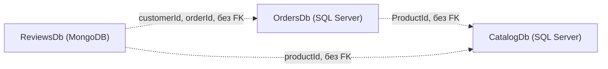
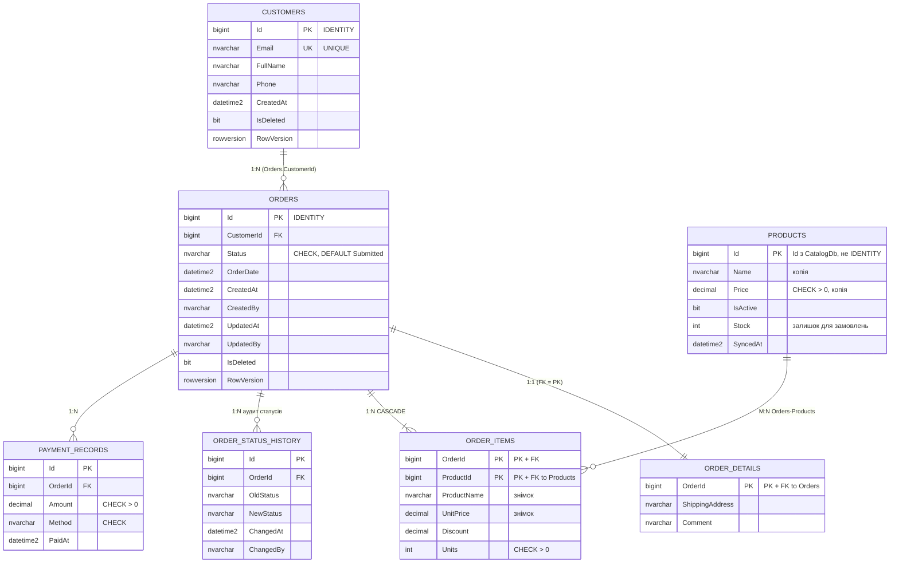
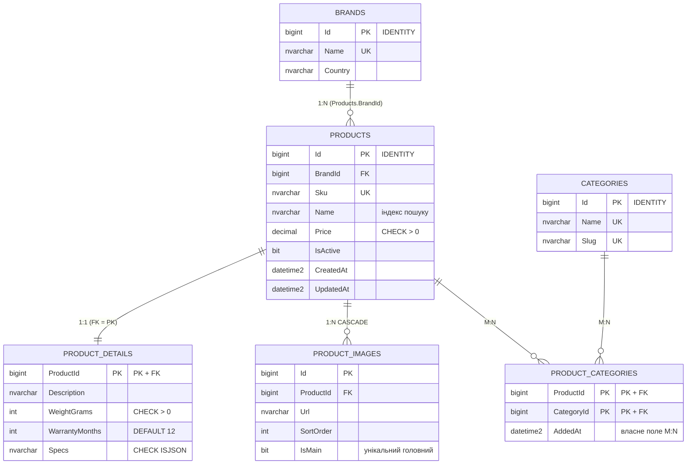
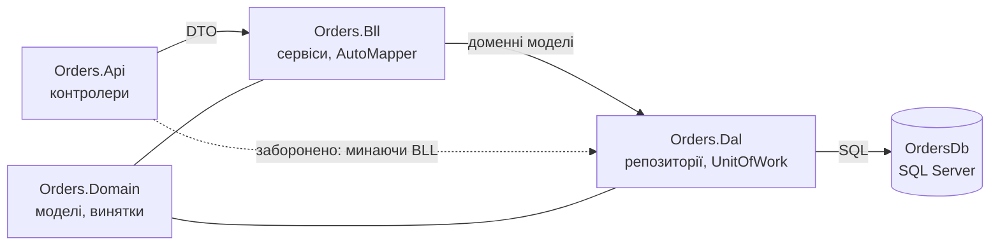
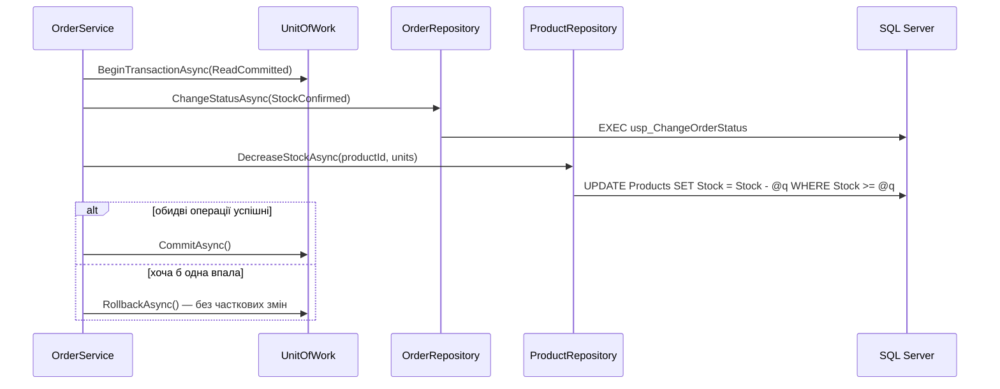

# TechNest — платформа інтернет-магазину електроніки (.NET)

| Практичне заняття | Що зроблено | Розділ |
|-------------------|-------------|--------|
| № 01 | Три бази даних для мікросервісів (SQL Server ×2 + MongoDB), політика дублювання | [Частина 1](#частина-1--три-бази-даних-лаб-01) |
| № 02 | Мікросервіс «Замовлення»: DAL → BLL → Web/API (ADO.NET + Dapper), Unit of Work, Aspire | [Частина 2](#частина-2--мікросервіс-замовлення-лаб-02) |
| № 03 | Мікросервіс «Каталог» на EF Core: Code First, Fluent API, міграції, специфікації, пагінація | [Частина 3](#частина-3--мікросервіс-каталог-на-ef-core-лаб-03) |

# Частина 1 — три бази даних (Лаб. 01)


Практичне заняття № 01 «ASP.NET. Проєктування та розробка баз даних для мікросервісної архітектури».
Три самостійні БД одного інтернет-магазину електроніки: дві реляційні (SQL Server) і одна документна (MongoDB).

## 1. Предметна область і контексти

**TechNest** — інтернет-магазин електроніки. Покупці переглядають каталог, оформлюють і оплачують замовлення та залишають відгуки й обговорення під товарами. Систему розділено на три незалежні мікросервіси, кожен із власною БД і логікою.

| # | Контекст | БД | Сутності (кожна належить рівно одному контексту) |
|---|----------|----|--------------------------------------------------|
| 1 | **Замовлення** | `OrdersDb` — SQL Server (ADO.NET + Dapper, Лаб. 02) | Customers, Orders, OrderDetails, OrderItems, OrderStatusHistory, PaymentRecords, Products (лише локальна копія довідника) |
| 2 | **Каталог** | `CatalogDb` — SQL Server (EF Core, Лаб. 03) | Brands, Categories, Products, ProductDetails, ProductCategories, ProductImages |
| 3 | **Відгуки та обговорення** | `ReviewsDb` — MongoDB (Лаб. 04) | reviews, discussions, messages, productRatings |

Деталі (агрегати, життєвий цикл, карта контекстів) — у [`docs/contexts.md`](docs/contexts.md).
**Між базами немає жодного FOREIGN KEY і жодних міжбазових JOIN-ів**: `ProductId`, `customerId`, `orderId` — звичайні значення (логічні посилання).



## 2. Структура репозиторію

```
README.md                  опис домену, запуск (Aspire), розгортання БД, таблиця дублювання, приклади curl
docs/                      contexts.md · erd-p1.md · erd-p2.md · duplication-policy.md · mongo-documents.md · lab02-requests.http
db/p1/                     schema.sql · procedures.sql · seed.sql · checks.sql     (OrdersDb)
db/p2/                     schema.sql · seed.sql                                   (CatalogDb)
db/p3/                     collections.js · seed.js · queries.js                   (ReviewsDb, MongoDB)
Platform.slnx              одне рішення на всю платформу
Platform.AppHost/          оркестрація .NET Aspire (AppHost.cs)
Services/Orders/           мікросервіс «Замовлення» (Проєкт №1)
    Orders.Api/            контролери, Program.cs, appsettings.json, обробка помилок
    Orders.Bll/            сервіси, DTO, профілі AutoMapper
    Orders.Dal/            репозиторії (ADO.NET, Dapper), Unit of Work
    Orders.Domain/         моделі, доменні винятки
    Orders.Tests/          unit-тести BLL
Services/Catalog/          мікросервіс «Каталог» (Проєкт №2, EF Core)
    Catalog.Api/           контролери, Program.cs, appsettings*.json, Dockerfile
    Catalog.Bll/           сервіси, DTO, профілі AutoMapper, валідатори FluentValidation
    Catalog.Dal/           DbContext, Configurations/, Migrations/, репозиторії, специфікації, UoW, сідінг
    Catalog.Domain/        сутності з бізнес-правилами, доменні винятки
    Catalog.Tests/         unit-тести (домен, сервіси, специфікації на InMemory)
```

## 3. Розгортання з нуля

### 3.1. Вимоги
* SQL Server 2019+ (або Docker), утиліта `sqlcmd`; MongoDB 6+ (або Docker), `mongosh`.
* Усі скрипти **ідемпотентні** — їх можна запускати повторно без помилок і дублікатів.

### 3.2. Сервери в Docker (за потреби)
```bash
docker run -d --name sql -e ACCEPT_EULA=Y -e MSSQL_SA_PASSWORD='Your_strong_Passw0rd' -p 1433:1433 mcr.microsoft.com/mssql/server:2022-latest
docker run -d --name mongo -p 27017:27017 mongo:7
```

### 3.3. Проєкт №1 — OrdersDb (порядок важливий)
```bash
sqlcmd -S localhost -U sa -P 'Your_strong_Passw0rd' -C -I -i db/p1/schema.sql      # 1) БД, таблиці, індекси, view
sqlcmd -S localhost -U sa -P 'Your_strong_Passw0rd' -C -I -i db/p1/procedures.sql  # 2) 6 збережуваних процедур
sqlcmd -S localhost -U sa -P 'Your_strong_Passw0rd' -C -I -i db/p1/seed.sql        # 3) тестові дані (ідемпотентно)
sqlcmd -S localhost -U sa -P 'Your_strong_Passw0rd' -C -I -i db/p1/checks.sql      # 4) перевірки (CRUD, помилки, конкурентність)
```
`-I` обов'язковий (QUOTED_IDENTIFIER для фільтрованих індексів). У SSMS достатньо відкрити файли й виконати по черзі.

### 3.4. Проєкт №2 — CatalogDb
```bash
sqlcmd -S localhost -U sa -P 'Your_strong_Passw0rd' -C -I -i db/p2/schema.sql
sqlcmd -S localhost -U sa -P 'Your_strong_Passw0rd' -C -I -i db/p2/seed.sql
```

### 3.5. Проєкт №3 — ReviewsDb (MongoDB)
```bash
mongosh "mongodb://localhost:27017" --file db/p3/collections.js   # колекції, JSON Schema, індекси
mongosh "mongodb://localhost:27017" --file db/p3/seed.js          # дані (upsert, ідемпотентно)
mongosh "mongodb://localhost:27017" --file db/p3/queries.js       # find / aggregation / $lookup / $text
```

### 3.6. Самоперевірка
| Що перевірити | Як |
|---------------|----|
| Немає FK за межі бази | `SELECT * FROM sys.foreign_keys` у `OrdersDb` і `CatalogDb` — усі таблиці лише своєї БД (також `checks.sql`, п. 1) |
| Недопустимий перехід статусу | `checks.sql`, п. 5–6: «відвантажити» неоплачене → помилка **50002**, статус не змінився |
| Конкурентність | `checks.sql`, п. 7: застарілий `RowVersion` → помилка **50008** |
| Різні набори полів у MongoDB | `db.reviews.find()` у `ReviewsDb` — документи мають різні поля (photos / pros+cons / videoUrl / лише rating) |
| Ідемпотентність seed | Запустити `seed.sql` / `seed.js` вдруге — кількість рядків/документів не змінюється |

### 3.7. (Рекомендовано) Принцип найменших привілеїв
```sql
-- виконати в master:  CREATE LOGIN orders_app WITH PASSWORD = '<пароль>';
USE OrdersDb;  CREATE USER orders_app FOR LOGIN orders_app;
GRANT SELECT, INSERT, UPDATE, EXECUTE ON SCHEMA::dbo TO orders_app;   -- доступ лише до власної БД, без DELETE/DDL
```

## 4. ERD

### 4.1. Проєкт №1 — OrdersDb


### 4.2. Проєкт №2 — CatalogDb


### 4.3. Проєкт №3 — ReviewsDb (MongoDB)
```
reviews ──(embedded)── author{}, comments[], verifiedPurchase{}, photos[]      ← EMBEDDING
reviews ──(reference)── discussionId ─► discussions                            ← REFERENCING (гібрид)
messages ──(reference)── discussionId ─► discussions, parentMessageId ─► messages
productRatings (_id = productId)                                                ← проєкція для читання
```
Приклади документів — [`docs/mongo-documents.md`](docs/mongo-documents.md).

## 5. Типи зв'язків

| БД | 1:1 | 1:N | M:N |
|----|-----|-----|-----|
| OrdersDb | Orders ↔ OrderDetails (FK = PK) | Customers → Orders; Orders → OrderStatusHistory / PaymentRecords | Orders ↔ Products через OrderItems |
| CatalogDb | Products ↔ ProductDetails (FK = PK) | Brands → Products; Products → ProductImages | Products ↔ Categories через ProductCategories (власне поле `AddedAt`) |

## 6. Ключі, обмеження, індекси

* **PK:** `BIGINT IDENTITY` — вставки йдуть з одного джерела (одна БД на сервіс), ключ компактний і послідовний. GUID був би виправданий, якби Id генерувались у кількох місцях. `OrdersDb.Products.Id` — не IDENTITY, а Id із Каталогу. У MongoDB — `ObjectId`.
* **Обмеження:** PK, FK, UNIQUE (`Customers.Email`, `Products.Sku`, …), CHECK (статуси, `Price > 0`, `Units > 0`, `Discount <= UnitPrice*Units`, `ISJSON`), DEFAULT.
* **Каскади:** `ON DELETE CASCADE` лише для залежних частин агрегата (OrderDetails, OrderItems, OrderStatusHistory, ProductDetails, ProductImages, ProductCategories). Для клієнта з історією замовлень і платежів каскаду **немає**.
* **Індекси** — кожен має коментар у `schema.sql` з описом запиту: `IX_Orders_CustomerId_Status`, `IX_Orders_Active` (filtered), `IX_Orders_Status_OrderDate` (filtered), `IX_OrderItems_ProductId`, `IX_OrderStatusHistory_OrderId_ChangedAt`, `IX_PaymentRecords_OrderId`, `IX_Products_BrandId`, `IX_Products_Name_Active` (filtered), `IX_ProductCategories_CategoryId`, `IX_ProductImages_ProductId_SortOrder`, `UX_ProductImages_Main` (unique filtered); у MongoDB — див. `collections.js`.
* **Аудит і soft delete:** `CreatedAt/CreatedBy/UpdatedAt/UpdatedBy/IsDeleted` у `Customers` та `Orders`.
* **Конкурентність:** `ROWVERSION` у `Orders` і `Customers` — оптимістичне блокування: два користувачі, що редагують одне замовлення, не затруть зміни «тихо» (`usp_UpdateOrderDetails` повертає помилку 50008 при застарілому RowVersion). Під час зміни статусу додатково використовується `UPDLOCK` у транзакції.

## 7. Збережувані процедури Проєкту №1

| Процедура | Призначення |
|-----------|-------------|
| `usp_CreateOrder` | Create: замовлення + деталі + позиції (знімок назви/ціни) + запис в історії, у транзакції |
| `usp_GetOrderById` | Read: 3 набори (шапка + RowVersion, позиції, історія статусів) |
| `usp_GetCustomerOrders` | Read: фільтр за статусом і пагінація (OFFSET/FETCH) |
| `usp_UpdateOrderDetails` | Update: адреса/коментар з перевіркою RowVersion |
| `usp_SoftDeleteOrder` | Delete: м'яке видалення (лише Submitted/Cancelled) |
| `usp_ChangeOrderStatus` | **Транзакційна** зміна статусу: `UPDLOCK`, перевірка переходу, `THROW 50002` на недопустимому, запис у PaymentRecords при `Paid` та в історію |

Допустимі переходи: `Submitted → AwaitingValidation → StockConfirmed → Paid → Shipped`; `Cancelled` — лише до оплати.
Коди керованих помилок наведено на початку `procedures.sql`.

## 8. Політика дублювання даних і узгодженості

| Поле | Де зберігається | Джерело (власник даних) | Політика узгодженості |
|------|-----------------|-------------------------|-----------------------|
| `OrderItems.ProductName`, `OrderItems.UnitPrice` | OrdersDb | Product (CatalogDb) | **Знімок** на момент оформлення — не оновлюється |
| `Products.Name`, `Products.Price`, `Products.IsActive` (локальна копія довідника) | OrdersDb | Product (CatalogDb) | Копія для читання, **оновлюється подіями** з Каталогу (eventual consistency, Лаб. 08) |
| `reviews.productName` | ReviewsDb (MongoDB) | Product (CatalogDb) | Копія для читання, **оновлюється подіями** з Каталогу |
| `discussions.productName` | ReviewsDb (MongoDB) | Product (CatalogDb) | Копія для читання, **оновлюється подіями** з Каталогу |
| `productRatings.productName` | ReviewsDb (MongoDB) | Product (CatalogDb) | Копія для читання, **оновлюється подіями** з Каталогу |
| `reviews.author.displayName`, `messages.author.displayName` | ReviewsDb (MongoDB) | Customer (OrdersDb, `Customers.FullName`) | **Знімок** на момент написання — не оновлюється |
| `reviews.verifiedPurchase.orderId` | ReviewsDb (MongoDB) | Order (OrdersDb) | Лише посилання за Id (без FK); факт покупки фіксується на момент написання відгуку |
| `Products.Stock` (OrdersDb) | OrdersDb | Сервіс Замовлень (резервування залишку при підтвердженні) | Власник — Замовлення: зменшується при `confirm`, повертається при `cancel`; поповнення приходить подіями (Лаб. 08). Каталог цього поля не редагує |
| `Products.AvailableStock` (CatalogDb) | CatalogDb | Каталог (фізичний залишок на складі) | Не дублюється в інших базах; не плутати з `OrdersDb.Products.Stock` (резерв для замовлень, власник — Замовлення) |

* **Знімок** — свідомо не оновлюється (ціна й назва в позиції замовлення фіксуються на момент покупки, як `OrderItem` в Microsoft eShop).
* **Копія для читання** — оновлюється подіями від власника даних (механізм подій — Лаб. 08; до того копії змінюються лише скриптами від імені власника).
* Незалежне редагування двох копій без власника (**dual write**) заборонене.
* Жодне з цих полів не має FOREIGN KEY на іншу базу.

## 9. Відповідність вимогам

| Вимога | Де |
|--------|----|
| Опис домену та 3 контексти | цей README, `docs/contexts.md` |
| Таблиця політики дублювання | розділ 8, `docs/duplication-policy.md` |
| Три бази без FK між ними | розділ 3.6, `db/` |
| P1: ≥4 таблиці, 1:1 / 1:N / M:N | `db/p1/schema.sql` (7 таблиць) |
| Ключі, обмеження, індекси під запити | `db/p1/schema.sql`, `db/p2/schema.sql` |
| Аудит, soft delete, rowversion | `db/p1/schema.sql` |
| 4–6 процедур, транзакційна зміна статусу | `db/p1/procedures.sql` (6 процедур) |
| P2: 6 сутностей, M:N з власним полем | `db/p2/schema.sql`, `db/p2/seed.sql` |
| P3: 4 колекції, embed / reference / гібрид, гнучка схема | `db/p3/collections.js`, `db/p3/seed.js`, `docs/mongo-documents.md` |
| Ідемпотентні seed-скрипти | `db/p1/seed.sql`, `db/p2/seed.sql`, `db/p3/seed.js` |
| Скрипти розгортання, README, ERD | розділи 3–4 |

---

# Частина 2 — мікросервіс «Замовлення» (Лаб. 02)

Тришарова архітектура **Web/API → BLL → DAL** поверх бази `OrdersDb` (Проєкт №1 з Лаб. 01): репозиторії на **ADO.NET** та **Dapper**, **Unit of Work** з транзакціями, **DTO + AutoMapper**, асинхронні контролери, помилки у форматі **ProblemDetails**, запуск через **.NET Aspire**.

## 11. Структура рішення та залежності

| Проєкт | Призначення |
|--------|-------------|
| `Orders.Api` | Web/API: контролери, Program.cs (DI, Serilog, Swagger), глобальний обробник помилок |
| `Orders.Bll` | сервіси й інтерфейси, DTO, профілі AutoMapper, бізнес-валідація |
| `Orders.Dal` | інтерфейси репозиторіїв (у т.ч. `IGenericRepository<T>`), реалізації ADO.NET / Dapper, Unit of Work |
| `Orders.Domain` | моделі, константи статусів, доменні винятки (`NotFound`, `BusinessConflict`, `Validation`) |
| `Orders.Tests` | unit-тести BLL (NSubstitute) і перевірка конфігурації AutoMapper |
| `Platform.AppHost` | .NET Aspire: запуск API разом із базою даних |

Залежності спрямовані в один бік: `Api → Bll → Dal`; `Domain` підключають і `Dal`, і `Bll`. Контролер не звертається до репозиторію — лише до сервісу; SQL є **лише** в `Orders.Dal`.



### Репозиторії (DAL)

| Репозиторій | Технологія | Особливості |
|-------------|-----------|-------------|
| `CustomerRepository` | **чистий ADO.NET** (`SqlCommand`, `SqlParameter`, `SqlDataReader`) | свідомо **не** успадковує `IGenericRepository<T>`; власні `Update`/`SoftDelete`; ручне читання через reader |
| `BaseDapperRepository<T>` | Dapper | спільний CRUD **написано один раз** (`GetById`, `GetAll`, `Add`, `Delete`); `SELECT`/`INSERT` будуються з властивостей моделі |
| `OrderRepository : BaseDapperRepository<Order>` | Dapper | **multi-mapping** (`Order` + `OrderItem` одним JOIN), виклик збережених процедур Лаб. 01 (`usp_ChangeOrderStatus`, `usp_GetCustomerOrders`, `usp_UpdateOrderDetails`, `usp_SoftDeleteOrder`), асинхронні `QueryAsync`/`ExecuteAsync` |
| `ProductRepository : BaseDapperRepository<Product>` | Dapper | `IN @Ids`, атомарне `DecreaseStock` (`WHERE Stock >= @Quantity`), `Upsert` локальної копії |

* **Параметризація:** значення передаються **лише** як параметри (`SqlParameter` / об'єкт-параметри Dapper). Ім'я таблиці в `BaseDapperRepository` — константа з коду і додатково перевіряється регулярним виразом.
* **З'єднання:** `await using` / `DisposeAsync`; пул підключень SqlClient увімкнено за замовчуванням. Dapper не керує з'єднанням — лише розширює `SqlConnection`.
* **Перетворення помилок БД** (`SqlErrorTranslator`): `THROW 50001` → `NotFoundException`; `50002` (недопустимий перехід) → `BusinessConflictException`; `2601/2627` (UNIQUE) → `BusinessConflictException`. Raw SQL-повідомлення в API не потрапляють.

### Unit of Work

`UnitOfWork` відкриває **одне** `SqlConnection`, створює всі репозиторії з цим з'єднанням і функцією `() => _transaction`, тому всі вони автоматично працюють у **поточній** транзакції (`BeginTransactionAsync(IsolationLevel)` → `CommitAsync` / `RollbackAsync` → `DisposeAsync`). Реєструється як **Scoped**: один екземпляр і одне з'єднання на HTTP-запит.



**Рівень ізоляції та таймаути.** За замовчуванням `ReadCommitted`: немає «брудних» читань і мінімум блокувань. Вищі рівні (`RepeatableRead`, `Serializable`) прибирають більше аномалій читання, але тримають більше блокувань і підвищують ризик взаємних блокувань (deadlock); нижчі — швидші, але допускають аномалії. Критичну консистентність забезпечено точково: `UPDLOCK` у процедурі зміни статусу та умова `Stock >= @Quantity` в одному `UPDATE`. Для зменшення ризику deadlock залишки змінюються у **фіксованому порядку** (за `ProductId`). Таймаути: підключення — `Connect Timeout=15` у рядку підключення; команди — 30 с (`RepositoryBase.CommandTimeoutSeconds`).

**Відкат, ініційований сервером.** Процедура з Лаб. 01 працює з `XACT_ABORT ON`: після `THROW` SQL Server сам відкочує *всю* транзакцію. Тому `UnitOfWork.RollbackAsync` толерантний до вже завершеної транзакції (ловить `InvalidOperationException`/`SqlException`).

### Бізнес-операції (BLL) і валідація

| Метод сервісу | Транзакція | Що змінює |
|---------------|-----------|-----------|
| `CreateAsync` | так | `Orders` + `OrderDetails` + `OrderItems` + `OrderStatusHistory` (назва й ціна позиції беруться з `Products` як **знімок**) |
| `ConfirmOrderAsync` | так | статус замовлення → `StockConfirmed` та зменшення `Products.Stock` — або обидва, або жодне |
| `CancelOrderAsync` | так | статус → `Cancelled` + повернення залишку, якщо замовлення було підтверджене |
| `PayOrderAsync`, `ShipOrderAsync` | процедура | `usp_ChangeOrderStatus` (власна транзакція); `Shipped` для неоплаченого → 409 |

Валідація на двох рівнях: **DataAnnotations** на DTO (відхиляє некоректний запит ще до сервісу → 400) і **бізнес-правила в BLL** (клієнт/товар існує, дублікати позицій, допустимі статуси, page/pageSize, унікальність email).

### Відповідність помилок і HTTP-статусів

| Де виникає | Виняток (Domain) | HTTP |
|------------|------------------|------|
| `THROW 50001/50006/50010`, сервіс не знайшов ресурс | `NotFoundException` | **404** |
| `THROW 50002/50004/50008/50009`, UNIQUE (2601/2627), нестача товару | `BusinessConflictException` | **409** |
| `THROW 50003/50005/50007`, бізнес-валідація BLL | `ValidationException` | **400** |
| DataAnnotations на DTO (до сервісу) | автоматично `[ApiController]` | **400** (ValidationProblemDetails) |
| інше | — | **500** (без технічних деталей) |

Усе перетворюється **одним** глобальним обробником `DomainExceptionHandler` (`IExceptionHandler` + `AddProblemDetails`); у кожну відповідь додається `traceId`. Операції логуються Serilog з кореляційним ідентифікатором (`X-Correlation-ID`), без персональних і секретних даних.

## 12. Запуск через .NET Aspire

**Потрібно:** .NET SDK 9.0.200+ (формат `.slnx`), SQL Server з базою з Лаб. 01. Docker потрібен лише для SQL Server у контейнері (або для варіанта 2 нижче).

1. **Розгорніть БД** (розділ 3.3 цього README; після зміни схеми в Лаб. 02 **перезапустіть** `schema.sql` → `procedures.sql` → `seed.sql` — у `Products` додано колонку `Stock`, скрипти ідемпотентні й самі мігрують стару схему).
2. **Вкажіть рядок підключення** у `Platform.AppHost/appsettings.json` (секція `ConnectionStrings:OrdersDb`; за замовчуванням — `sa` з Docker-команди розділу 3.2). Для запуску API без Aspire — той самий ключ у `Services/Orders/Orders.Api/appsettings.json` або змінна оточення `ConnectionStrings__OrdersDb=Server=...;Database=OrdersDb;...`.
3. **Запустіть однією командою:**
   ```bash
   dotnet run --project Platform.AppHost
   ```
4. Відкрийте **Aspire Dashboard** за посиланням з консолі: ресурс `orders-api` має статус **Running**. Натисніть на його endpoint — відкриється **Swagger** (`/` перенаправляє на `/swagger`).
5. Візьміть URL API з Dashboard і виконайте запити зі Swagger або `curl` (розділ 13).

**Варіант 2 — SQL Server у контейнері:** у `Platform.AppHost/AppHost.cs` закоментуйте `AddConnectionString`, розкоментуйте `AddSqlServer("sql").WithDataVolume().AddDatabase("OrdersDb")`. База створюється **порожньою** — застосуйте до неї `db/p1/schema.sql`, `procedures.sql`, `seed.sql` (рядок підключення видно в Dashboard).

Ім'я ресурсу `OrdersDb` збігається з іменем рядка підключення в API, тому Aspire передає його через `WithReference(ordersDb)` автоматично (`ConnectionStrings__OrdersDb`), і код `Orders.Api` не змінюється.

Без Aspire: `dotnet run --project Services/Orders/Orders.Api` → <http://localhost:5080/swagger>. Тести: `dotnet test Services/Orders/Orders.Tests`.

## 13. Приклади запитів (curl)

Підставте адресу з Aspire Dashboard (або `http://localhost:5080`). Ті самі запити — у [`docs/lab02-requests.http`](docs/lab02-requests.http). Для `https` з dev-сертифікатом додайте `-k`. Дані — з `seed.sql` (замовлення 1 — Paid, 2 — Submitted, 3 — Cancelled).

```bash
API=http://localhost:5080

# --- READ -----------------------------------------------------------------
curl -i $API/api/products
curl -i $API/api/customers/1
curl -i "$API/api/orders?customerId=1&status=Paid&page=1&pageSize=5"   # фільтр + пагінація
curl -i $API/api/orders/2                                               # замовлення з позиціями та rowVersion
curl -i $API/api/orders/2/history

# --- CREATE (201 Created + Location) ---------------------------------------
curl -i -X POST $API/api/orders -H "Content-Type: application/json" \
  -d '{"customerId":1,"shippingAddress":"Чернівці, вул. Руська, 10","items":[{"productId":3,"units":2},{"productId":4,"units":1}]}'

# спецсимвол у даних (SQL-ін'єкція неможлива: усе — параметри)
curl -i -X POST $API/api/customers -H "Content-Type: application/json" \
  -d "{\"email\":\"patrick.obrien@example.com\",\"fullName\":\"Patrick O'Brien\"}"

# --- ПОМИЛКИ (ProblemDetails) ----------------------------------------------
curl -i -X POST $API/api/orders/2/ship          # 409: Invalid status transition: Submitted -> Shipped
curl -i -X POST $API/api/orders/999999/confirm  # 404: Order 999999 not found
curl -i -X POST $API/api/orders -H "Content-Type: application/json" -d '{"customerId":0,"shippingAddress":"","items":[]}'   # 400

# --- ТРАНЗАКЦІЙНА БІЗНЕС-ОПЕРАЦІЯ ------------------------------------------
curl -i -X POST $API/api/orders/2/confirm       # 204: статус -> StockConfirmed, залишки товарів 2 і 3 зменшено
curl -i -X POST $API/api/orders/2/confirm       # 409: повторне підтвердження
curl -i -X POST $API/api/orders/2/pay -H "Content-Type: application/json" -d '{"paymentMethod":"Card"}'   # 204
curl -i -X POST $API/api/orders/2/ship          # 204: тепер дозволено

# --- ВІДКАТ ТРАНЗАКЦІЇ ------------------------------------------------------
# товар 5 має залишок 5; замовляємо 1 шт. товару 4 і 6 шт. товару 5
curl -i -X POST $API/api/orders -H "Content-Type: application/json" \
  -d '{"customerId":2,"shippingAddress":"Київ, просп. Науки, 1","items":[{"productId":4,"units":1},{"productId":5,"units":6}]}'
curl -i -X POST $API/api/orders/5/confirm       # 409 Insufficient stock for product 5
curl -s $API/api/orders/5                       # статус усе ще Submitted -> зміну статусу відкочено
curl -s $API/api/products/4                     # залишок товару 4 не змінився -> відкотилось і перше списання

# --- ОПТИМІСТИЧНА КОНКУРЕНТНІСТЬ -------------------------------------------
curl -s $API/api/orders/4                       # скопіюйте поле rowVersion
curl -i -X PUT $API/api/orders/4/details -H "Content-Type: application/json" \
  -d '{"shippingAddress":"Нова адреса, 5","comment":"змінено","rowVersion":"<rowVersion>"}'   # 200
# повторіть той самий запит зі СТАРИМ rowVersion -> 409 Concurrency conflict
```

Приклад відповіді 409 (`application/problem+json`):
```json
{ "title": "Business rule conflict", "status": 409,
  "detail": "Invalid status transition: Submitted -> Shipped", "traceId": "0HN..." }
```

| Метод і шлях | Успіх | Помилки |
|--------------|-------|---------|
| `GET /api/orders/{id}` | 200 | 404 |
| `GET /api/orders?customerId=&status=&page=&pageSize=` | 200 | 400, 404 |
| `GET /api/orders/{id}/history` | 200 | 404 |
| `POST /api/orders` | **201** + `Location` | 400 |
| `PUT /api/orders/{id}/details` | 200 | 400, 404, 409 |
| `DELETE /api/orders/{id}` (soft) | 204 | 404, 409 |
| `POST /api/orders/{id}/confirm` · `/pay` · `/ship` · `/cancel` | 204 | 400, 404, 409 |
| `GET/POST/PUT/DELETE /api/customers` | 200 / 201 / 200 / 204 | 400, 404, 409 |
| `GET /api/products`, `GET /api/products/{id}`, `PUT /api/products/{id}` (sync з Каталогу) | 200 | 400, 404 |

## 14. Git

Гілки: `main` — стабільна, `develop` — інтеграційна, `feature/*` — завдання (наприклад `feature/dal`, `feature/bll`, `feature/api`, `feature/aspire`). Зміни зливаються в `develop` через Pull Request з описом, `develop` → `main` — після перевірки.

```bash
git init -b main && git add . && git commit -m "chore: Lab 01 databases"
git switch -c develop
git switch -c feature/dal    # ... комітимо: feat(dal): ADO.NET CustomerRepository, Dapper repositories, UnitOfWork
```

## 15. Самоперевірка перед здачею

| Перевірка | Очікуваний результат |
|-----------|----------------------|
| Створити клієнта з ім'ям `O'Brien` | 201, без синтаксичної помилки SQL |
| Підтвердити замовлення, де товару не вистачає (розділ 13, «Відкат») | 409, статус і залишок першого товару не змінилися |
| Підтвердити вже підтверджене замовлення | 409 у форматі ProblemDetails |
| `GET /api/orders/999999` | 404, не 500 |
| `dotnet run --project Platform.AppHost` | у Dashboard `orders-api` — Running; Swagger відкривається |
| `dotnet test Services/Orders/Orders.Tests` | усі тести зелені |

**Знімки екрана для здачі:** Swagger з переліком ендпоінтів і Aspire Dashboard зі статусом Running (покласти в `docs/screenshots/`).

## 16. Відповідність критеріям Лаб. 02

| Критерій | Де |
|----------|----|
| Рішення з шарів Api → Bll → Dal (+ Domain), DI, рядок підключення в appsettings, Scoped UoW, логування | `Platform.slnx`, `Orders.Api/Program.cs`, `appsettings.json` |
| `IGenericRepository<T>` + конкретні інтерфейси | `Orders.Dal/Interfaces/` |
| Репозиторій на чистому ADO.NET (без Generic Repository) | `CustomerRepository` |
| ≥ 2 репозиторії на Dapper зі спільною `BaseDapperRepository<T>` | `OrderRepository`, `ProductRepository` |
| Усі запити параметризовані, з'єднання звільняються | `Orders.Dal/Repositories/` |
| Unit of Work: одне з'єднання, транзакція з рівнем ізоляції, Commit/Rollback/DisposeAsync | `Orders.Dal/UnitOfWork.cs` |
| DTO + профілі AutoMapper в BLL, зареєстровані в DI | `Orders.Bll/Dtos`, `Mapping`, `Program.cs` |
| Транзакційна операція через кілька репозиторіїв, знімок назви й ціни | `OrderService.CreateAsync` / `ConfirmOrderAsync` / `CancelOrderAsync` |
| Доменні винятки NotFound / BusinessConflict / Validation | `Orders.Domain/Exceptions` |
| Валідація: DataAnnotations (DTO) + бізнес-правила (BLL) | `Dtos/*.cs`, `Services/*.cs` |
| Тонкі асинхронні контролери, атрибутна маршрутизація, Swagger, `CreatedAtAction`, 204, `CancellationToken` | `Orders.Api/Controllers` |
| Централізована обробка помилок у ProblemDetails | `ErrorHandling/DomainExceptionHandler.cs` |
| AppHost запускає API разом із базою даних | `Platform.AppHost/AppHost.cs` |
| README із запуском через Aspire та прикладами curl | розділи 12–13 |

---

# Частина 3 — мікросервіс «Каталог» на EF Core (Лаб. 03)

Мікросервіс `Services/Catalog` будується за тією самою схемою, що й «Замовлення» (**Api → Bll → Dal**, спільні моделі в **Domain**), але доступ до даних — **Entity Framework Core (Code First)**: сутності з бізнес-правилами, Fluent API, міграції, LINQ to Entities, репозиторії з Eager / Explicit / LINQ-завантаженням, Unit of Work з єдиним `SaveChangesAsync()`, пагінація/фільтрація/сортування в SQL, специфікації (Ardalis.Specification), валідація (DataAnnotations + FluentValidation), ProblemDetails, Serilog.

Модель відповідає Проєкту №2 з Лаб. 01 (`db/p2`): `Brand`, `Category`, `Product`, `ProductDetail` (1:1), `ProductImage` (1:N), `ProductCategory` (M:N з полем `AddedAt`). Ідентифікатори — `long` (`bigint`), як у Лаб. 01, бо інші сервіси посилаються на `ProductId` без FK.

## 17. Запуск і міграції

> **Важливо:** схему `CatalogDb` тепер створюють **міграції EF Core**. Якщо ви раніше виконували `db/p2/schema.sql` (Лаб. 01), видаліть ту базу (`DROP DATABASE CatalogDb;`) — файли `db/p2/*.sql` залишаються як проєктний документ Лаб. 01. Рядок підключення: `Services/Catalog/Catalog.Api/appsettings.json` (ключ `ConnectionStrings:CatalogDb`) або змінна `ConnectionStrings__CatalogDb`.

```bash
# 1) інструмент dotnet-ef (один раз)
dotnet tool install --global dotnet-ef

# 2) застосувати міграцію до бази (DbContext у Catalog.Dal, рядок підключення — в Catalog.Api)
dotnet ef database update --project Services/Catalog/Catalog.Dal --startup-project Services/Catalog/Catalog.Api --environment Development

# 3) SQL-скрипт міграції (для перегляду або ручного застосування)
dotnet ef migrations script --project Services/Catalog/Catalog.Dal --startup-project Services/Catalog/Catalog.Api -o db/p2/ef-InitialCreate.sql

# 4) запуск сервісу (міграції та сідінг застосовуються автоматично при старті в Development)
dotnet run --project Services/Catalog/Catalog.Api          # http://localhost:5090/swagger
```

Або через Aspire — `dotnet run --project Platform.AppHost` запускає `orders-api` і `catalog-api`; у `Platform.AppHost/appsettings.json` задано рядки `OrdersDb` і `CatalogDb`. Docker-образ: `docker build -f Services/Catalog/Catalog.Api/Dockerfile -t technest-catalog-api .` (контекст — корінь репозиторію).

**Початкова міграція.** Папка `Services/Catalog/Catalog.Dal/Migrations/` містить `InitialCreate` і знімок моделі, а `db/p2/ef-InitialCreate.sql` — її SQL-скрипт. Створена міграція містить усі таблиці, складений ключ `ProductCategories`, `CHECK`-обмеження (ціна, залишок, вага, гарантія, `ISJSON`), унікальний індекс `Sku`, відфільтрований унікальний індекс головного зображення та довідникові дані (`HasData`).

> **Чесна примітка про міграцію.** Файли міграції та знімка написано **вручну** за форматом EF Core 9 (в середовищі підготовки не було .NET SDK). Щоб отримати «еталонні» файли, один раз перегенеруйте їх:
> ```bash
> rm -r Services/Catalog/Catalog.Dal/Migrations
> dotnet ef migrations add InitialCreate --project Services/Catalog/Catalog.Dal --startup-project Services/Catalog/Catalog.Api
> dotnet ef migrations script --project Services/Catalog/Catalog.Dal --startup-project Services/Catalog/Catalog.Api -o db/p2/ef-InitialCreate.sql
> ```
> Доки цього не зроблено, у `appsettings.json` увімкнено `Database:IgnorePendingModelChangesWarning` (EF Core 9 інакше зупинить `MigrateAsync` при розбіжності знімка з моделлю). Після перегенерації встановіть його в `false`.

Режими сідінгу: `Database:MigrateOnStartup` і `Database:Seed` (у `appsettings.Production.json` обидва `false`).

## 18. Модель, Fluent API, зв'язки

| Сутність | Бізнес-правила в самій сутності (приватні setter-и, валідація в конструкторі) |
|----------|-------------------------------------------------------------------------------|
| `Product` | ціна > 0 (≤ 2 знаки), SKU `^[A-Z0-9-]+$`, `RemoveStock`/`AddStock`/`ChangePrice`/`Rename`/`SetActive`/`SetDetail`/`AddImage`/`AssignToCategory`; `RowVersion` для оптимістичної конкурентності |
| `ProductDetail` | вага > 0, гарантія ≥ 0, `Specs` — валідний JSON |
| `ProductImage` | непорожній URL, не більше одного головного зображення |
| `Brand`, `Category` | обов'язкові назви, slug у форматі `a-b-c` |
| `ProductCategory` | проміжна сутність M:N, складений ключ `(ProductId, CategoryId)`, поле `AddedAt` |

Конфігурації — окремі `IEntityTypeConfiguration<T>` у `Catalog.Dal/Configurations/` (таблиці, ключі, довжини, `decimal(18,2)`, унікальні індекси, `CHECK`), підключені одним рядком `ApplyConfigurationsFromAssembly` в `OnModelCreating`.

| Зв'язок | Реалізація |
|---------|------------|
| 1:1 | `Product` ↔ `ProductDetail` (PK = FK `ProductId`) |
| 1:N | `Product` → `ProductImage` (cascade); `Brand` → `Product` (restrict) |
| M:N | `Product` ↔ `Category` через явну `ProductCategory` з `AddedAt` |

## 19. Репозиторії та Unit of Work

| Репозиторій | Спосіб завантаження | Метод |
|-------------|---------------------|-------|
| `GenericRepository<T>` | базові `GetByIdAsync`, `GetAllAsync`, `AddAsync`; `Update`/`Delete` лише змінюють стан | — |
| `ProductRepository` | **Eager Loading** — один запит із JOIN | `GetWithDetailsAsync` (`Include`/`ThenInclude`) |
| `CategoryRepository` | **Explicit Loading** — категорія окремо, товари окремим запитом | `GetWithProductsAsync` (`Entry(...).Collection(...).Query().Include(...).LoadAsync()`) |
| `ProductCategoryRepository` | **LINQ to Entities** через проміжну сутність за її полем | `GetRecentlyAddedAsync(categoryName, since)` |

`UnitOfWork` об'єднує репозиторії навколо одного `DbContext` (Scoped); `SaveChangesAsync()` викликається **один раз** наприкінці бізнес-операції. Помилки збереження перетворюються на `ConflictException` (дублікат унікального ключа 2601/2627, `DbUpdateConcurrencyException`).

**Перевірка за логом SQL.** Serilog логує SQL-команди EF Core (`Microsoft.EntityFrameworkCore.Database.Command`). Виконайте `GET /api/products/1` — у лозі **один** `SELECT ... LEFT JOIN ...` (eager). Виконайте `GET /api/categories/1/products` — **два** окремі `SELECT` (explicit): спочатку `Categories`, потім `ProductCategories JOIN Products`. Фрагмент логу додайте до звіту.

## 20. API: пагінація, фільтрація, сортування, валідація, помилки

`GET /api/products?page=1&pageSize=20&search=&minPrice=&maxPrice=&categoryId=&brandId=&inStock=&sortBy=name&sortDir=asc`

* `pageSize` — 1…100 (за замовчуванням 20), `sortBy` — лише `name | price | sku | created | stock`, `sortDir` — `asc | desc`.
* Відповідь (тіло): `items`, `totalCount`, `page`, `pageSize`, `totalPages`, `hasNext`, `hasPrevious`; заголовки: `X-Total-Count`, `X-Total-Pages`, `X-Page`, `X-Page-Size`.
* Фільтрація, сортування, `Skip/Take` і підрахунок `totalCount` виконуються **в SQL** (`ProductsPageSpec` → `OFFSET … FETCH`, `ProductsFilterSpec` → `COUNT(*)`).
* **Specification pattern:** критерії, `Include`, `OrderBy`, `Skip/Take` описані в класах специфікацій (`Catalog.Dal/Specifications`), а репозиторій лише застосовує їх (`WithSpecification`). Друга специфікація — `LowStockProductsSpec` (`GET /api/products/low-stock?threshold=5`) — працює через той самий `ListAsync` без змін у репозиторії.

**Валідація у два шари.** DataAnnotations на DTO (`Required`, `StringLength`, `Range`) відхиляє структурно некоректний запит автоматично (`[ApiController]` → 400 `ValidationProblemDetails`). Правила формату — FluentValidation у окремих класах (`Catalog.Bll/Validators`), зареєстровані через `AddValidatorsFromAssemblyContaining` і викликані **явно** в контролерах (без застарілого `AddFluentValidation`): SKU-формат, ціна (> 0, 2 знаки), дозволені `sortBy`/`sortDir`, `minPrice ≤ maxPrice`, валідний JSON, формат slug/URL. Помилки повертаються в `ValidationProblemDetails` з переліком по полях.

**Глобальна обробка помилок** (`ApiExceptionHandler`, `IExceptionHandler` + `AddProblemDetails`):

| Виняток | HTTP |
|---------|------|
| `EntityNotFoundException` | **404** |
| `ValidationException` (BLL), DataAnnotations/FluentValidation | **400** |
| `ConflictException` (дублікат SKU, конкурентна зміна), `DomainException` (ціна ≤ 0, недостатній залишок) | **409** |
| інше | **500** (деталі — лише в Development) |

Виняток логується **один раз** — в обробнику. **Serilog:** структуровані властивості, sink-и console + file (`logs/catalog-.log`), enrich `CorrelationId`, `RequestPath`, `UserId` (якщо користувач автентифікований), `UseSerilogRequestLogging`, SQL-команди EF Core на рівні `Information` (вимикаються ключем `Diagnostics:LogSqlCommands`).

| Метод і шлях | Успіх | Помилки |
|--------------|-------|---------|
| `GET /api/products` (пагінація/фільтри/сортування) | 200 | 400 |
| `GET /api/products/{id}` (eager) | 200 | 404 |
| `POST /api/products` | **201** + `Location` | 400, 409 (SKU) |
| `PUT /api/products/{id}` · `/price` · `/detail` | 200 | 400, 404 |
| `POST /api/products/{id}/stock/add` · `/stock/remove` | 200 | 400, 404, 409 |
| `POST /api/products/{id}/images` | 200 | 400, 404, 409 |
| `POST` / `DELETE /api/products/{id}/categories/{categoryId}` | 204 | 404, 409 |
| `DELETE /api/products/{id}` | 204 | 404 |
| `GET /api/products/low-stock` | 200 | 400 |
| `GET /api/categories` · `/{id}` · `/{id}/products` (explicit) · `/recent-products?categoryName=&since=` (M:N) | 200 | 404 |
| `POST /api/categories`, `POST /api/brands` | 201 | 400, 409 |

## 21. Приклади запитів (curl)

```bash
API=http://localhost:5090

# список: сторінка 2 по 5, сортування за ціною (totalCount — по всій вибірці)
curl -i "$API/api/products?page=2&pageSize=5&sortBy=price&sortDir=desc"
curl -i "$API/api/products?search=ноут&minPrice=1000&maxPrice=40000&inStock=true"

# картка (eager) і категорія з товарами (explicit) — порівняйте SQL у лозі
curl -s $API/api/products/1
curl -s $API/api/categories/1/products
curl -s "$API/api/categories/recent-products?categoryName=Ноутбуки"       # M:N за AddedAt

# створення: 201 + Location; повтор з тим самим SKU -> 409; порожній Name -> 400 з помилками по полях
curl -i -X POST $API/api/products -H "Content-Type: application/json" \
  -d '{"brandId":1,"name":"Ноутбук Z9","sku":"NB-Z9","price":45999.00,"initialStock":3}'
curl -i -X POST $API/api/products -H "Content-Type: application/json" \
  -d '{"brandId":1,"name":"Ноутбук Z9","sku":"NB-Z9","price":45999.00}'            # 409
curl -i -X POST $API/api/products -H "Content-Type: application/json" \
  -d '{"brandId":1,"name":"","sku":"bad sku","price":-1}'                           # 400

# бізнес-правила сутності
curl -i -X PUT  $API/api/products/1/price -H "Content-Type: application/json" -d '{"price":-5}'          # 400
curl -i -X POST $API/api/products/5/stock/remove -H "Content-Type: application/json" -d '{"quantity":99}' # 409 Only 5 units available
curl -i $API/api/products/999999                                                                          # 404 ProblemDetails
curl -i "$API/api/products?sortBy=password"                                                               # 400

# друга специфікація
curl -s "$API/api/products/low-stock?threshold=10"
```

## 22. Самоперевірка перед здачею

| Перевірка | Очікуваний результат |
|-----------|----------------------|
| Лог SQL для `GET /api/products/1` і `GET /api/categories/1/products` | eager — 1 запит, explicit — 2 запити |
| `POST /api/products` з порожнім `name` | 400 `ValidationProblemDetails` з помилками по полях, не 500 |
| Повторне створення з тим самим SKU | 409; неіснуючий Id — 404 (ProblemDetails) |
| `page=2&pageSize=5` | `totalCount` = кількість усіх товарів у БД, а не на сторінці |
| Двічі запустити застосунок | seed не дублюється (`SELECT COUNT(*) FROM Products` не змінюється) |
| Додати іншу специфікацію (`/low-stock`) | працює через `ListAsync` без змін у репозиторії |
| `dotnet test Services/Catalog/Catalog.Tests` | усі тести зелені |

**Знімки екрана для здачі:** Swagger з ендпоінтами; відповідь з пагінацією; відповідь 400 з помилками валідації; фрагмент логу з SQL для eager і explicit loading.

## 23. Відповідність критеріям Лаб. 03

| Критерій | Де |
|----------|----|
| Сутності з інкапсульованими бізнес-правилами | `Catalog.Domain/Entities` |
| Окремі `IEntityTypeConfiguration<T>`, підключені централізовано | `Catalog.Dal/Configurations`, `CatalogDbContext.OnModelCreating` |
| Зв'язки 1:1, 1:N, M:N через явну проміжну сутність | `ProductConfiguration`, `ProductCategoryConfiguration` |
| Початкова міграція в репозиторії | `Catalog.Dal/Migrations`, `db/p2/ef-InitialCreate.sql` |
| Async Generic Repository + Unit of Work з єдиним `SaveChangesAsync` | `GenericRepository<T>`, `UnitOfWork` |
| Три специфічні репозиторії: Eager, Explicit, LINQ M:N | `ProductRepository`, `CategoryRepository`, `ProductCategoryRepository` |
| Сервіси BLL через UoW, DTO, AutoMapper | `Catalog.Bll/Services`, `Dtos`, `Mapping` |
| Асинхронні контролери зі статусами та Swagger | `Catalog.Api/Controllers`, `Program.cs` |
| Ідемпотентний сідінг: `HasData` + програмний після `MigrateAsync` | `BrandConfiguration`, `CategoryConfiguration`, `DbInitializer`, `Program.cs` |
| Пагінація, фільтрація, сортування в SQL | `ProductsPageSpec`, `ProductsFilterSpec`, `ProductService.GetListAsync` |
| DataAnnotations + FluentValidation з ValidationProblemDetails | `Dtos/InputDtos.cs`, `Validators/Validators.cs`, контролери |
| Глобальна обробка помилок ProblemDetails | `ErrorHandling/ApiExceptionHandler.cs` |
| Serilog зі структурованими властивостями | `Program.cs`, `appsettings*.json`, `RequestLogContextMiddleware` |
| Specification pattern | `Catalog.Dal/Specifications` |
