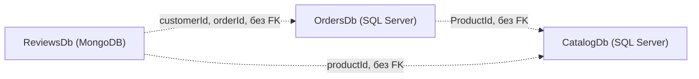
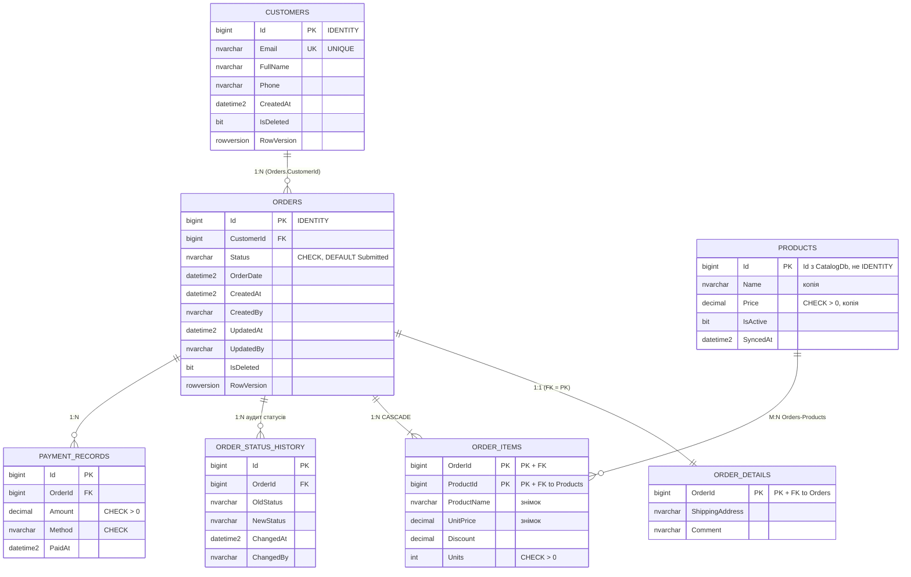
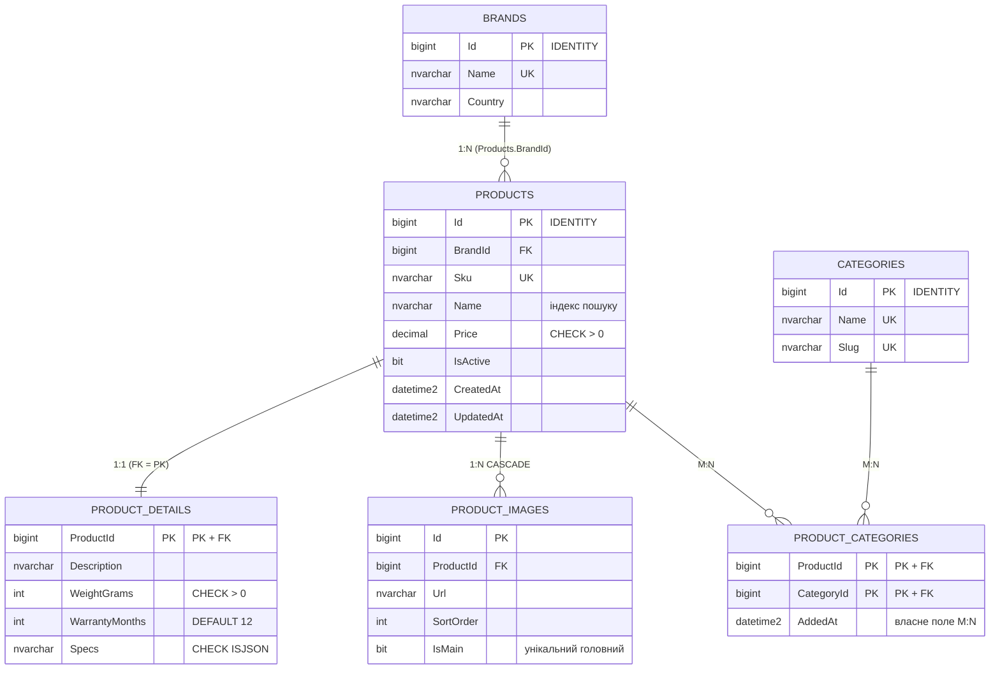

# TechNest — три бази даних для мікросервісної архітектури


Практичне заняття № 01 «ASP.NET. Проєктування та розробка баз даних для мікросервісної архітектури».
Три самостійні БД одного інтернет-магазину електроніки: дві реляційні (SQL Server) і одна документна (MongoDB).

## 1. Предметна область і контексти

**TechNest** — інтернет-магазин електроніки. Покупці переглядають каталог, оформлюють і оплачують замовлення та залишають відгуки й обговорення під товарами. Систему розділено на три незалежні мікросервіси, кожен із власною БД і логікою.

| # | Контекст | БД | Сутності (кожна належить рівно одному контексту) |
|---|----------|----|--------------------------------------------------|
| 1 | **Замовлення** | `OrdersDb` — SQL Server (ADO.NET + Dapper, Лаб. 02) | Customers, Orders, OrderDetails, OrderItems, OrderStatusHistory, PaymentRecords, Products (лише локальна копія довідника) |
| 2 | **Каталог** | `CatalogDb` — SQL Server (EF Core, Лаб. 03) | Brands, Categories, Products, ProductDetails, ProductCategories, ProductImages |
| 3 | **Відгуки та обговорення** | `ReviewsDb` — MongoDB (Лаб. 04) | reviews, discussions, messages, productRatings |

Деталі (агрегати, життєвий цикл, карта контекстів) — у [`docs/contexts.md`](docs/contexts.md).
**Між базами немає жодного FOREIGN KEY і жодних міжбазових JOIN-ів**: `ProductId`, `customerId`, `orderId` — звичайні значення (логічні посилання).



## 2. Структура репозиторію

```
README.md                  опис, розгортання, ERD, таблиця дублювання
docs/                      contexts.md · erd-p1.md · erd-p2.md · duplication-policy.md · mongo-documents.md
db/p1/                     schema.sql · procedures.sql · seed.sql · checks.sql     (OrdersDb)
db/p2/                     schema.sql · seed.sql                                   (CatalogDb)
db/p3/                     collections.js · seed.js · queries.js                   (ReviewsDb, MongoDB)
```

## 3. Розгортання з нуля

### 3.1. Вимоги
* SQL Server 2019+ (або Docker), утиліта `sqlcmd`; MongoDB 6+ (або Docker), `mongosh`.
* Усі скрипти **ідемпотентні** — їх можна запускати повторно без помилок і дублікатів.

### 3.2. Сервери в Docker (за потреби)
```bash
docker run -d --name sql -e ACCEPT_EULA=Y -e MSSQL_SA_PASSWORD='Your_strong_Passw0rd' -p 1433:1433 mcr.microsoft.com/mssql/server:2022-latest
docker run -d --name mongo -p 27017:27017 mongo:7
```

### 3.3. Проєкт №1 — OrdersDb (порядок важливий)
```bash
sqlcmd -S localhost -U sa -P 'Your_strong_Passw0rd' -C -I -i db/p1/schema.sql      # 1) БД, таблиці, індекси, view
sqlcmd -S localhost -U sa -P 'Your_strong_Passw0rd' -C -I -i db/p1/procedures.sql  # 2) 6 збережуваних процедур
sqlcmd -S localhost -U sa -P 'Your_strong_Passw0rd' -C -I -i db/p1/seed.sql        # 3) тестові дані (ідемпотентно)
sqlcmd -S localhost -U sa -P 'Your_strong_Passw0rd' -C -I -i db/p1/checks.sql      # 4) перевірки (CRUD, помилки, конкурентність)
```
`-I` обов'язковий (QUOTED_IDENTIFIER для фільтрованих індексів). У SSMS достатньо відкрити файли й виконати по черзі.

### 3.4. Проєкт №2 — CatalogDb
```bash
sqlcmd -S localhost -U sa -P 'Your_strong_Passw0rd' -C -I -i db/p2/schema.sql
sqlcmd -S localhost -U sa -P 'Your_strong_Passw0rd' -C -I -i db/p2/seed.sql
```

### 3.5. Проєкт №3 — ReviewsDb (MongoDB)
```bash
mongosh "mongodb://localhost:27017" --file db/p3/collections.js   # колекції, JSON Schema, індекси
mongosh "mongodb://localhost:27017" --file db/p3/seed.js          # дані (upsert, ідемпотентно)
mongosh "mongodb://localhost:27017" --file db/p3/queries.js       # find / aggregation / $lookup / $text
```

### 3.6. Самоперевірка
| Що перевірити | Як |
|---------------|----|
| Немає FK за межі бази | `SELECT * FROM sys.foreign_keys` у `OrdersDb` і `CatalogDb` — усі таблиці лише своєї БД (також `checks.sql`, п. 1) |
| Недопустимий перехід статусу | `checks.sql`, п. 5–6: «відвантажити» неоплачене → помилка **50002**, статус не змінився |
| Конкурентність | `checks.sql`, п. 7: застарілий `RowVersion` → помилка **50008** |
| Різні набори полів у MongoDB | `db.reviews.find()` у `ReviewsDb` — документи мають різні поля (photos / pros+cons / videoUrl / лише rating) |
| Ідемпотентність seed | Запустити `seed.sql` / `seed.js` вдруге — кількість рядків/документів не змінюється |

### 3.7. (Рекомендовано) Принцип найменших привілеїв
```sql
-- виконати в master:  CREATE LOGIN orders_app WITH PASSWORD = '<пароль>';
USE OrdersDb;  CREATE USER orders_app FOR LOGIN orders_app;
GRANT SELECT, INSERT, UPDATE, EXECUTE ON SCHEMA::dbo TO orders_app;   -- доступ лише до власної БД, без DELETE/DDL
```

## 4. ERD

### 4.1. Проєкт №1 — OrdersDb


### 4.2. Проєкт №2 — CatalogDb


### 4.3. Проєкт №3 — ReviewsDb (MongoDB)
```
reviews ──(embedded)── author{}, comments[], verifiedPurchase{}, photos[]      ← EMBEDDING
reviews ──(reference)── discussionId ─► discussions                            ← REFERENCING (гібрид)
messages ──(reference)── discussionId ─► discussions, parentMessageId ─► messages
productRatings (_id = productId)                                                ← проєкція для читання
```
Приклади документів — [`docs/mongo-documents.md`](docs/mongo-documents.md).

## 5. Типи зв'язків

| БД | 1:1 | 1:N | M:N |
|----|-----|-----|-----|
| OrdersDb | Orders ↔ OrderDetails (FK = PK) | Customers → Orders; Orders → OrderStatusHistory / PaymentRecords | Orders ↔ Products через OrderItems |
| CatalogDb | Products ↔ ProductDetails (FK = PK) | Brands → Products; Products → ProductImages | Products ↔ Categories через ProductCategories (власне поле `AddedAt`) |

## 6. Ключі, обмеження, індекси

* **PK:** `BIGINT IDENTITY` — вставки йдуть з одного джерела (одна БД на сервіс), ключ компактний і послідовний. GUID був би виправданий, якби Id генерувались у кількох місцях. `OrdersDb.Products.Id` — не IDENTITY, а Id із Каталогу. У MongoDB — `ObjectId`.
* **Обмеження:** PK, FK, UNIQUE (`Customers.Email`, `Products.Sku`, …), CHECK (статуси, `Price > 0`, `Units > 0`, `Discount <= UnitPrice*Units`, `ISJSON`), DEFAULT.
* **Каскади:** `ON DELETE CASCADE` лише для залежних частин агрегата (OrderDetails, OrderItems, OrderStatusHistory, ProductDetails, ProductImages, ProductCategories). Для клієнта з історією замовлень і платежів каскаду **немає**.
* **Індекси** — кожен має коментар у `schema.sql` з описом запиту: `IX_Orders_CustomerId_Status`, `IX_Orders_Active` (filtered), `IX_Orders_Status_OrderDate` (filtered), `IX_OrderItems_ProductId`, `IX_OrderStatusHistory_OrderId_ChangedAt`, `IX_PaymentRecords_OrderId`, `IX_Products_BrandId`, `IX_Products_Name_Active` (filtered), `IX_ProductCategories_CategoryId`, `IX_ProductImages_ProductId_SortOrder`, `UX_ProductImages_Main` (unique filtered); у MongoDB — див. `collections.js`.
* **Аудит і soft delete:** `CreatedAt/CreatedBy/UpdatedAt/UpdatedBy/IsDeleted` у `Customers` та `Orders`.
* **Конкурентність:** `ROWVERSION` у `Orders` і `Customers` — оптимістичне блокування: два користувачі, що редагують одне замовлення, не затруть зміни «тихо» (`usp_UpdateOrderDetails` повертає помилку 50008 при застарілому RowVersion). Під час зміни статусу додатково використовується `UPDLOCK` у транзакції.

## 7. Збережувані процедури Проєкту №1

| Процедура | Призначення |
|-----------|-------------|
| `usp_CreateOrder` | Create: замовлення + деталі + позиції (знімок назви/ціни) + запис в історії, у транзакції |
| `usp_GetOrderById` | Read: 3 набори (шапка + RowVersion, позиції, історія статусів) |
| `usp_GetCustomerOrders` | Read: фільтр за статусом і пагінація (OFFSET/FETCH) |
| `usp_UpdateOrderDetails` | Update: адреса/коментар з перевіркою RowVersion |
| `usp_SoftDeleteOrder` | Delete: м'яке видалення (лише Submitted/Cancelled) |
| `usp_ChangeOrderStatus` | **Транзакційна** зміна статусу: `UPDLOCK`, перевірка переходу, `THROW 50002` на недопустимому, запис у PaymentRecords при `Paid` та в історію |

Допустимі переходи: `Submitted → AwaitingValidation → StockConfirmed → Paid → Shipped`; `Cancelled` — лише до оплати.
Коди керованих помилок наведено на початку `procedures.sql`.

## 8. Політика дублювання даних і узгодженості

| Поле | Де зберігається | Джерело (власник даних) | Політика узгодженості |
|------|-----------------|-------------------------|-----------------------|
| `OrderItems.ProductName`, `OrderItems.UnitPrice` | OrdersDb | Product (CatalogDb) | **Знімок** на момент оформлення — не оновлюється |
| `Products.Name`, `Products.Price`, `Products.IsActive` (локальна копія довідника) | OrdersDb | Product (CatalogDb) | Копія для читання, **оновлюється подіями** з Каталогу (eventual consistency, Лаб. 08) |
| `reviews.productName` | ReviewsDb (MongoDB) | Product (CatalogDb) | Копія для читання, **оновлюється подіями** з Каталогу |
| `discussions.productName` | ReviewsDb (MongoDB) | Product (CatalogDb) | Копія для читання, **оновлюється подіями** з Каталогу |
| `productRatings.productName` | ReviewsDb (MongoDB) | Product (CatalogDb) | Копія для читання, **оновлюється подіями** з Каталогу |
| `reviews.author.displayName`, `messages.author.displayName` | ReviewsDb (MongoDB) | Customer (OrdersDb, `Customers.FullName`) | **Знімок** на момент написання — не оновлюється |
| `reviews.verifiedPurchase.orderId` | ReviewsDb (MongoDB) | Order (OrdersDb) | Лише посилання за Id (без FK); факт покупки фіксується на момент написання відгуку |

* **Знімок** — свідомо не оновлюється (ціна й назва в позиції замовлення фіксуються на момент покупки, як `OrderItem` в Microsoft eShop).
* **Копія для читання** — оновлюється подіями від власника даних (механізм подій — Лаб. 08; до того копії змінюються лише скриптами від імені власника).
* Незалежне редагування двох копій без власника (**dual write**) заборонене.
* Жодне з цих полів не має FOREIGN KEY на іншу базу.

## 9. Відповідність вимогам

| Вимога | Де |
|--------|----|
| Опис домену та 3 контексти | цей README, `docs/contexts.md` |
| Таблиця політики дублювання | розділ 8, `docs/duplication-policy.md` |
| Три бази без FK між ними | розділ 3.6, `db/` |
| P1: ≥4 таблиці, 1:1 / 1:N / M:N | `db/p1/schema.sql` (7 таблиць) |
| Ключі, обмеження, індекси під запити | `db/p1/schema.sql`, `db/p2/schema.sql` |
| Аудит, soft delete, rowversion | `db/p1/schema.sql` |
| 4–6 процедур, транзакційна зміна статусу | `db/p1/procedures.sql` (6 процедур) |
| P2: 6 сутностей, M:N з власним полем | `db/p2/schema.sql`, `db/p2/seed.sql` |
| P3: 4 колекції, embed / reference / гібрид, гнучка схема | `db/p3/collections.js`, `db/p3/seed.js`, `docs/mongo-documents.md` |
| Ідемпотентні seed-скрипти | `db/p1/seed.sql`, `db/p2/seed.sql`, `db/p3/seed.js` |
| Скрипти розгортання, README, ERD | розділи 3–4 |
