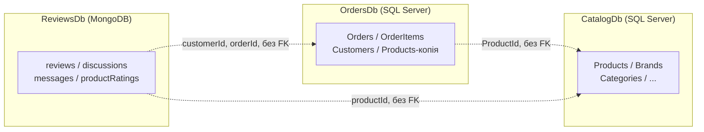

# Предметна область і межі контекстів (Bounded Contexts)

## Опис домену

**TechNest** — інтернет-магазин електроніки. Покупці переглядають каталог товарів, оформлюють і оплачують замовлення та залишають відгуки й обговорення під товарами. Систему розділено на три незалежні мікросервіси, кожен із власною БД і власною моделлю даних, щоб команди могли розвивати каталог, замовлення й відгуки окремо.

## Три контексти

| # | Контекст (мікросервіс) | БД / технологія | Власні сутності | Агрегати |
|---|------------------------|-----------------|-----------------|----------|
| 1 | **Замовлення** (Ordering) | `OrdersDb` — SQL Server, ADO.NET + Dapper | Customer, Order, OrderDetails, OrderItem, OrderStatusHistory, PaymentRecord, Product (лише локальна копія довідника) | **Order** = Order + OrderDetails + OrderItem + OrderStatusHistory + PaymentRecord; **Customer** |
| 2 | **Каталог** (Catalog) | `CatalogDb` — SQL Server, EF Core Code First | Brand, Category, Product, ProductDetail, ProductCategory, ProductImage | **Product** = Product + ProductDetail + ProductImage + ProductCategory; **Brand**; **Category** |
| 3 | **Відгуки та обговорення** (Reviews) | `ReviewsDb` — MongoDB | reviews, discussions, messages, productRatings | **Review** (відгук + вбудовані коментарі); **Discussion** (+ messages за посиланням); **ProductRating** (проєкція) |

Кожна сутність належить **рівно одному** контексту. Якщо сутність потрібна іншому контексту, там зберігається лише її ідентифікатор і, за потреби, знімок окремих полів.

| Сутність | Власник даних | Хто ще про неї знає |
|----------|---------------|---------------------|
| Product | Каталог | Замовлення (копія `Products` + знімок в `OrderItems`), Відгуки (`productId`, `productName`) |
| Customer | Замовлення | Відгуки (`author.customerId`, `author.displayName`) |
| Order | Замовлення | Відгуки (`verifiedPurchase.orderId`) |

## Життєвий цикл даних

* **Order** створюється разом з `OrderDetails` та `OrderItem`, змінюється тільки через процедури; статус рухається за ланцюгом `Submitted → AwaitingValidation → StockConfirmed → Paid → Shipped`, скасування (`Cancelled`) можливе лише до оплати. Замовлення не видаляються фізично (soft delete).
* **Product** (Каталог) може змінювати назву та ціну — це розсилається подіями (Лаб. 08); замовлення цих змін **не бачать** (знімок).
* **Review** живе разом зі своїми коментарями (embedding); **Discussion** може мати тисячі повідомлень, тому `messages` винесено в окрему колекцію (referencing).

## Карта контекстів

Пунктир — лише логічне посилання за ідентифікатором. Між базами **немає** FOREIGN KEY і міжбазових JOIN-ів.
