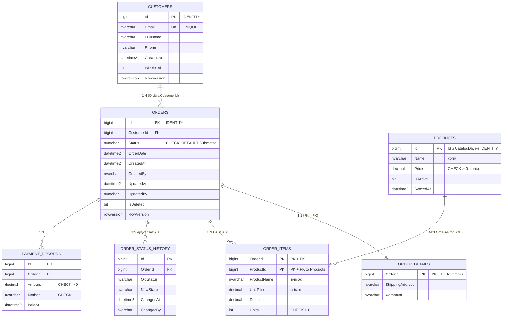

# ERD — Проєкт №1: OrdersDb (SQL Server)

Зв'язки: **1:1** Orders ↔ OrderDetails (FK є одночасно PK); **1:N** Customers → Orders, Orders → OrderStatusHistory, Orders → PaymentRecords; **M:N** Orders ↔ Products через OrderItems.
`Products` — локальна копія довідника Каталогу (Id збігається з CatalogDb, FK на Каталог немає).

