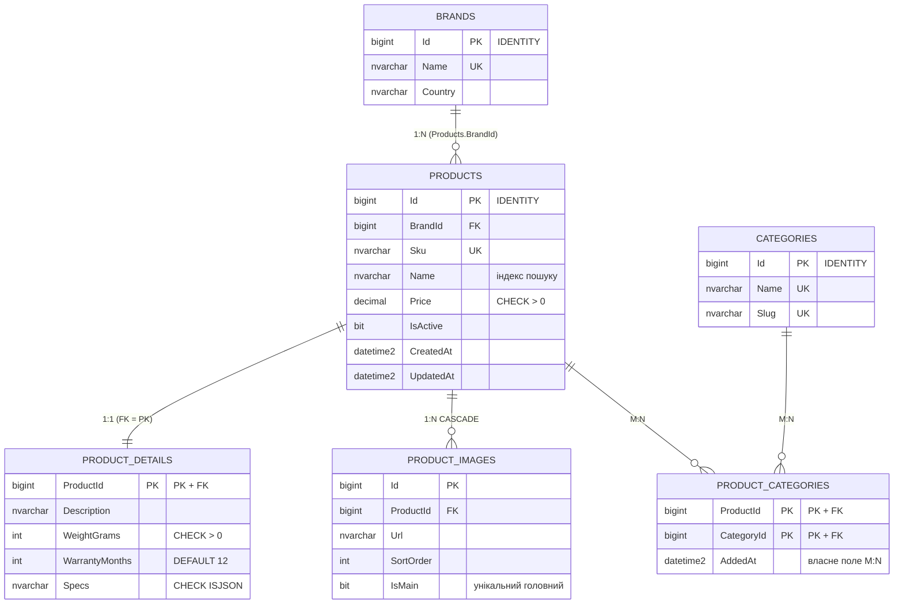

# ERD — Проєкт №2: CatalogDb (SQL Server, EF Core Code First)

Зв'язки: **1:1** Products ↔ ProductDetails (FK є PK); **1:N** Brands → Products, Products → ProductImages; **M:N** Products ↔ Categories через ProductCategories з власним полем `AddedAt`.

